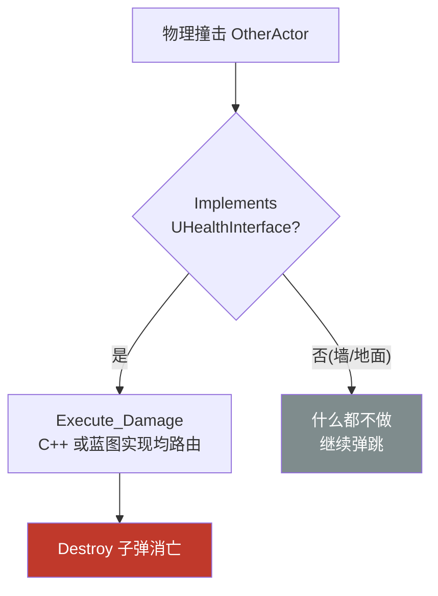

# 实战：接口 Interface 与命中解耦

第 18 章的 `OnHit` 里用 `Cast<AMyThirdCharacter>` 判断"撞的是不是玩家"——能用，但子弹从此**认识了**玩家类：明天想加"可被击碎的木桶"、"会掉血的敌人"，子弹代码就得挨个 Cast 一遍。本章把"能受伤"抽成一份**接口** `IHealthInterface`，子弹只问一句话："你实现了这个接口吗？"——问完就完，你是谁、什么类、 blueprint 还是 C++，一概不关心。新增文件在 `Source/MyThird/Public/Interface/` 与 `Private/Interface/`，对照蓝图章节 [10.1 蓝图接口](/蓝图/10.蓝图通讯/蓝图接口/蓝图接口.md)食用更佳。

先看全貌，三步走完：**定义接口 → 角色实现接口 → 子弹改用接口调用**。

## 一、为什么需要接口

第 18 章的写法把"命中判定"和"玩家类"焊死了：

```cpp
// 旧写法:子弹必须包含角色头文件、必须认识每一个目标类
AMyThirdCharacter* Player = Cast<AMyThirdCharacter>(OtherActor);
if (Player) { /* 命中玩家 */ }
```

- 耦合：子弹 → 角色类，单向硬依赖，角色改名/重构牵连子弹；
- 不可扩展：想打碎木桶？`Cast<ABarrel>`；想伤害敌人？`Cast<AEnemy>`……目标有几种，Cast 就有几串，`OnHit` 膨胀成面条。

接口反转这个依赖：定义一份**能力契约**——"谁实现我，谁就拥有 Death / Damage 能力"。子弹只依赖契约本身，不依赖任何具体类。这就是第 8 章多态的进阶形态：继承链多态回答"**你是什么**"，接口回答"**你会什么**"——而"会什么"恰恰是命中判定唯一关心的事。

## 二、UInterface：一个接口，两个类

新建接口（编辑器 → New C++ Class → Unreal Interface，或手写）得到的是**成对的两个类**：

```cpp
// Public/Interface/HealthInterface.h
#pragma once

#include "CoreMinimal.h"
#include "UObject/Interface.h"
#include "HealthInterface.generated.h"

// 元数据类:进反射系统,让蓝图/引擎"看得见"这个接口,不写任何逻辑
UINTERFACE(MinimalAPI)
class UHealthInterface : public UInterface
{
    GENERATED_BODY()
};

// 真正的接口类:角色实际继承的是它,契约写在这里
class MYTHIRD_API IHealthInterface
{
    GENERATED_BODY()

public:
    UFUNCTION(BlueprintNativeEvent, Category = "Health")
    void Death();
    virtual void Death_Implementation() = 0;

    UFUNCTION(BlueprintNativeEvent, Category = "Health")
    void Damage();
    virtual void Damage_Implementation() = 0;
};
```

为什么非要两个类？`UInterface` 前缀的 `U` 类是给**反射系统**看的身份证——UE 的蓝图虚拟机不认识 C++ 的虚表，它需要一个 UObject 派生的元数据类来登记"世上有这么个接口"（和 `UCLASS`/`UFUNCTION` 的思路一脉相承，第 4 章）。`I` 前缀的 `IHealthInterface` 才是契约本体，**不是 UObject**，随便多继承不占 UObject 唯一继承名额。命名约定死记：`U` 类与 `I` 类同名、同文件、只差前缀。

## 三、BlueprintNativeEvent 与 _Implementation

接口函数标了 `BlueprintNativeEvent`，于是每个函数实际是**三层结构**：

| 层 | 谁生成 | 作用 |
|---|---|---|
| `Death()` | UHT 生成的入口 | 统一分发：蓝图有重写走蓝图，否则走 C++ |
| `Death_Implementation()` | 我们手写 | C++ 默认/实际实现体 |
| 蓝图重写事件 | 蓝图编辑器里 | 覆盖 C++ 默认（BlueprintNativeEvent 的含义） |

两个常见说明符对比：

| 说明符 | 蓝图能重写? | C++ 有默认实现? |
|---|---|---|
| `BlueprintNativeEvent` | 能（可不重写） | 有（`_Implementation`） |
| `BlueprintImplementableEvent` | 能（**必须**实现） | 无（C++ 只声明不定义） |

再注意 `= 0`：纯虚函数，**强制**每个 C++ 实现类必须给出 `Damage_Implementation`，漏写直接编译报错——比运行时才发现没行为安全得多（UE 默认接口写法不加 `= 0`，允许类继承了接口却静默无实现；这里主动收紧）。

## 四、角色实现接口

```cpp
// MyThirdCharacter.h
#include "Interface/HealthInterface.h"   // 必须在 .generated.h 之前

UCLASS(config=Game)
class AMyThirdCharacter : public ACharacter, public IHealthInterface
{
    GENERATED_BODY()

public:
    void Death_Implementation() override;
    void Damage_Implementation() override;
};
```

```cpp
// MyThirdCharacter.cpp——目前先用日志占位,后续接真正的血量组件
void AMyThirdCharacter::Death_Implementation()
{
    UE_LOG(LogTemp, Warning, TEXT("Death"))
}

void AMyThirdCharacter::Damage_Implementation()
{
    UE_LOG(LogTemp, Warning, TEXT("Damage"))
}
```

三个细节：

1. **多继承**：`ACharacter` 是主继承（占 UObject 名额），`IHealthInterface` 是能力追加——接口类不是 UObject，所以可以这么叠加；
2. **override 的是 `_Implementation`** 而不是 `Death()`：入口层是 UHT 生成的，实现层才归我们；
3. `#include` 位置照旧在 `.generated.h` 之前（第 4 章的老规矩）。

## 五、调用方：Implements + Execute

子弹侧 `OnHit` 全部重写：

```cpp
// BallProjectile.cpp
#include "Interface/HealthInterface.h"

void ABallProjectile::OnHit(...)
{
    if (OtherActor->Implements<UHealthInterface>())   // 问:你实现了这个接口吗?
    {
        IHealthInterface::Execute_Damage(OtherActor); // 调:执行 Damage 能力
        Destroy();
    }
}
```

### 为什么不能直接 `OtherActor->Damage()`

- `OtherActor` 是 `AActor*`，`AActor` 没实现接口，直接调在编译器看来**不存在这个函数**；
- 就算 Cast 到 `IHealthInterface*` 再调虚函数，也只能覆盖 **C++ 实现**的那批——蓝图重写了 `Damage` 的话，蓝图虚拟机不走 C++ 虚表，调用会**静默落空**。

所以 UE 给了成套的两个工具：

| 工具 | 用途 |
|---|---|
| `Actor->Implements<UHealthInterface>()` | **判断**：C++ 继承或蓝图实现都返回 true（`Cast<IHealthInterface>` 只认 C++ 实现，蓝图类会漏判——别用错） |
| `IHealthInterface::Execute_Damage(Actor)` | **调用**：静态函数，内部查反射表，C++/蓝图实现都能正确路由 |



对照第 18 章：流程图形状一模一样，只是判据从"是玩家吗"（Cast，认血缘）换成了"能受伤吗"（Implements，认能力）。明天给木桶加上 `IHealthInterface`，子弹**一行不改**就能打碎它——这就是解耦的兑现。

## 六、常见坑

1. **`Implements` 的模板参数写 `U` 前缀**：`Implements<UHealthInterface>()`——它查的是元数据类；写成 `I` 前缀编译不过；
2. **用 `Cast<IHealthInterface>` 代替 `Implements`**：蓝图实现接口的类 Cast 返回 null，会漏判；判断统一用 `Implements`；
3. **直接调 `Actor->Damage()` 或 `Actor->Damage_Implementation()`**：前者编译不过，后者绕过分发层、蓝图重写全部失效；必须 `Execute_Damage`；
4. **忘写 `_Implementation` 却声明了 `= 0`**：链接期报 unresolved external——纯虚强制实现的代价，按提示补上 override 即可；
5. **接口类里写 `UPROPERTY` / 构造函数**：`I` 类不是 UObject，没有反射属性、没有构造入口，只放纯函数契约；
6. **`#include` 放到 `.generated.h` 之后**：UHT 解析直接报错，老规矩（第 4 章）；
7. **实现类忘了 `public IHealthInterface`**：默认私有继承，外部 `Implements` 判否，静默失效——继承列表里 `public` 不能省。

## 小结

- 接口是**能力契约**：把"能受伤"从玩家类里抽出来，调用方只问 `Implements`、只调 `Execute_`，与具体类彻底解耦；
- 一个接口两个类：`UHealthInterface`（UInterface 元数据，给反射/蓝图看）+ `IHealthInterface`（契约本体，非 UObject，可被多继承）；
- `BlueprintNativeEvent` 三层结构：`Death()` 入口 → `Death_Implementation()` C++ 实现 → 蓝图可选重写；`= 0` 纯虚强制每个实现类给出实现体；
- 实现侧：多继承 `public IHealthInterface`，override 的是 `_Implementation`；
- 调用侧成对出现：`Implements<UHealthInterface>()` 判断（C++/蓝图通吃）+ `IHealthInterface::Execute_Damage(Actor)` 调用（静态、走反射路由）；
- 对照蓝图侧"蓝图接口"（10.1）：概念同源，C++ 版多了元数据类与 Execute 分发这套底层机关。
