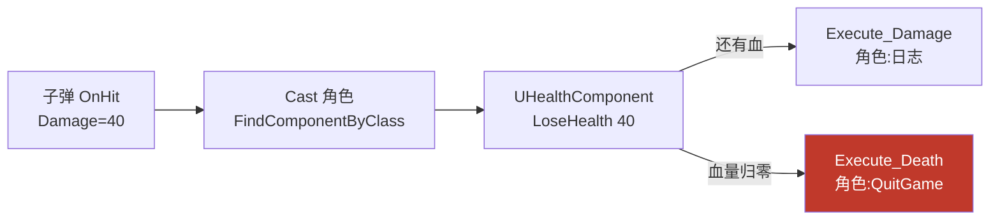
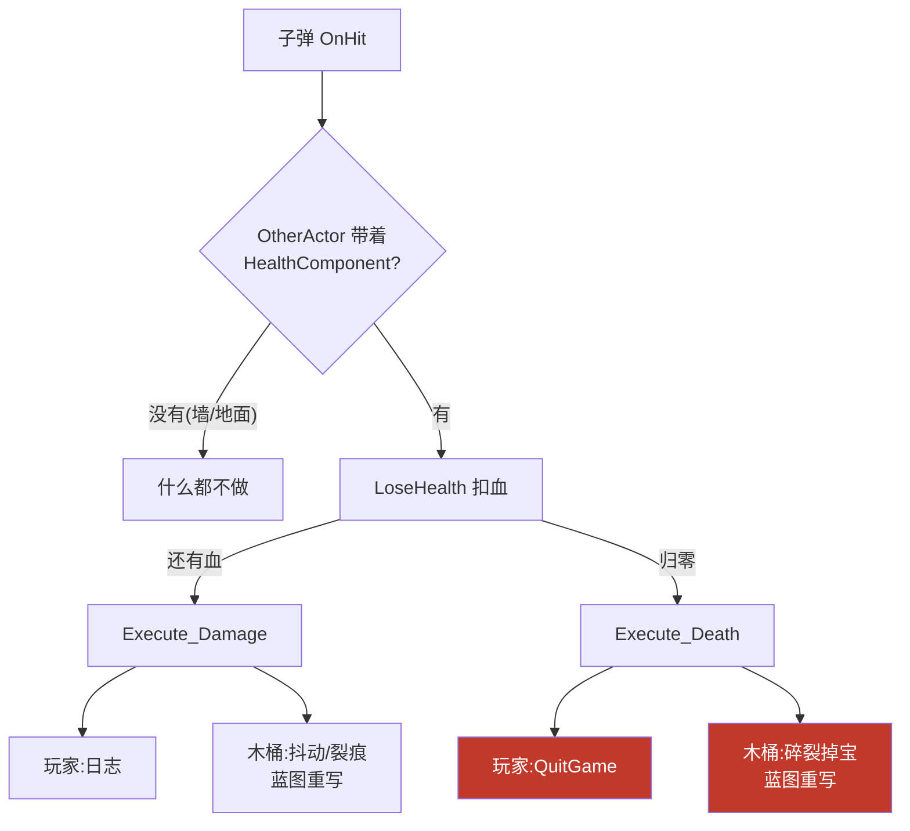

# 实战：血量组件 HealthComponent

第 19 章末尾 `Damage_Implementation` / `Death_Implementation` 里只打了两行日志，立了个Flag："后续接真正的血量组件"——本章兑现：新建 `UHealthComponent` 管血量数据与扣血逻辑，角色挂上它，子弹带可配置伤害打过来，血量归零直接退出游戏。接口没有下岗，而是**下沉了一层**：从"子弹 ↔ 角色"挪到"组件 ↔ 拥有者"之间。涉及文件：`Components/HealthComponent.h/.cpp`（新增）、`MyThirdCharacter.h/.cpp`、`BallProjectile.h/.cpp`，对照蓝图章节 [6. 角色死亡设置](/蓝图/6.角色死亡设置/角色死亡设置.md)。

先看链路全貌：



## 一、为什么血量要做组件

血量放角色类里直接写个 `float Health` 行不行？行，但明天敌人要血量、木桶要血量、Boss 要血量还要护盾——每个类复制一遍字段和扣血逻辑？第 3 章的结论直接适用：**可复用的能力+数据，做成组件挂上去**（组合优于继承，第 8 章）。

```cpp
// Public/Components/HealthComponent.h
UCLASS(ClassGroup=(Custom), meta=(BlueprintSpawnableComponent))
class MYTHIRD_API UHealthComponent : public UActorComponent
{
    GENERATED_BODY()

public:
    void LoseHealth(float Amount);

    // 只读访问器:给 UI 血条算百分比用
    FORCEINLINE float GetHealthPercent() const { return Health / 100.0f; }

protected:
    UPROPERTY(EditAnywhere, Category = Health)
    float Health = 100.0f;
};
```

两个细节：

1. 基类选 `UActorComponent`——血量不需要形状、不需要碰撞，纯数据+逻辑，最轻的基类就够（第 15 章组件速查的选型思路）；
2. `Health` 是 `EditAnywhere`：蓝图子类、场景实例里都能调初始血量，不用改 C++ 重新编译。

## 二、LoseHealth：组件里的扣血与接口通知

```cpp
// Private/Components/HealthComponent.cpp
void UHealthComponent::LoseHealth(float Amount)
{
    Health -= Amount;
    if (GetOwner()->Implements<UHealthInterface>())
    {
        IHealthInterface::Execute_Damage(GetOwner());
    }

    if (Health <= 0)
    {
        Health = 0.f;   // 钳到 0,血条不出现负数
        if (GetOwner()->Implements<UHealthInterface>())
        {
            IHealthInterface::Execute_Death(GetOwner());
        }
    }
}
```

这一段是本章的题眼：**组件不认识任何角色类**。它拿到的是 `GetOwner()` 返回的 `AActor*`，想知道"该通知谁"全靠第 19 章的接口套件——`Implements<UHealthInterface>()` 先问、`Execute_Damage` / `Execute_Death` 再喊。血量数据归组件管，"受伤了、死了要做什么"归拥有者（通过接口）管，两层职责切开：

| 职责 | 归属 | 例子 |
|---|---|---|
| 血量数据、扣血、归零钳制 | `UHealthComponent` | `Health`、`LoseHealth` |
| 受伤/死亡时的**表现与后果** | 拥有者（经接口回调） | 播动画、退出游戏、掉落 |

时序也值得看一眼：默认 100 血、每发 40 伤害——第一、二发只剩 `Damage` 回调（血量 60 → 20），第三发 `Health` 变 -20，先钳回 0 再触发 `Death`：**Damage 每次命中都响，Death 只在归零那发响一次**。

## 三、角色：挂组件 + 死亡退出游戏

```cpp
// MyThirdCharacter.h——前置声明,避免头文件互相包含
class UHealthComponent;

protected:
    UPROPERTY(EditAnywhere, BlueprintReadOnly, Category = Health, meta = (AllowPrivateAccess = "true"))
    TObjectPtr<UHealthComponent> HealthComponent;
```

```cpp
// MyThirdCharacter.cpp
#include "Components/HealthComponent.h"

AMyThirdCharacter::AMyThirdCharacter()
{
    // ...
    HealthComponent = CreateDefaultSubobject<UHealthComponent>("HP");
}

void AMyThirdCharacter::Death_Implementation()
{
    UE_LOG(LogTemp, Warning, TEXT("Death"))
    UKismetSystemLibrary::QuitGame(this, nullptr, EQuitPreference::Quit, true);
}
```

全是第 3 章的老三样，快速过一遍：

- `CreateDefaultSubobject` **只能在构造函数**里调（CDO/实例化机制决定），组件名 `"HP"` 运行时还能用于 `FindComponentByClass` 之外的按名查找；
- 头文件只写前置声明，`#include` 挪到 .cpp——减少编译依赖；
- `UPROPERTY` + `TObjectPtr` 让组件引用进 GC 视野（第 12 章）；`protected` + `AllowPrivateAccess` 是模板工程的惯用组合；
- `QuitGame`（Kismet 系统库）四个参数：上下文对象 `this`、指定退出的 PlayerController（`nullptr` 交给引擎处理）、`EQuitPreference::Quit` 正常退出、`true` 忽略平台限制（Web/移动端的退出确认）。正式游戏里死亡应该走"重生/结算"流程（蓝图第 7 章的做法），这里先一死了之，验证链路最直观。

## 四、子弹：可配置伤害 + 找到血量组件

```cpp
// BallProjectile.h
UPROPERTY(EditAnywhere, BlueprintReadOnly, Category = "Damage", meta = (AllowPrivateAccess = true))
float Damage = 40.f;
```

```cpp
// BallProjectile.cpp——OnHit
AMyThirdCharacter* MyThirdCharacter = Cast<AMyThirdCharacter>(OtherActor);
if (MyThirdCharacter != nullptr)
{
    UHealthComponent* HealthComponent = MyThirdCharacter->FindComponentByClass<UHealthComponent>();
    if (HealthComponent != nullptr)
    {
        HealthComponent->LoseHealth(Damage);
    }
    Destroy();
}
```

- `Damage` 挂 `EditAnywhere`：不同子弹（敌人力弹、Boss 炮弹）各配各的伤害，不改代码；
- `FindComponentByClass<UHealthComponent>()` 按类型在目标 Actor 的组件列表里翻，翻不到返回 `nullptr`——两段判空都不能省。

## 五、一点反思：Cast 回来了，接口去哪了

眼尖的会发现：第 19 章刚把 `Cast` 换成 `Implements`，这一章 `OnHit` 里 `Cast<AMyThirdCharacter>` 又回来了——因为要**拿到组件实例**，而 `FindComponentByClass` 恰好是 `AActor` 的成员函数，其实不需要先 Cast：

```cpp
// 更解耦的等价写法:AActor 本身就能 FindComponentByClass,不必认识角色类
UHealthComponent* HP = OtherActor->FindComponentByClass<UHealthComponent>();
if (HP)
{
    HP->LoseHealth(Damage);
    Destroy();
}
```

当前写法把接口的解耦点下沉到了"组件 ↔ 拥有者"（`LoseHealth` 内部），子弹侧仍是"认识角色类"的强依赖——能跑，但木桶想挨打就得让子弹认识木桶类。现阶段只有玩家一个目标时不必急着改；真出现第二类可受伤对象时，按下节的拓展版改造。

## 六、拓展：多可受伤对象的解耦版

预设一个场景：木桶（打碎掉道具）、敌人（有 AI）、玩家（死亡退游戏）都要能挨打。当前版 `OnHit` 里那句 `Cast<AMyThirdCharacter>` 意味着每加一类目标就得加一串 Cast——拓展版一次性解决，而且**只需要改子弹的一个函数**。

### 第一步：子弹去掉 Cast，认组件不认类

```cpp
// BallProjectile.cpp——OnHit 拓展版
void ABallProjectile::OnHit(UPrimitiveComponent* HitComponent, AActor* OtherActor,
                            UPrimitiveComponent* OtherComp, FVector NormalImpulse,
                            const FHitResult& Hit)
{
    // FindComponentByClass 是 AActor 的成员函数,任何 Actor 都能直接问,不需要先 Cast 成具体类
    UHealthComponent* HP = OtherActor->FindComponentByClass<UHealthComponent>();
    if (HP != nullptr)
    {
        HP->LoseHealth(Damage);
        Destroy();
    }
}
```

`FindComponentByClass` 本来就是 `AActor` 的成员函数——上一节"先 Cast 再找组件"里的 Cast 其实是多余的。子弹的依赖从"`AMyThirdCharacter` 这个类"换成"`UHealthComponent` 这个组件类型"，判断标准从"你是谁"变成"你带没带血条组件"，与第 19 章"只问能力不认血缘"的思路殊途同归：**契约从接口换成了组件类型**。

### 第二步：木桶接入——零 C++ 代码

还记得 `HealthComponent.h` 里 `UCLASS` 自带的 `meta=(BlueprintSpawnableComponent)` 吗？它就是为这一步准备的：

1. 新建木桶蓝图 `BP_Barrel`（任意 Actor 蓝图）；
2. Add Component 里直接搜 Health 挂上 `UHealthComponent`——不需要写一行木桶的 C++；
3. 细节面板里 `EditAnywhere` 的 `Health` 想调多少调多少（木桶 30 血，两发碎）；
4. 要"碎了"的表现？Class Settings → Interfaces 里实现 `UHealthInterface`，蓝图重写 `Damage` / `Death` 事件（`BlueprintNativeEvent` 保证蓝图能重写）——碎裂动画、掉落道具都写在这里。

### 拓展后的全链路



子弹、组件、接口三层各司其职，**新增目标类型时前两层零改动**：

| 层 | 职责 | 新增木桶时要改吗 |
|---|---|---|
| 子弹 `OnHit` | 按组件类型判定 + 扣血 | 不改 |
| `UHealthComponent` | 血量数据 + 经接口通知拥有者 | 不改 |
| 拥有者（接口实现） | 受伤/死亡的表现与后果 | 木桶蓝图自己实现 |

### 当前版 vs 拓展版

| | 当前版（本章主线） | 拓展版 |
|---|---|---|
| 子弹依赖 | `AMyThirdCharacter` 具体类 | `UHealthComponent` 组件类型 |
| 新增可受伤对象 | 改子弹代码（加 Cast 链） | 蓝图挂组件 + 实现接口，零 C++ |
| 适用阶段 | 只有一类目标，链路最直观 | 目标多样，扩展频繁 |

两个口径没有对错：当前版胜在直观，是学习路径的落脚点；拓展版是它的一次"第 14 章式重构"——行为不变、依赖松绑。体会到这一步的差异，组件+接口组合的价值就真正吃透了。

## 七、常见坑

1. **`CreateDefaultSubobject` 写进 BeginPlay** → 编译直接报错，组件创建只能在构造函数（第 3 章）；
2. **`FindComponentByClass` 不判空就用** → 目标没挂组件（比如裸 Actor）当场空指针崩溃；
3. **`LoseHealth` 里直接调 `GetOwner()->Damage_Implementation()`** → 绕过分发层且 `AActor*` 根本没有该成员；对 Owner 的回调必须 `Implements` + `Execute_` 成对出现（第 19 章）；
4. **血量不钳 0** → `Health = -20` 传给 `GetHealthPercent` 得到负百分比，血条 UI 直接画歪；
5. **`QuitGame` 的 PC 传 `this`（角色指针）** → 参数要的是 `APlayerController*`，类型不对编译不过；`nullptr` 即"让引擎自己找"；
6. **`GetHealthPercent` 写成 `Health / MaxHealth` 但 MaxHealth 没同步初始值** → 目前分母硬编码 100，若蓝图把 `Health` 调成 200，血条永远半血——改进方向是加 `MaxHealth` 字段；
7. **每帧 Tick 里轮询血量** → 血量是事件驱动数据，命中才变；`TickComponent` 留着默认实现即可，别往里塞检查。

## 小结

- 血量做成 `UActorComponent`：数据（`Health`）+ 行为（`LoseHealth`）打包，任何 Actor 挂上就能挨打（组合复用，第 3/8 章思路落地）；
- 组件经 `GetOwner()` + `Implements` + `Execute_` 通知拥有者——**组件不认识任何具体角色类**，接口的解耦点从"子弹 ↔ 角色"下沉到"组件 ↔ 拥有者"；
- 角色侧三件套：构造函数 `CreateDefaultSubobject`、头文件前置声明 + `TObjectPtr<UPROPERTY>`、`Death_Implementation` 里 `QuitGame` 退出；
- 子弹侧：`Damage` 做 `EditAnywhere` 可配置伤害，`FindComponentByClass` 定位组件、两段判空；
- 时序记牢：`Damage` 每次命中都回调，`Death` 只在血量钳 0 的那一发触发一次；
- 拓展版（第六节）：子弹去掉 Cast 直接 `FindComponentByClass`，新目标用蓝图挂组件 + 实现接口接入，**子弹与组件两层零改动**——`BlueprintSpawnableComponent` 让 C++ 组件能被蓝图直接复用；
- 遗留改进：`MaxHealth` 字段补上、死亡流程将来换成重生/结算。
