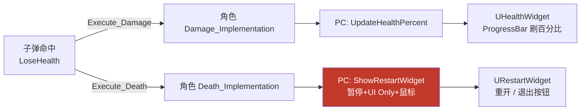

# 实战：UMG 血条与死亡重开界面

第 20 章结尾死亡直接 `QuitGame` 一死了之，立了个 Flag："正式游戏里死亡应该走重生/结算流程"——本章兑现：用 **UMG**（Unreal Motion Graphics）做两套界面——头顶常驻的血条 `UHealthWidget`、死亡后弹出的重开/退出菜单 `URestartWidget`，中间加一个 `AThirdPlayerController` 当 UI 总管。角色从此不再直接操作界面：受伤只喊一嗓子"血量变了"，显示的事全交给 PlayerController。涉及文件：`Game/ThirdPlayerController.h/.cpp`、`HUD/HealthWidget.h/.cpp`、`HUD/RestartWidget.h/.cpp`（均新增），`MyThirdCharacter.cpp`、`HealthComponent.cpp`、`MyThird.Build.cs`、`MyThird.uproject`，对照蓝图章节 [7. 死亡后重生](/蓝图/7.死亡后重生/死亡后重生.md)。

先看链路全貌：



## 一、开工前的事：把 UMG 模块接进来

C++ 里用 `UUserWidget` 不是" include 就完事"——UMG、Slate 相关代码住在独立模块里，得先在两个地方登记：

```csharp
// MyThird.Build.cs
PublicDependencyModuleNames.AddRange(new string[]
    { "Core", "CoreUObject", "Engine", "InputCore", "EnhancedInput",
      "HeadMountedDisplay", "UMG", "Slate", "SlateCore" });
```

```json
// MyThird.uproject——AdditionalDependencies 里补 "UMG"
"AdditionalDependencies": [
    "Engine",
    "UMG"
]
```

三个 Slate 相关模块的分工：**UMG** 是蓝图友好的 Widget 封装层（`UUserWidget`、`UProgressBar`、`UButton` 都在这）；**Slate / SlateCore** 是底层 UI 框架——只 `#include "Blueprint/UserWidget.h"` 编译 UMG 层时也常常需要它们兜底。`.uproject` 的 `AdditionalDependencies` 则让头文件查找范围覆盖到 UMG 模块。忘了加的典型症状：`无法打开包括文件: "Blueprint/UserWidget.h"` 或一堆 `Unresolved external symbol`。

## 二、AThirdPlayerController：UI 总管

为什么中间要插一个自定义 PlayerController？因为**Widget 的创建与销毁天然属于"玩家侧"职责**：血条跟着视口走、死亡菜单要抢输入模式和鼠标——这些都是 `APlayerController` 的地盘（第 11 章框架类速查）。角色管游戏逻辑，Controller 管"这个玩家看到什么"，各归各位。

```cpp
// Public/Game/ThirdPlayerController.h
UCLASS()
class MYTHIRD_API AThirdPlayerController : public APlayerController
{
    GENERATED_BODY()

public:
    UPROPERTY(EditDefaultsOnly)
    TSubclassOf<URestartWidget> ReStartWidgetClass;

    void ShowRestartWidget();
    void HideRestartWidget();

    UPROPERTY(EditDefaultsOnly)
    TSubclassOf<UHealthWidget> HealthWidgetClass;

    void UpdateHealthPercent(float HealthPercent);

protected:
    virtual void BeginPlay() override;

private:
    UPROPERTY()
    TObjectPtr<URestartWidget> RestartWidget;

    UPROPERTY()
    TObjectPtr<UHealthWidget> HealthWidget;
};
```

三个要点：

1. **`TSubclassOf<URestartWidget>`**：第 16 章见过的"类引用"——C++ 只认类型，具体用哪个蓝图版 Widget（`WBP_HealthBar` 之类，里面摆好了 ProgressBar 和按钮）由蓝图子类在细节面板里配。界面布局归蓝图，行为逻辑归 C++；
2. Widget 成员放 `private` + `UPROPERTY()`：引用进 GC 视野（第 12 章），外部只能走 `ShowRestartWidget` / `UpdateHealthPercent` 这些语义化接口，摸不到实例；
3. 头文件里 Widget 类型只用前置声明（`class UHealthWidget;`），`#include` 挪到 .cpp——老规矩，减少编译依赖。

### ShowRestartWidget：死亡菜单的三件套

```cpp
// Private/Game/ThirdPlayerController.cpp
void AThirdPlayerController::ShowRestartWidget()
{
    if (ReStartWidgetClass == nullptr)
    {
        UE_LOG(LogTemp, Warning,
            TEXT("ReStartWidgetClass 未配置,请在 PlayerController 蓝图的中设置 Widget Class"));
        return;
    }

    if (RestartWidget != nullptr)
    {
        // 已有 Widget 时不再重复创建,避免叠加
        return;
    }

    SetPause(true);
    SetInputMode(FInputModeUIOnly());
    bShowMouseCursor = true;
    RestartWidget = CreateWidget<URestartWidget>(this, ReStartWidgetClass);
    RestartWidget->AddToViewport();
}
```

弹出死亡菜单不是只"画个窗口"，得把整个游戏的输入语境切过去，三件套缺一不可：

| 调用 | 作用 | 不调的后果 |
|---|---|---|
| `SetPause(true)` | 暂停游戏逻辑（`bCanTick` 级别的停摆，单人游戏够用） | 背后还在挨打/移动 |
| `SetInputMode(FInputModeUIOnly())` | 输入全给 UI，游戏侧收不到 | 角色还能被键盘操控 |
| `bShowMouseCursor = true` | 显示鼠标光标 | 按钮看得见点不着 |

`CreateWidget<T>(this, Class)` 的第一个参数是**OwningPlayer**——Widget 归这个 PlayerController 管（谁创建谁负责）；第二个就是 `TSubclassOf` 里的蓝图类。`AddToViewport()` 之后界面才真正上屏。

### HideRestartWidget：对称收尾

```cpp
void AThirdPlayerController::HideRestartWidget()
{
    if (RestartWidget != nullptr)
    {
        RestartWidget->RemoveFromParent();
        RestartWidget = nullptr;
    }

    SetPause(false);
    SetInputMode(FInputModeGameOnly());
    bShowMouseCursor = false;
}
```

与 Show 完全镜像：`RemoveFromParent` 下屏、置 `nullptr`（下次 Show 才能重建）、三件套反向关掉。虽然重开走的是 `OpenLevel` 整关重载、这段清理略显仪式化，但**开关对称**是防"状态残留"的好习惯——将来换成不开新关的重生流程（原地复活），这段就是主路径。

### BeginPlay：血条常驻

```cpp
void AThirdPlayerController::BeginPlay()
{
    Super::BeginPlay();
    if (HealthWidgetClass != nullptr)
    {
        HealthWidget = CreateWidget<UHealthWidget>(this, HealthWidgetClass);
        HealthWidget->AddToViewport();
    }
}
```

血条是"进游戏就在"的 HUD，BeginPlay 里创建一次、全程不销毁——和死亡菜单的"按需创建/销毁"是两种典型的 Widget 生命周期口径。

## 三、UHealthWidget：BindWidget 绑控件

```cpp
// Public/HUD/HealthWidget.h
UCLASS()
class MYTHIRD_API UHealthWidget : public UUserWidget
{
    GENERATED_BODY()

public:
    UPROPERTY(meta = (BindWidget))
    TObjectPtr<UProgressBar> HealthBar;

    void UpdateHealthPercent(float HealthPercent);
};
```

```cpp
// Private/HUD/HealthWidget.cpp
void UHealthWidget::UpdateHealthPercent(float HealthPercent)
{
    HealthBar->SetPercent(HealthPercent);
}
```

核心是 `meta = (BindWidget)`：C++ 侧只声明"我想要一个叫 `HealthBar` 的 ProgressBar"，**实例由蓝图 WBP 里的同名控件自动注入**——在 Widget 蓝图里放一个 ProgressBar、命名为 `HealthBar`，运行时这个指针就指向它。C++ 不知道布局长什么样，蓝图不知道百分比怎么算，两边只靠控件名对暗号。

注意 `BindWidget` 绑的是**名字**：蓝图里控件叫 `Healthbar`（小写 b）都绑不上，运行时是 `nullptr`，一调 `SetPercent` 当场崩溃——这是本章第一大坑。

## 四、URestartWidget：按钮与 C++ 委托

```cpp
// Public/HUD/RestartWidget.h
UCLASS()
class MYTHIRD_API URestartWidget : public UUserWidget
{
    GENERATED_BODY()

public:
    virtual void NativeOnInitialized() override;

    UPROPERTY(meta=(BindWidget))
    TObjectPtr<UButton> ExitButton;

    UPROPERTY(meta=(BindWidget))
    TObjectPtr<UButton> RestartButton;

protected:
    UFUNCTION()
    void OnRestartButtonClicked();

    UFUNCTION()
    void OnExitButtonClicked();
};
```

```cpp
// Private/HUD/RestartWidget.cpp
void URestartWidget::NativeOnInitialized()
{
    Super::NativeOnInitialized();

    if (RestartButton != nullptr)
    {
        RestartButton->OnClicked.AddDynamic(this, &URestartWidget::OnRestartButtonClicked);
    }

    if (ExitButton != nullptr)
    {
        ExitButton->OnClicked.AddDynamic(this, &URestartWidget::OnExitButtonClicked);
    }
}

void URestartWidget::OnRestartButtonClicked()
{
    AThirdPlayerController* PlayerController = Cast<AThirdPlayerController>(GetOwningPlayer());
    if (PlayerController != nullptr)
    {
        PlayerController->HideRestartWidget();
    }

    UGameplayStatics::OpenLevel(this, FName(UGameplayStatics::GetCurrentLevelName(this)));
}

void URestartWidget::OnExitButtonClicked()
{
    UKismetSystemLibrary::QuitGame(this, nullptr, EQuitPreference::Quit, true);
}
```

逐个拆：

- **`NativeOnInitialized`** 是 `UUserWidget` 的原生初始化回调（对应蓝图的 Event Construct 时机，Widget 创建后、显示前），绑按钮时机放这里最稳；
- **`OnClicked.AddDynamic(...)`** 与第 18 章 `OnComponentHit` 是同一套动态多播委托套路：`AddDynamic` 绑定、`UFUNCTION()` 标记接收函数——漏了 `UFUNCTION` 编译直接报错；
- **`GetOwningPlayer()`** 拿回 `CreateWidget` 时传入的那个 PlayerController——正是第二节的 `this`。Widget 反向找 Controller 走这条官方通道，不用自己存引用；
- **重开 = `OpenLevel` 重载当前关**：`GetCurrentLevelName` 取当前关名，`OpenLevel` 重新加载——世界整个换新，血量、组件、Widget 全部归零，是蓝图第 7 章"死亡后重生"里最简单的口径（更精细的检查点重生见蓝图第 8 章）。`HideRestartWidget` 在 OpenLevel 前调用是为了把暂停/输入模式恢复对称——虽然关卡重载后一切都会重建；
- **退出 = `QuitGame`**：第 20 章死亡退出的老朋友，搬到了它真正该在的位置——退出按钮。

## 五、角色接线：从"操作界面"退位为"喊话"

```cpp
// MyThirdCharacter.cpp
void AMyThirdCharacter::Death_Implementation()
{
    UE_LOG(LogTemp, Warning, TEXT("Death"));
    AThirdPlayerController* PlayerController = Cast<AThirdPlayerController>(GetController());
    if (PlayerController != nullptr)
    {
        PlayerController->ShowRestartWidget();
    }
}

void AMyThirdCharacter::Damage_Implementation()
{
    UE_LOG(LogTemp, Warning, TEXT("Damage"));
    AThirdPlayerController* PlayerController = Cast<AThirdPlayerController>(GetController());

    if (PlayerController != nullptr)
    {
        PlayerController->UpdateHealthPercent(HealthComponent->GetHealthPercent());
    }
}

void AMyThirdCharacter::BeginPlay()
{
    Super::BeginPlay();

    AThirdPlayerController* PlayerController = Cast<AThirdPlayerController>(GetController());
    if (PlayerController != nullptr)
    {
        PlayerController->UpdateHealthPercent(HealthComponent->GetHealthPercent());
    }
}
```

对比第 20 章：`Death_Implementation` 里的 `QuitGame` 换成了 `ShowRestartWidget()`；`Damage_Implementation` 从"只打日志"升级为"推送血量百分比"。三个入口各有一次 `Cast + 判空`——`GetController()` 返回 `AController*`，可能是默认 PlayerController（World Settings 没换成自己的 GameMode 时），判空一省就崩。

值得留意 **BeginPlay 里那次初始化推送**：血条 Widget 在 PlayerController 的 `BeginPlay` 里创建，如果角色 BeginPlay 跑在它之前，那次 `UpdateHealthPercent` 会因 `HealthWidget == nullptr` 静默失败（Controller 里判了空）——所以这次"多余的"推送是在补初始帧：满血也得画出来。事件驱动 UI 的通病就是**首帧谁來画**，别忘。

### HealthComponent：补一道防重闸

```cpp
// Private/Components/HealthComponent.cpp
void UHealthComponent::LoseHealth(float Amount)
{
    // 已死亡则不再结算,防止 Death 重复触发(叠加 Widget)
    if (Health <= 0)
    {
        return;
    }
    // ...原扣血逻辑
}
```

第 20 章的隐患在 UI 时代被放大了：角色死后尸体还在场，子弹还能命中它——每多发一发，`Execute_Death` 再响一次，`ShowRestartWidget` 再被调一次。Show 里有"已存在就 return"的挡板，但那只是 UI 层的兜底；闸门修在源头 `LoseHealth` 更干净：**血量归零后组件拒绝再结算**，一处 return，下游全部免疫。

## 六、编辑器侧配置：让链路真正跑起来

到这里 C++ 侧已经闭环，但**一个界面还不会出现**——`TSubclassOf` 和 `BindWidget` 都是"运行时对接点"，对接的另一头在编辑器里。三步：

### 第一步：建 Widget 蓝图（对接 BindWidget）

- 新建 `WBP_Health`（继承 HealthWidget）：画布上放一个 **ProgressBar，命名为 `HealthBar`**——必须与 C++ 属性名完全一致（大小写敏感）；
- 新建 `WBP_Restart`（继承 RestartWidget）：放两个 **Button，分别命名 `RestartButton`、`ExitButton`**，配上文字。

`BindWidget` 的注入原理就是**按控件名匹配**：蓝图 WBP 里的同名控件会在创建时自动填进 C++ 的 `TObjectPtr`。名字差一个字母，指针就是 `nullptr`，一调 `SetPercent` / `AddDynamic` 当场崩溃。

### 第二步：Controller 蓝图配 Widget 类（对接 TSubclassOf）

新建 `BP_ThirdPlayerController`（继承 ThirdPlayerController），在 **Class Defaults** 细节面板里：

- `HealthWidgetClass` → `WBP_Health`
- `ReStartWidgetClass` → `WBP_Restart`

两个属性是 `EditDefaultsOnly`——只能在**类默认值**上配（蓝图编辑器的 Class Defaults 页签），实例上不可改，这正是"布局归蓝图"的落点。

### 第三步：GameMode 换上这个 Controller

关键且最容易漏的一步：引擎默认给玩家发的是**基类 `APlayerController`**，不是我们的 `AThirdPlayerController`——不换的话角色里 `Cast<AThirdPlayerController>(GetController())` 全部返回 `nullptr`，界面一个都出不来（还不会崩，静默失败，最難排查）。当前工程 `GlobalDefaultGameMode` 直接指向 C++ 的 `AMyThirdGameMode`，两种接法：

```cpp
// MyThirdGameMode.cpp——接法一:纯 C++,直接指定 Controller 类
// 前置:#include "Game/ThirdPlayerController.h"
PlayerControllerClass = AThirdPlayerController::StaticClass();
```

接法二（沿 Pawn 的老路）：建 `BP_GameMode`，Class Defaults 里把 **Player Controller Class** 设为 `BP_ThirdPlayerController`，再把 `DefaultEngine.ini` / World Settings 的 GameMode 指过去。想连 Widget 类也不在编辑器里点，还可以照 `BP_ThirdPersonCharacter` 的样子用 `ConstructorHelpers::FClassFinder` 在 GameMode 构造函数里加载——但那种写法把资产路径焊死在代码里，资产一挪就崩，慎用。

三步各对接一个 C++ 机制，一张表看清：

| 编辑器操作 | 对接的 C++ 机制 | 漏了的症状 |
|---|---|---|
| WBP 里同名控件 | `meta = (BindWidget)` | 运行时空指针崩溃 |
| Controller 蓝图配 Widget 类 | `TSubclassOf` + `EditDefaultsOnly` | 日志警告"未配置 Widget Class" |
| GameMode 设 Player Controller Class | `PlayerControllerClass` 默认是基类 | **静默失败**，界面全不出现 |

## 七、数据流回顾：谁认识谁

| 调用方 | 认识谁 | 不认识谁 |
|---|---|---|
| 子弹 `OnHit` | `UHealthComponent`（组件类型） | 角色、UI |
| `UHealthComponent` | `UHealthInterface`（接口） | 角色、Controller、UI |
| 角色 `Damage/Death_Implementation` | `AThirdPlayerController`、`UHealthComponent` | Widget 长什么样 |
| `AThirdPlayerController` | `UHealthWidget` / `URestartWidget`（TSubclassOf） | 控件布局、血量数据 |
| Widget | 控件名（BindWidget）、`GetOwningPlayer()` | 角色、血量组件 |

血量数据从子弹到屏幕上的一格血条，走了五跳：`子弹 → HealthComponent → 接口 → 角色 → PlayerController → Widget`。链路长，但每一跳只认识下一跳——除了角色那两个 `Cast<AThirdPlayerController>` 是具体类型依赖（单人游戏里 PlayerController 类型可控，这笔账划算；多人/多 Controller 场景可以如法炮制一个 `UHUDInterface` 把它也接口化）。

## 八、常见坑

1. **Build.cs 没加 `UMG`/`Slate`/`SlateCore`** → `UserWidget.h` 打不开或链接报 `Unresolved external symbol`，本章第一节两处都要改；
2. **BindWidget 控件名对不上**（大小写、多空格）→ 运行时指针为 `nullptr`，`SetPercent` / `AddDynamic` 处崩溃；控件命名必须与 C++ 属性名完全一致；
3. **`AddDynamic` 的接收函数漏 `UFUNCTION()`** → 编译报错 "Unable to find function"，与第 18 章同一坑；
4. **只 `AddToViewport` 不切输入模式** → 菜单弹出来角色还能动、鼠标出不来，三件套（Pause / InputMode / MouseCursor）成套调用；
5. **`ShowRestartWidget` 不挡重复创建** → 死后连中三发，屏幕叠三层菜单；本章在 Show 里查 `RestartWidget != nullptr`、在 `LoseHealth` 里 `Health <= 0` 直接 return，双保险；
6. **`CreateWidget` 写进构造函数** → Actor 构造期 World 还没就绪，Widget 创建要在 `BeginPlay` 这类运行期入口；
7. **`GetController()` 不判空** → GameMode 没配对时拿到默认 Controller，Cast 失败返回 `nullptr`，当场崩溃；
8. **GameMode 忘了设 Player Controller Class** → 引擎发的是基类 `APlayerController`，角色的 Cast 全部落空，界面一个不出、一行报错都没有（第六节第三步）；
9. **忘了 BeginPlay 的首帧推送** → 初始满血不画，血条要挨第一枪才出现。

## 小结

- C++ 用 UMG 三步走：**Build.cs / uproject 补模块 → Widget 类（BindWidget 绑控件 + 行为函数）→ PlayerController 持有 TSubclassOf 并 CreateWidget**；
- `TSubclassOf` 让 C++ 管行为、蓝图管布局，两界以控件名对暗号（`BindWidget`）；
- 死亡菜单三件套：`SetPause(true)` + `FInputModeUIOnly` + `bShowMouseCursor`，隐藏时镜像恢复；
- 按钮绑定是动态多播委托老套路：`NativeOnInitialized` 里 `AddDynamic`，接收函数挂 `UFUNCTION`；
- 重开 = `OpenLevel` 重载当前关（世界归零，最简重生口径），退出 = `QuitGame`（从第 20 章的死亡逻辑挪到了退出按钮）；
- 角色对 UI 只喊话不操盘：`Damage → UpdateHealthPercent`、`Death → ShowRestartWidget`；首帧血量靠 BeginPlay 手动推一次；
- `LoseHealth` 头部 `Health <= 0` 早退——把"死亡只发生一次"修在数据源头，比在 UI 层兜底干净；
- 遗留改进：角色对 `AThirdPlayerController` 的具体类型依赖可接口化；血条可加受伤闪红（`Damage` 回调已具备事件源）。
