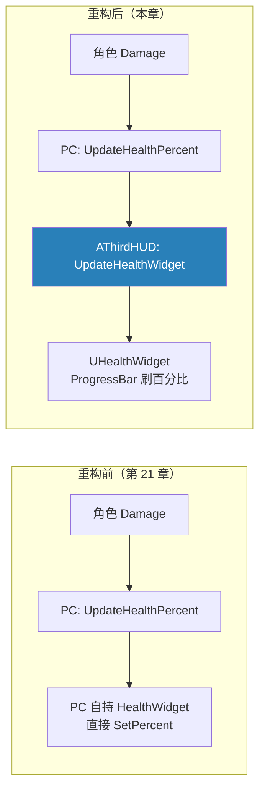

# 实战：HUD 类与血条管理重构

第 21 章把血条和死亡菜单都塞进了 `AThirdPlayerController`——能用，但 PlayerController 的职责正在膨胀：输入、暂停、输入模式、现在又加上"创建/持有/刷新 Widget"。引擎其实早就为"这个玩家看到什么"准备了一个专属框架类：**`AHUD`**（第 11 章框架类速查表里的老熟人）。本章把血条的管理权从 PlayerController 搬进自定义 `AThirdHUD`，PC 退位为"转发一嗓子"——顺带体验一次典型的**职责迁移重构**：行为不变，归属变清晰。涉及文件：新增 `HUD/ThirdHUD.h/.cpp`、编辑器新增 `WBP_HUD_ThirdHUD`，修改 `ThirdPlayerController.h/.cpp` 与 GameMode 蓝图 `BP_MyThirdPerson`。

重构前后对比：



## 一、AHUD 是什么：被 UMG 时代重新就业的框架类

`AHUD` 和 `APlayerController` 一样由 GameMode 派发（第 11 章），关键事实三件：

1. **每玩家一个**：GameMode 按 `HUDClass` 为每个 PlayerController 生成一个 HUD 实例，归该 PC 所有（`GetOwningPlayerController()` 能反向找到主人）；
2. **`APlayerController::GetHUD()` 是官方通道**：PC 想摸自己的 HUD 不用自己存引用，引擎已经代持；
3. 它出生在 Canvas 手绘 HUD 的年代（`DrawHUD` 里画线画字），UMG 兴起后"画"的职能被 Widget 抢走——但"**这个玩家的屏幕层**"这个挂载点依然非它莫属。

于是三个类的分工变成一张干净的表：

| 类 | 职责 | 本章之后管什么 |
|---|---|---|
| `AThirdPlayerController` | 玩家交互：输入、暂停、输入模式 | 转发血量、弹/收死亡菜单（菜单要切输入模式，是交互行为，留下合理） |
| `AThirdHUD` | 玩家屏幕：显示什么、怎么排 | 血条的创建与刷新 |
| `UHealthWidget` | 单个控件的呈现 | ProgressBar 百分比 |

一个可用的判断口径：**涉及输入模式和暂停的 UI 归 PC，纯展示的 HUD 归 AHUD**。死亡菜单弹窗要抢鼠标、切 UIOnly、暂停——留在 PC；血条只是"往屏幕上钉一个常驻控件"——搬进 HUD。

## 二、AThirdHUD：新管家

```cpp
// Public/HUD/ThirdHUD.h
UCLASS()
class MYTHIRD_API AThirdHUD : public AHUD
{
    GENERATED_BODY()

public:
    // 保存 Class
    UPROPERTY(EditDefaultsOnly, Category="HUD")
    TSubclassOf<UHealthWidget> HealthWidgetClass;

    // 保存实例
    UPROPERTY()
    TObjectPtr<UHealthWidget> HealthWidget;

    void CreateHealthWidget();

    void UpdateHealthWidget(float HealthPrecent);
};
```

```cpp
// Private/HUD/ThirdHUD.cpp
#include "HUD/ThirdHUD.h"
#include "HUD/HealthWidget.h"

void AThirdHUD::CreateHealthWidget()
{
    APlayerController* PlayerController = GetOwningPlayerController();
    if (HealthWidgetClass != nullptr)
    {
        HealthWidget = CreateWidget<UHealthWidget>(PlayerController, HealthWidgetClass);
        HealthWidget->AddToViewport();
    }
}

void AThirdHUD::UpdateHealthWidget(float HealthPrecent)
{
    if (HealthWidget != nullptr)
    {
        HealthWidget->UpdateHealthPercent(HealthPrecent);
    }
}
```

结构完全是第 21 章 PlayerController 里那套的平移，几个细节：

- **`TSubclassOf<UHealthWidget>` + `EditDefaultsOnly`**：老配方——C++ 只认类型，具体用哪个 WBP 由蓝图子类的 Class Defaults 配（第 16、21 章同一思路，这次配置点从 Controller 蓝图挪到 HUD 蓝图）；
- **实例成员挂 `UPROPERTY()` 但不给 Edit**：只进 GC 视野（第 12 章），不给编辑器改的口子——实例是运行时创建的，改了也没意义；
- **`GetOwningPlayerController()`**：HUD 自带的反向通道，对应 `CreateWidget` 需要的 OwningPlayer 参数。Widget 的"主人"最终还是 PlayerController——HUD 只是替它管；
- `UpdateHealthWidget` 判空是兜底而非常态：角色 BeginPlay 的首帧推送可能跑在 `CreateHealthWidget` 之前（第五节细说）；
- 小瑕疵：参数名拼成了 `HealthPrecent`（正确是 `Percent`）——不影响功能，但自己写代码时顺手拼对。

## 三、PlayerController 重构：从"自己干"到"找人干"

```cpp
// Private/Game/ThirdPlayerController.cpp
void AThirdPlayerController::UpdateHealthPercent(float HealthPercent)
{
    if (ThirdHUD != nullptr)
    {
        ThirdHUD->UpdateHealthWidget(HealthPercent);
    }
}

void AThirdPlayerController::BeginPlay()
{
    Super::BeginPlay();

    ThirdHUD = Cast<AThirdHUD>(GetHUD());
    if (ThirdHUD != nullptr)
    {
        ThirdHUD->CreateHealthWidget();
    }
}
```

头文件侧同步两处：删掉 `HealthWidget` / `HealthWidgetClass` 成员，新增 `TObjectPtr<AThirdHUD> ThirdHUD`（照样 `UPROPERTY()` 进 GC）+ 前置声明 `class AThirdHUD;`。旧的创建代码整段注释而非删除——学习期习惯，正式代码请直接删，注释掉的代码放三个月连自己都不记得为什么留。

核心是这一行：

```cpp
ThirdHUD = Cast<AThirdHUD>(GetHUD());
```

`GetHUD()` 返回 `AHUD*`——**类型由 GameMode 的 HUDClass 决定**。默认是引擎基类 `AHUD`，这时 Cast 落空返回 `nullptr`，后面判空直接跳过：**不崩、不报错、血条不出现**——和第 21 章"GameMode 忘配 PlayerController Class"是同款静默失败，排查时第一反应就该是去查 GameMode 配置。

为什么要 PC 在 BeginPlay 里喊 `CreateHealthWidget()`，而不是 HUD 自己在 `BeginPlay` 里创建？两者都可行。PC 驱动的好处是**创建时机显式地跟输入侧对齐**（PC 的 BeginPlay 里一并安排"这个玩家的初始状态"）；HUD 自驱则更内聚。选哪种都行，本章跟随 PC 驱动的写法——但注意别把 `CreateWidget` 写进任何一方的**构造函数**：构造期 World 还没就绪（第 21 章第八节第 6 条的老坑，换了归属依然成立）。

## 四、编辑器配置：两个对接点

C++ 侧闭环后又是熟悉的"运行时对接点等编辑器喂资产"，这次两步：

### 第一步：建 HUD 蓝图类 WBP_HUD_ThirdHUD

新建蓝图时选 **Blueprint Class → ThirdHUD**（父类是 AHUD，**不是 Widget Blueprint**）。虽然名字带了 `WBP_` 前缀，它和 `WBP_HUD_Health` 那种 Widget 蓝图是两回事——前者是 Actor 家族的蓝图类，后者是 UUserWidget 家族的界面布局。前缀纯属命名手滑， asset 列表里分辨的窍门：看图标、看创建入口。

在它的 **Class Defaults** 里：`HealthWidgetClass → WBP_HUD_Health`。

### 第二步：GameMode 配 HUD Class

打开 GameMode 蓝图 `BP_MyThirdPerson`（就是 StartMap 在用的那个，第 21 章配过 Player Controller Class），Class Defaults 里：**HUD Class → WBP_HUD_ThirdHUD**。

纯 C++ 的替代写法是 GameMode 构造函数里 `HUDClass = AThirdHUD::StaticClass();`——但那样 `HealthWidgetClass` 就没地方配了（C++ 里只能 `ConstructorHelpers::FClassFinder` 焊死资产路径，第 21 章已吐槽），所以 HUD 走蓝图路线反而更顺。

| 编辑器操作 | 对接的 C++ 机制 | 漏了的症状 |
|---|---|---|
| WBP_HUD_ThirdHUD 配 HealthWidgetClass | `TSubclassOf` + `EditDefaultsOnly` | 日志无警告、血条不出现 |
| GameMode 配 HUD Class | `GetHUD()` 的返回类型 | `Cast` 落空，**静默失败** |

## 五、时序复盘：首帧血条谁画

把本章之后的启动时序摆开（第 9、11 章的老问题，每加一层都要重新对表）：

1. GameMode 生成 PlayerController，紧接着按 `HUDClass` 生成 AThirdHUD；
2. PC `BeginPlay`：`GetHUD()` 拿到 HUD，`CreateHealthWidget()` 创建血条；
3. 角色 `BeginPlay`：首帧推送 `UpdateHealthPercent(满血)`。

隐患在第 3 步可能跑在第 2 步之前——角色和 PC 的 BeginPlay 顺序不保证，这时 `ThirdHUD` 或其内部 `HealthWidget` 还是 `nullptr`，两层判空各自兜住、静默跳过，等第一次受伤时血条才"上线"，且直接显示受伤后的值（满血那一帧丢了）。第 21 章结尾立过的 Flag 在本章结构下依然成立：**事件驱动 UI 的通病是首帧谁画，解法要么接受、要么在 Widget 侧重取数据自绘**（`NativeConstruct` 时拉一次 `GetHealthPercent`）。

## 六、常见坑

1. **WBP_HUD_ThirdHUD 当成 Widget 蓝图建** → 父类选错家族，GameMode 的 HUD Class 下拉里根本找不到它。创建入口是 Blueprint Class，父类搜 ThirdHUD；
2. **GameMode 忘配 HUD Class** → `GetHUD()` 返回基类 `AHUD`，Cast 落空，血条静默不出现（不崩、无日志）——排查第一步永远先查 GameMode；
3. **`CreateWidget` 写进 HUD 或 PC 的构造函数** → 构造期 World 未就绪，第 21 章老坑换壳重现；
4. **旧代码注释留着不删** → 半年后分不清"待办"还是"废弃"，学习仓库可以容忍，正式仓库直接删——git 里都找得回来；
5. **`UpdateHealthWidget` 判空省略** → 首帧推送时序竞态直接崩溃，两层判空（PC 判 ThirdHUD、HUD 判 HealthWidget）都要在；
6. **死亡菜单也急着搬** → 菜单要 `SetPause` / 切输入模式 / 抢鼠标，是交互职责，PC 才是这些能力的持有者；搬家按职责搬，不是按"凡是 UI 都进 HUD"一刀切。

## 小结

- `AHUD` 是每玩家一个的屏幕层框架类，由 GameMode 的 `HUDClass` 派发、PlayerController 所有，`GetHUD()` 是官方取用通道；
- 分工口径：**涉及输入/暂停的 UI 归 PC，纯展示的 HUD 归 AHUD**；
- 重构是"行为不变的职责平移"：`TSubclassOf` + 实例 + 创建/刷新函数整套从 PC 搬进 AThirdHUD，PC 只留一句转发；
- 配置链多了一环：GameMode 配 HUD Class → HUD 蓝图配 Widget Class → WBP 里同名控件对接 `BindWidget`，任何一环脱节都是**静默失败**；
- 首帧血条问题跨章存在：事件驱动 UI 的初始帧要么接受丢失、要么 Widget 侧在 `NativeConstruct` 主动拉一次数据；
- 遗留改进：`HealthPrecent` 拼写；死亡菜单如后续要做渐变/动效，可考虑也挂到 HUD 名下、PC 只发指令。
