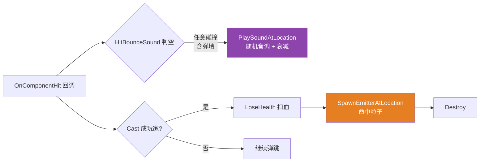

# 实战：音效与命中特效

子弹打中玩家只有日志和血条跳变，没有一点"打击感"。本章给子弹补上两件事：**碰撞弹跳音效**（带随机音调 + 距离衰减）和**命中玩家的粒子特效**。C++ 改动小到奢侈——三个 `UPROPERTY` + 两行 `UGameplayStatics` 调用——但这两个调用背后是 UE 音效与特效体系的一整套常识，值得展开。涉及文件：`Projectile/BallProjectile.h/.cpp`，新增资产 `BP_HitSound`（SoundCue）、`BP_HitSoundAttenuation`（SoundAttenuation），蓝图 `BP_BallProjectile` 配置。

先看 OnHit 的新链路：



## 一、三个资产型属性：C++ 只开槽，内容走编辑器

```cpp
// Public/Projectile/BallProjectile.h
UPROPERTY(EditAnywhere, Category=Damage)
TObjectPtr<USoundBase> HitBounceSound;

UPROPERTY(EditAnywhere, Category=Damage)
TObjectPtr<USoundAttenuation> HitSoundAttenuation;

UPROPERTY(EditAnywhere, Category=Damage)
TObjectPtr<UParticleSystem> HitParticle;
```

这是第 16 章就定下的模式：**C++ 声明"我要这个类型的东西"，具体哪个资产由蓝图在细节面板里填**。`EditAnywhere` 而非 `EditDefaultsOnly`——子弹是原型体（CDO）直接 Spawn 的，没实例可改，两种写法在这里等价，但语义上这类配置更常用 `EditDefaultsOnly` 收紧口子（只许改类默认值）。

三个槽位对应三条资产线，类型选择都有讲究：

| 槽位 | 类型 | 为什么是这个类型 |
|---|---|---|
| 音效 | `USoundBase` | 音效家族的抽象基类，`USoundWave` 和 `USoundCue` 都派生自它——槽位开得宽，两种资产都能塞 |
| 衰减 | `USoundAttenuation` | 声音随距离变化的配置资产（第 5 节） |
| 特效 | `UParticleSystem` | Cascade 粒子系统的资产类型（第 4 节，新项目其实更该用 Niagara） |

## 二、音效体系：SoundWave / SoundCue / SoundBase

UE 音频三件套的关系一句话：**`USoundWave` 是原始音频文件，`USoundCue` 是加工它的节点图，`USoundBase` 是两者的共同祖先**。

- **SoundWave**：导入 .wav 生成的资产，就是"一段录好的声音"，直连它没有任何加工余地；
- **SoundCue**：音频界的蓝图——把一个或多个 SoundWave 接进节点图，可以混合、随机挑选、循环、调音量音调、按距离调制。本章的 `BP_HitSound` 就是一个 SoundCue：内部一个 Wave Player 节点装着弹跳声的 SoundWave，接 Output；
- **SoundBase**：抽象层。C++ 播放函数收的都是 `USoundBase*`，所以直放一个 SoundWave 或放一个做足了效果的 SoundCue，调用侧代码一字不改。

以后想升级音效（比如随机三四种弹跳声），**只改 SoundCue 内部节点，C++ 与蓝图配置都不用动**——这就是抽象基类槽位的价值，和 `TSubclassOf` 让蓝图管布局是同一个设计哲学。

## 三、PlaySoundAtLocation：一行调用，六个参数

```cpp
// Private/Projectile/BallProjectile.cpp —— OnComponentHit 回调顶部
// 前置：#include "Kismet/GameplayStatics.h"（本章顺带把已无用的
// Interface/HealthInterface.h 头文件换成了它——接口调用早在第 21 章就被注释了）
if (HitBounceSound != nullptr)
{
    UGameplayStatics::PlaySoundAtLocation(
        this,                    // 上下文对象（WorldContext）
        HitBounceSound,          // 音效资产
        GetActorLocation(),      // 发声位置——3D 空间化的锚点
        1,                       // VolumeMultiplier 音量倍率
        FMath::RandRange(0.4f, 1.f), // PitchMultiplier 音调倍率：每发随机
        0.f,                     // StartTime 起始偏移
        HitSoundAttenuation);    // AttenuationSettings 距离衰减配置
}
```

逐个拆值得拆的：

- **位置在 OnHit 最顶部**——意味着撞墙弹跳也响（所以名字叫 BounceSound 而不是 DamageSound）。弹跳每次碰撞都触发，配合随机音调才不会听成机关枪式重复；
- **`FMath::RandRange(0.4f, 1.f)` 是本章的点睛**：同一个音效每发以不同音调播放，重复一万次也不腻。这是游戏音频的标配技巧——UE 的 SoundCue 里也有专门的 Pitch 节点干这事，放 C++ 侧的好处是所有音效共用这一行随机。范围 0.4~1 偏宽（音调可低到六成），常规打击声用 0.9~1.1 更自然，这里宽范围反而做出了"软弹球"的俏皮感；
- **Fire-and-forget**：调用即发射，声音播完自动回收，不需要持有任何句柄、不存在"停止/销毁"的心智负担。代价是播出去就管不着了——想中途停止、改音量，得改用 `SpawnSoundAtLocation`，它返回 `UAudioComponent` 供动态控制；
- 判空是老规矩：蓝图没配资产就静默跳过，不崩。

### USoundAttenuation：距离衰减

`PlaySoundAtLocation` 播的是 3D 空间声，但"离多远开始衰减、衰减多快、要不要立体声定位"不是调用处该操心的事——这些都打包进 `USoundAttenuation` 资产（本章的 `BP_HitSoundAttenuation`）。它是一张配置表：距离-音量曲线、空间化（立体声/环绕）、低通滤波（隔着墙发闷）等。

资产化的好处是**复用**：枪声、脚步、爆炸共用同一套衰减口径，策划在资产里统一调，C++ 一行不改。`PlaySoundAtLocation` 不传衰减配置时用引擎默认值——近距离玩法能凑合，一旦场景变大就会暴露"远处枪声和近处一样响"的假感。

顺带两个邻居：`PlaySound2D` 播无位置的 UI 声/全局 BGM（无衰减无空间化）；音量倍率和音调倍率参数在 `PlaySound2D` 里同样有。

## 四、SpawnEmitterAtLocation：命中粒子

```cpp
// OnComponentHit —— Cast 成玩家成功、扣血之后
if (HitParticle != nullptr)
{
    UGameplayStatics::SpawnEmitterAtLocation(GetWorld(), HitParticle, GetActorTransform());
}
```

三个要点：

- **只在命中玩家的分支里**——扣了血才值得爆特效，撞墙弹跳只有音效。位置上放在 `LoseHealth` 之后、`Destroy` 之前，用的是子弹当前的 `GetActorTransform()`（位置+旋转一起带，粒子朝向跟子弹一致）；
- 同样 fire-and-forget：生成的 EmitterActor 自动播放，粒子寿命结束自动销毁，不用管回收；
- 兄弟函数 `SpawnEmitterAttached`：把特效绑在某个组件上跟着动（冒烟的引擎、拖尾的刀光）；本章命中瞬间子弹就销毁，用不着跟随，AtLocation 正确。

### 不得不说：Cascade 与 Niagara

`UParticleSystem` 是 **Cascade** 粒子体系的资产类型——UE4 时代的主力，UE5 里已标记为遗留（引擎自带资产前缀 `P_`）。官方接班人是 **Niagara**（`UNiagaraSystem` 资产，前缀 `NS_`），C++ 侧对应调用：

```cpp
// 想改用 Niagara 时：换槽位类型 + 换函数，其余不动
#include "NiagaraFunctionLibrary.h"

UPROPERTY(EditAnywhere, Category=Damage)
TObjectPtr<UNiagaraSystem> HitParticle;   // 原 TObjectPtr<UParticleSystem>

UNiagaraFunctionLibrary::SpawnSystemAtLocation(GetWorld(), HitParticle, GetActorLocation());
```

两者类型不通用——`UParticleSystem` 槽位塞不进 Niagara 资产，反之亦然。本章跟着教程用了 Cascade（引擎自带示例资产里 `P_` 打头的遍地都是，捡现成的快），**新项目从零做特效建议直接 Niagara**：编辑器更现代、模拟在 GPU 上跑、官方所有新示例都是它。学习期两套都认识即可，辨析口诀：`P_` = Cascade 旧，`NS_` = Niagara 新。

## 五、编辑器侧：建资产、配蓝图

### 建两个音频资产

1. **BP_HitSound（SoundCue）**：内容浏览器右键 → Sounds → Sound Cue（或在音频编辑器里建）；打开后拖入弹跳声的 SoundWave，接 Wave Player → Output。哪里找声源：引擎内容（内容浏览器左下角 Settings 勾上 Show Engine Content）里搜 bounce / impact 类的 `A_` 资产，或 Quixel/市场免费音效包；
2. **BP_HitSoundAttenuation（Sound Attenuation）**：右键 → Sounds → Sound Attenuation；进资产把 Attenuation（距离衰减）调到和场景尺度匹配——默认衰减距离对百米大世界太小，近身小游戏则无所谓。

### 配 BP_BallProjectile

打开子弹蓝图，细节面板 **Damage 分类**下：`HitBounceSound → BP_HitSound`、`HitSoundAttenuation → BP_HitSoundAttenuation`、`HitParticle → 选一个 P_ 爆裂/火花资产`。三个槽都是 `EditAnywhere`，和第 17 章碰撞预设一样"C++ 开槽、蓝图填资产"。

### 试听验证

SoundCue 编辑器里点播放键能单听 Cue；衰减效果要在 PIE 里拉开摄像机距离听——衰减曲线是按**听者（音频监听组件，通常挂在 PC 上）到发声点**的距离算的。

## 六、扩展视野：打击感的下一步

本章两行调用是"从无到有"，往"从有到好"走还有几级台阶，按性价比排序：

1. **音调随机范围收窄**（前述 0.9~1.1），或挪进 SoundCue 的 Pitch 节点统一管理；
2. **音效并发限制**：一片子弹连撞，几十个弹跳声同时播会糊成一团。给 SoundCue 或 SoundAttenuation 配 **Sound Concurrency**（同组最多 N 个实例、超了掐最旧的）——霰弹枪贴脸十发只有一声"啪"的工业做法；
3. **命中不同材质不同音效**：物理材质（Physical Material）驱动——`Hit.Result.PhysMaterial` 查表换 SoundCue，金属声/肉声/泥土声各自配；
4. **特效改 Niagara + 池化**：命中频繁时每次 Spawn Actor 开销可观，正式项目用对象池（`Activate`/`Deactivate` 复用）替代 Spawn/Destroy；
5. 相机震动（`PlayerController::ClientStartCameraShake`）——打击感的三分之一其实在镜头上。

## 七、常见坑

1. **SoundCue 没声**：Wave Player 没接 Output、或节点没连 SoundWave——音频编辑器里点播放键是最快的单点排查；
2. **PIE 里远处听不见**：不是音效坏了，是衰减曲线距离不够——听者距离超过曲线末端的自然衰减；先把 Attenuation 的 Distance 级别拉大再判断；
3. **`UGameplayStatics` 未声明**：忘了 `#include "Kismet/GameplayStatics.h"`——它没有前置声明可偷懒，这个头文件是全家桶（声音、特效、OpenLevel、QuitGame 全在里面）；
4. **给 `UParticleSystem` 槽位拖 Niagara 资产**：拖不进去不是编辑器卡了，是类型体系不同（第 4 节），换 `UNiagaraSystem` + `SpawnSystemAtLocation`；
5. **特效在 Destroy 之后才 Spawn**：不是必崩但顺序应讲究——先取 Transform 再 Destroy；本章写法（特效在 Destroy 前一行）刚好安全；
6. **音效放在"命中玩家"分支里**：那就成了伤害音不是弹跳音——放 OnHit 顶部（任意碰撞）还是分支里（仅命中玩家），是**声音语义**问题，先想清楚这个声音描述的是什么事件。

## 小结

- C++ 开槽、编辑器填资产的老模式扩展到音效/特效：`USoundBase` / `USoundAttenuation` / `UParticleSystem` 三个 `EditAnywhere` 槽位；
- 音频三件套：**SoundWave 原始音频、SoundCue 加工节点图、SoundBase 抽象槽位**——升级音效只动 Cue，代码零改动；
- `PlaySoundAtLocation` 的**随机音调倍率**是重复音效不单调的标配技巧，位置参数即 3D 空间化锚点，衰减细节外包给 `USoundAttenuation` 资产复用；
- `SpawnEmitterAtLocation` 用 `GetActorTransform()` 连朝向一起带，fire-and-forget 免回收；跟随目标用 `SpawnEmitterAttached`；
- Cascade（`UParticleSystem`，`P_` 前缀）是遗留体系，新项目用 Niagara（`UNiagaraSystem`，`SpawnSystemAtLocation`）——本章随教程用 Cascade，迁移只换槽位类型和函数名；
- 音效语义先于代码位置：弹跳音放 OnHit 顶部（任意碰撞），命中特效放 Cast 成功分支（仅玩家）——先问"这个声音/特效描述什么事件"，再决定挂在哪；
- 打击感进阶路线：并发限制 → 物理材质分音效 → Niagara 池化 → 相机震动。
