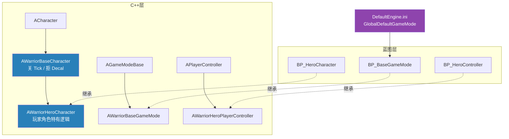

# RPG 项目骨架与 Base/Hero 类分层

Warrior 动作 RPG 工程的第一份 C++ 骨架：四个框架类（`WarriorBaseCharacter` / `WarriorHeroCharacter` / `WarriorBaseGameMode` / `WarriorHeroPlayerController`）几乎是空的，但项目的底子已经打好——**目录按角色分层、类按 Base/Hero 分层、构造函数里先写性能习惯、蓝图只在最后一层**。涉及文件：`Source/Warrior/` 下四组 `.h/.cpp`、`Warrior.Build.cs` 与 `Config/` 两份 ini。

先看整体分层——C++ 三条继承线，蓝图各自在最顶端收口：



## 一、目录组织：Public/Private 与按角色分文件夹

小工程里类文件通常平铺在模块根目录；Warrior 一上来就按**访问权限 + 职能**两级分目录：

| 路径 | 放什么 | 谁能 include |
|---|---|---|
| `Public/Character/` | 角色类 `.h` | 本模块外的模块也可以 |
| `Private/Character/` | 角色类 `.cpp` | 只有模块内部 |
| `Public/GameModes/`、`Public/Controllers/` | 模式 / 控制器头文件 | 同上 |
| 模块根 | `Warrior.h/.cpp`、`Warrior.Build.cs`、Target 文件 | 模块入口与构建配置 |

配套的习惯是 **include 路径写相对模块的目录**，而不是文件名裸奔：

```cpp
// Private/Character/WarriorBaseCharacter.cpp
#include "Character/WarriorBaseCharacter.h"
```

`.cpp` 里的 include 查找起点是 `Source/Warrior/`（模块的 Public/Private 路径都注册进了 include 搜索路径），所以写 `"Character/WarriorBaseCharacter.h"` 而不是 `"WarriorBaseCharacter.h"`——后者在文件平铺时能过编译，一旦挪进子目录就满屏红。把这个写法固化成工程约定。

## 二、Base/Hero 分层：为"敌我共用"留位置

四个类的继承关系与职责：

| 类 | 父类 | 职责 | 现状 |
|---|---|---|---|
| `AWarriorBaseCharacter` | `ACharacter` | 敌我角色**共用**的逻辑：属性初始化、通用组件 | 已有构造函数 |
| `AWarriorHeroCharacter` | `AWarriorBaseCharacter` | 玩家角色特有：输入绑定、相机、技能 | 空 |
| `AWarriorBaseGameMode` | `AGameModeBase` | 规则、默认类指定 | 空 |
| `AWarriorHeroPlayerController` | `APlayerController` | 玩家侧输入与 UI 的宿主 | 空 |

为什么角色要分 Base/Hero 两层，而不是直接一个 `WarriorCharacter`？因为动作游戏里**敌人也是 Character**。将来写 `AWarriorEnemyCharacter` 时同样派生自 `WarriorBaseCharacter`——血量、受击、死亡这些敌我一致的逻辑放 Base 写一遍；输入绑定、相机臂这些只有玩家需要的放 Hero。继承树在 UE 框架类之上再延伸一层：`ACharacter` 管移动碰撞，`WarriorBaseCharacter` 管游戏规则层的共性，`Hero/Enemy` 管阵营差异。

三件套各留一个空的 C++ 类再马上建蓝图，看似多余，实际是给**将来必然要写的 C++ 逻辑预定位置**——直接拿引擎类建蓝图（比如 BP 直接继承 `ACharacter`），之后想加代码就得 Reparent 蓝图，不如一开始就占好坑。

另外注意类名统一带 `Warrior` 前缀。UE 的类名全局共享一个命名空间，叫 `BaseCharacter` 的类迟早和引擎或插件撞车；前缀是最低成本的防撞方案。

## 三、构造函数里的两行性能习惯

全部"有内容"的代码集中在 `WarriorBaseCharacter` 构造函数，共三行，每行都有讲究：

```cpp
// Private/Character/WarriorBaseCharacter.cpp
AWarriorBaseCharacter::AWarriorBaseCharacter()
{
    PrimaryActorTick.bCanEverTick = false;
    PrimaryActorTick.bStartWithTickEnabled = false;

    GetMesh()->bReceivesDecals = false;
}
```

**关 Tick（前两行）**。`bCanEverTick = false` 是彻底关掉这个 Actor 的 Tick 注册；`bStartWithTickEnabled = false` 则是"允许 Tick，但出生时不启用"，留给 `SetActorTickEnabled(true)` 按需打开。两个一起写等于宣布：**这个类的设计里没有"每帧必须做的事"**。角色身上每帧逻辑通常各有归宿——移动在 `CharacterMovementComponent`、动画状态机在 AnimBP、计时用 `GetWorldTimerManager`、输入在 EnhancedInput 回调。真到了要每帧 Tick 的那天（比如自定义朝向插值），再显式打开，比默认全开、出事再排查谁是性能黑洞便宜得多。**这个习惯写进 Base 类，等于所有敌我角色一起继承。**

**拒绝 Decal（第三行）**。`bReceivesDecals = false` 让网格体不接受贴花投影——弹孔、血迹、魔法阵这类 Decal 不再贴到角色身上。贴花投在角色身上不仅常常穿帮（随骨骼动画拉伸撕裂），还多一份渲染开销；动作游戏角色满身弹孔基本不会是想要的效果。`GetMesh()` 在 `ACharacter` 构造时已保证网格体组件存在，可以放心直接取。

## 四、蓝图层与项目接线

C++ 类编译后，各自继承出蓝图：`GameModes/BP_BaseGameMode`、`PlayerCharacter/BP_HeroCharacter`、`PlayerCharacter/BP_HeroController`（资产路径见 `Content/` 下同名目录）。蓝图这层目前不写逻辑，它的存在意义就是老规矩——**C++ 写逻辑，蓝图配资源**：网格体、动画蓝图、输入映射上下文（IMC/Input Mapping Context）都要在蓝图细节面板里填。

项目接线在 `Config/DefaultEngine.ini`：

```ini
[/Script/EngineSettings.GameMapsSettings]
GameDefaultMap=/Game/Maps/FeatureDevMap.FeatureDevMap
EditorStartupMap=/Game/Maps/FeatureDevMap.FeatureDevMap
GlobalDefaultGameMode=/Game/GameModes/BP_BaseGameMode.BP_BaseGameMode_C
```

- `GlobalDefaultGameMode` 指向**蓝图类**，路径末尾的 `_C` 是蓝图生成类的后缀（Class 的 C）——这是"引用蓝图资产"和"引用蓝图类"的语法区别，漏了 `_C` 路径解析直接失败；
- 注意 GameMode 里**还没有**指定 `DefaultPawnClass`——目前进图拿到的是默认 Pawn（灰球），把 `BP_HeroCharacter` 挂上 Default Pawn 是下一篇配网格体时一起做的事，在类默认值面板里设，而非 C++ 里用 `ConstructorHelpers::FClassFinder` 硬编码资产路径；
- 默认地图 `FeatureDevMap` 启用了 World Partition——关卡 Actor 拆存在 `Content/__ExternalActors__/Maps/FeatureDevMap/` 下的散文件里（`Config/DefaultEngine.ini` 里那段 `WorldPartitionEditorSettings` 即其开关），这就是"大关卡流送加载"机制的落地形态。

## 五、EnhancedInput 就位

两处配置确认输入体系走增强输入：

```csharp
// Source/Warrior/Warrior.Build.cs
PublicDependencyModuleNames.AddRange(new string[]
    { "Core", "CoreUObject", "Engine", "InputCore", "EnhancedInput" });
```

```ini
// Config/DefaultInput.ini（模板默认即如此）
DefaultPlayerInputClass=/Script/EnhancedInput.EnhancedPlayerInput
DefaultInputComponentClass=/Script/EnhancedInput.EnhancedInputComponent
```

`Build.cs` 加模块是 C++ 侧能 `#include "InputActionValue.h"` 的前提；两个 Default 类把整个项目的输入组件换成 Enhanced 版。`DefaultInput.ini` 里还躺着一大段模板的旧式 Action/Axis Mappings（Jump、MoveForward 那些）——它们只服务于模板自带的 `BP_ThirdPersonCharacter`，新写的 `WarriorHeroCharacter` 不会碰，留着无害，真要清爽可以整段删掉。

## 六、内容迁移：ThirdPerson 资产进新家

`Content/ThirdPerson/` 下是从第三人称模板迁移过来的整套资产：Mannequins 的网格体/动画/材质/绑定（`Characters/Mannequins/`）、输入配置（`Input/`）、还有 `LevelPrototyping` 灰盒积木。这是新建项目拿标准小人做占位的常规做法——正式角色资产到位前，动画调试、移动手感全靠这套。`BP_HeroCharacter` 接上 Mannequin 网格与动画蓝图后，这条线就正式"有角色"了。

## 七、常见坑

1. **include 路径漏目录**：类挪进 `Public/Character/` 后 `.cpp` 里还写 `#include "WarriorBaseCharacter.h"` 编不过——搜索路径不含模块根下任意递归目录，要写 `"Character/WarriorBaseCharacter.h"`；
2. **蓝图父类选错**：`BP_HeroCharacter` 手滑继承了 `WarriorBaseCharacter` 而不是 Hero 子类——不用删掉重建，右键 → **重设蓝图父类（Reparent Blueprint）** 即可，但变量/组件引用可能断链，新建时看准；
3. **改完 `Build.cs` 只在编辑器里点编译**：模块依赖变更（如加 `EnhancedInput`）建议关编辑器跑一次完整构建，编辑器内热编译对 Build.cs 变更的支持时灵时不灵；
4. **`GlobalDefaultGameMode` 路径漏 `_C`**：改回 C++ 类路径（`/Script/Warrior.WarriorBaseGameMode`）也能工作，但那样蓝图层就没意义了——引用蓝图类必须带 `_C` 后缀；
5. **在 Hero 类里写共用逻辑**：写完发现敌人也要——挪去 Base 越早越便宜，继承树上的代码"下沉"要动所有子类的排查面，第一行代码放对层比事后搬运划算。

## 小结

- 目录两级分层：`Public/`（对外头文件）/ `Private/`（实现），再按职能 `Character/`、`GameModes/`、`Controllers/` 分文件夹，include 路径带上目录前缀；
- 类分层 `Base/Hero`：敌我共用的逻辑沉在 `WarriorBaseCharacter`，玩家特有逻辑在 `WarriorHeroCharacter`——继承树在游戏规则层的延续；
- 构造函数三行习惯：**双开关关 Tick**（`bCanEverTick` + `bStartWithTickEnabled`）宣示"无每帧逻辑"，`bReceivesDecals = false` 让角色不吃贴花投影；
- 蓝图只在继承链顶端收口（`BP_*` 三个），负责配资源不写逻辑；`DefaultEngine.ini` 的 `GlobalDefaultGameMode` 引用蓝图类要带 `_C` 后缀；
- `Build.cs` 显式依赖 `EnhancedInput` + `DefaultInput.ini` 默认 Enhanced 输入类，输入体系就位；模板遗留的旧式 Axis Mappings 与新代码无关；
- World Partition 地图的 Actor 散存于 `__ExternalActors__/`，FeatureDevMap 即大关卡流送的落地形态。

下一步：给 `BP_HeroCharacter` 配上 Mannequin 网格与动画蓝图，把 GameMode 的 Default Pawn 指向它——让灰球变成能跑起来的小人。
