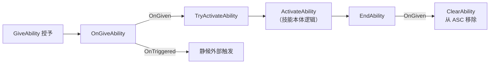

# GameplayAbility 基类与激活策略

上一篇把 ASC 的"线"接好了，本篇往里放第一样东西：技能的公共基类 `WarriorGameplayAbility`。它目前只干一件事——为所有技能定义**激活策略（Activation Policy）**：这个技能是"等外部触发"还是"被授予就立刻生效"，并据此接线自动激活与用后即焚的清理。最后用策略 `OnGiven` 建出第一个技能蓝图 `GA_Shared_SpawnWeapon`——武器生成技能的空壳。

## 一、WarriorGameplayAbility 基类

```cpp
UCLASS()
class WARRIOR_API UWarriorGameplayAbility : public UGameplayAbility
{
    GENERATED_BODY()

protected:
    virtual void OnGiveAbility(const FGameplayAbilityActorInfo* ActorInfo, const FGameplayAbilitySpec& Spec) override;
    virtual void EndAbility(const FGameplayAbilitySpecHandle Handle, const FGameplayAbilityActorInfo* ActorInfo,
        const FGameplayAbilityActivationInfo ActivationInfo, bool bReplicateEndAbility, bool bWasCancelled) override;

    UPROPERTY(EditDefaultsOnly, Category="WarriorAbility")
    EWarriorAbilityActivationPolicy AbilityActivationPolicy = EWarriorAbilityActivationPolicy::OnTriggered;
};
```

又是"空壳先占位"的老套路：`WarriorAbilitySystemComponent`、`WarriorInputComponent` 都这么走过来的。引擎的 `UGameplayAbility` 是不许动的黑盒，所有技能的公共行为——激活策略判定、将来的输入确认拦截、取消策略——都写在自有基类里，具体技能蓝图只管各自的逻辑。

## 二、激活策略：两档的区别

```cpp
UENUM(BlueprintType)
enum class EWarriorAbilityActivationPolicy : uint8 {
    OnTriggered,
    OnGiven
};
```

| 策略 | 语义 | 典型技能 |
|------|------|----------|
| **`OnTriggered`** | 授予后静静待命，等输入按键或代码显式触发 | 攻击、格挡、翻滚 |
| **`OnGiven`** | 授予的那一刻立即激活，结束后从 ASC 移除 | 袃生技能：出生生成武器、初始buff |

默认值给 `OnTriggered`——大多数技能是"等触发"的，默认值应该站在多数一边；`OnGiven` 是刻意声明的例外。

`OnGiven` 本质上把技能用成了**一次性事件**：Give → 自动 Activate → End → 移除。它不占输入键位、不进技能栏，"授予"这个动作本身就是触发。

## 三、接线：OnGiveAbility 与 EndAbility

```cpp
void UWarriorGameplayAbility::OnGiveAbility(const FGameplayAbilityActorInfo* ActorInfo,
    const FGameplayAbilitySpec& Spec)
{
    Super::OnGiveAbility(ActorInfo, Spec);

    if (AbilityActivationPolicy == EWarriorAbilityActivationPolicy::OnGiven)
    {
        if (ActorInfo && Spec.IsActive())   // ⚠ 此守卫存疑，见下方警告框
        {
            ActorInfo->AbilitySystemComponent->TryActivateAbility(Spec.Handle);
        }
    }
}

void UWarriorGameplayAbility::EndAbility(const FGameplayAbilitySpecHandle Handle,
    const FGameplayAbilityActorInfo* ActorInfo, const FGameplayAbilityActivationInfo ActivationInfo,
    bool bReplicateEndAbility, bool bWasCancelled)
{
    Super::EndAbility(Handle, ActorInfo, ActivationInfo, bReplicateEndAbility, bWasCancelled);

    if (AbilityActivationPolicy == EWarriorAbilityActivationPolicy::OnGiven)
    {
        if (ActorInfo)
        {
            ActorInfo->AbilitySystemComponent->ClearAbility(Handle);
        }
    }
}
```

两个重写一头一尾，围出 `OnGiven` 技能的完整生命周期：



- **`OnGiveAbility`**：ASC 执行 `GiveAbility` 落库时回调到技能——授予动作的"落点通知"。`OnGiven` 策略在这里顺势 `TryActivateAbility`，把"授予"与"激活"焊死成一步；
- **`EndAbility`**：技能结束时回调。`OnGiven` 技能到这里 `ClearAbility` 把自己从 ASC 的技能列表里移除——一次性事件用完即焚，不残留。`OnTriggered` 技能则两边都静默：授予只是入场，激活交给将来，结束后留着下次再用。

::: warning 存疑标记：`Spec.IsActive()` 守卫疑似死条件（暂不修改，待实测）
对照引擎 5.4 源码：`FGameplayAbilitySpec::IsActive()` 的实现就是 `ActiveCount > 0`（GameplayAbilityTypes.cpp:199），而 `OnGiveAbility` 由 `GiveAbility` 在**任何激活发生之前**调用（AbilitySystemComponent_Abilities.cpp:300）——授予瞬间 `ActiveCount` 恒为 0，守卫可能永远为假，`TryActivateAbility` 一句都执行不到，`OnGiven` 的自动激活整条链路静默失灵。

**当前决定保留原样**：等第一个 `OnGiven` 技能（GA_Shared_SpawnWeapon 的武器生成本体）落地后实测——若出现"授予后没反应"，把守卫改为 `ActorInfo && ActorInfo->AbilitySystemComponent.IsValid()`（顺带覆盖 `TWeakObjectPtr` 弱引用的判空，见坑 2）。
:::

## 四、第一个技能蓝图：GA_Shared_SpawnWeapon

Content 下新建 `Shared/GameplayAbility/` 目录，基于 `WarriorGameplayAbility` 建蓝图 **GA_Shared_SpawnWeapon**，Class Defaults 里把 Activation Policy 设为 **OnGiven**：


两个命名都有信息量：

- **Shared 目录**——这个技能英雄、敌人都要用：谁被授予它，谁的武器就生成。跨阵营的公共资产与 Hero 专属资产分目录放，和 C++ 侧 Base/Hero 分层同一逻辑；
- **SpawnWeapon 的职责**——它就是"角色出生自带武器"这件事的技能化表达：角色初始化时被授予这个 GA，`OnGiven` 让它立即激活，激活逻辑（下一阶段的武器 Actor 生成）执行完毕即自我移除。本篇它还是空壳——策略已经就位，只欠"生成武器"的本体。

## 五、细节与坑

1. **`Spec.IsActive()` 守卫存疑（已标记，暂不改）**——引擎源码证据见第三节警告框：授予瞬间条件恒为 false，`OnGiven` 自动激活疑似整条死路。当前保留原样待实测，届时若确认失灵，改守卫为 `ActorInfo->AbilitySystemComponent.IsValid()`。教训先记下：**判据要判"执行条件是否就绪"（ASC 有效），而不是判"想做的事是否已发生"（已激活）**——后者成立时恰恰不需要你再激活；
2. **`TWeakObjectPtr` 解引用前不 `IsValid()`**——`FGameplayAbilityActorInfo` 里的 `AbilitySystemComponent` 是弱引用，对象被销毁后 `operator->` 返回空指针，直接调 `TryActivateAbility` 就是空指针崩溃。弱引用的规矩：**先 `IsValid()` 再 `->`**，习惯上取一次 `.Get()` 存局部变量用到底；
3. **`ClearAbility` 不分策略一刀切**——把 `EndAbility` 里的清理写在策略判断外面，`OnTriggered` 技能一结束就被移出 ASC，下次按键没反应。用后即焚只属于 `OnGiven`；
4. **枚举忘标 `BlueprintType`**——蓝图 Details 面板里看不到 Activation Policy 下拉框，策略没法在技能蓝图侧配置，C++ 默认值钉死。暴露给蓝图配置的枚举必须 `UENUM(BlueprintType)` 配合 `EditDefaultsOnly`。

## 小结

- 技能公共基类 `WarriorGameplayAbility` 空壳占位，所有技能的公共行为（激活策略、将来的输入拦截）落在这里；
- 激活策略两档：**`OnTriggered`** 等外部触发（默认，多数派）、**`OnGiven`** 授予即激活的一次性事件（Give → Activate → End → Clear 闭环）；
- 接线两头：`OnGiveAbility` 里 `TryActivateAbility` 焊死"授予即激活"，`EndAbility` 里 `ClearAbility` 实现用后即焚——都只对 `OnGiven` 生效；
- 守卫 `Spec.IsActive()` 已标记存疑：授予瞬间 `ActiveCount` 恒为 0，自动激活链路疑似死条件——暂保留原样，待 `OnGiven` 技能实测后决定是否改为判 ASC 弱引用有效性（`IsValid()`）；
- `GA_Shared_SpawnWeapon`（Shared 目录，OnGiven）是武器生成技能的空壳，策略就位，本体待下一阶段填充。

下一步：武器 Actor——`WarriorWeaponBase` 与生成流程（SpawnActorDeferred + 手部 Socket 挂接）。
