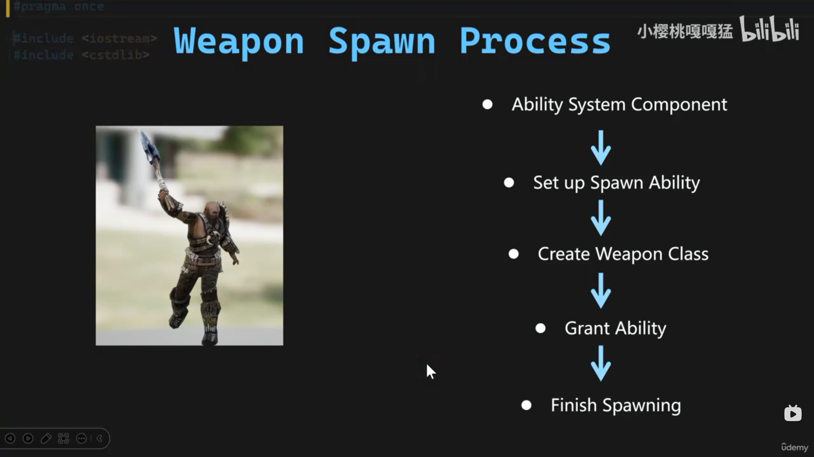
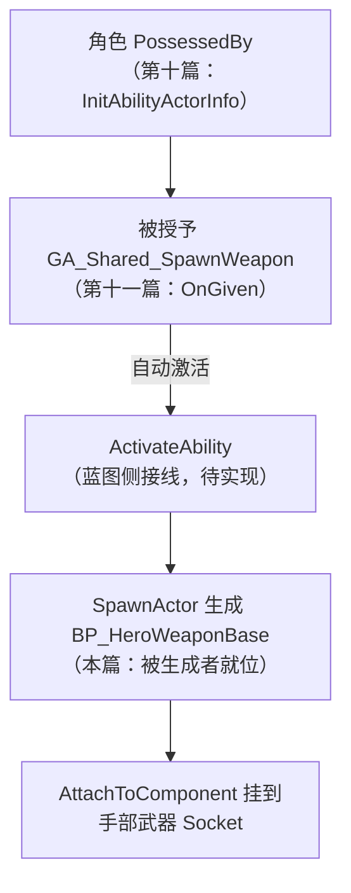

# 武器 Actor 基类与生成流程

`GA_Shared_SpawnWeapon` 立了"出生自带武器"的规矩，但"武器"本身还不存在——本篇把它造出来：`Items/Weapons` 下建武器 Actor 的双层基类（`WarriorWeaponBase` / `WarriorHeroWeapon`），网格作根、碰撞盒常闭，配出蓝图 `BP_HeroWeaponBase`。生成流程三个环节（角色初始化 → 授予 GA 自动激活 → 生成武器挂 Socket）前两环已就位，本篇补第三环的"被生成者"。

## 一、双层基类

```cpp
// Items/Weapons/WarriorWeaponBase.h
UCLASS()
class WARRIOR_API AWarriorWeaponBase : public AActor
{
    GENERATED_BODY()

protected:
    UPROPERTY(VisibleAnywhere, BlueprintReadOnly, Category="Weapons")
    UStaticMeshComponent* WeaponMesh;

    UPROPERTY(VisibleAnywhere, BlueprintReadOnly, Category="Weapons")
    UBoxComponent* WeaponCollisionBox;

public:
    FORCEINLINE UBoxComponent* GetWeaponCollisionBox() const { return WeaponCollisionBox; }
};
```

```cpp
// Items/Weapons/WarriorHeroWeapon.h
UCLASS()
class WARRIOR_API AWarriorHeroWeapon : public AWarriorWeaponBase
{
    GENERATED_BODY()
};
```

又是 Base / 派生 的双层结构，和角色侧 `WarriorBaseCharacter / WarriorHeroCharacter` 同构：**公共设施落 Base，阵营差异落派生**。英雄的斧头和敌人的镐子在"有个网格、有个碰撞盒"这一层完全一致；将来分道扬镳的是碰撞的打开时机、命中后的伤害逻辑——敌人武器命中英雄、英雄武器命中敌人，判定与响应各写各的派生类里。现在两个类都近乎空壳，`HeroWeapon` 层是给这些差异预留的座位。

放的位置是 `Items/Weapons/` 而不是 `Character/` 旁边——武器是场景里的"物品"，角色只是它暂时的挂接者；掉落、拾取、换装都会围绕"物品"做文章，目录结构跟着这个心智走。

## 二、构造函数：网格为根，碰撞常闭

```cpp
// Items/Weapons/WarriorWeaponBase.cpp
AWarriorWeaponBase::AWarriorWeaponBase()
{
    PrimaryActorTick.bCanEverTick = false;

    WeaponMesh = CreateDefaultSubobject<UStaticMeshComponent>(TEXT("WeaponMesh"));
    SetRootComponent(WeaponMesh);

    WeaponCollisionBox = CreateDefaultSubobject<UBoxComponent>(TEXT("WeaponCollisionBox"));
    WeaponCollisionBox->SetupAttachment(GetRootComponent());
    WeaponCollisionBox->SetBoxExtent(FVector(20.f));
    WeaponCollisionBox->SetCollisionEnabled(ECollisionEnabled::NoCollision);
}
```

每个决定都有说法：

- **网格作根组件**——武器的本体就是那把网格，位置、挂接、朝向都以它为参照。Actor 的根是谁，"这个 Actor 在哪"就由谁说了算；
- **碰撞盒挂在网格根部、半边长 20**——攻击判定的"剑锋"。这个盒不是用来做物理的，是给将来的战斗系统做**重叠检测**的窗口：挥砍到判定帧时由战斗代码打开碰撞，扫到重叠的敌人记一次命中，随后立刻关闭；
- **默认 `NoCollision`**——碰撞盒的一生几乎全程关闭，只在攻击判定窗口短暂打开。要是默认开着，武器会跟墙、跟地面、跟持有者自己发生物理互动，走两步把角色弹飞都有可能。"常闭、用时开"是武器碰撞的纪律；
- **`bCanEverTick = false`**——武器没有任何每帧逻辑，Tick 白挂在那就是白耗。本工程从角色到武器一律默认关 Tick，要动画有 AnimInstance、要逻辑有事件驱动，很少有非 Tick 不可的理由；
- **暴露档位**——两个组件 `VisibleAnywhere + BlueprintReadOnly`：C++ 构造创建、蓝图看得见改不了实例；`GetWeaponCollisionBox` FORCEINLINE 只放碰撞盒不放网格——将来读武器的是战斗系统，它只关心判定盒，网格是渲染的事，口子按需开。

## 三、蓝图与生成流程

`PlayerCharacter/HeroWeapon/` 下基于 `WarriorHeroWeapon` 建蓝图 **BP_HeroWeaponBase**，给 `WeaponMesh` 指定斧头静态网格（`Assets/Weapons/Axe` 里的 `SM_DefaultAxe`）。

至此，"出生自带武器"的三个环节凑齐了两环半：





流程图里前两环是前十篇的积累：角色初始化 ASC、GA 的 `OnGiven` 授予即激活。本篇备好"被生成的东西"——基类定义武器的骨架，蓝图填进具体的斧头网格。剩下的空心环节是下一阶段的活：GA 蓝图里接 `ActivateAbility`，从 `AvatarActor` 拿到角色，`SpawnActor` 生成武器后 `AttachToComponent` 挂到手部骨骼 Socket——届时角色右手凭空多出一把斧头，这条链路才算通灯。

## 四、细节与坑

1. **挂接写成 `SetRootComponent(GetRootComponent())`**——初稿的错：把根设成当前根，等于空操作；碰巧不炸是因为未显式挂接的场景组件默认就挂到根组件上、相对变换归零，最终效果与规范写法一致。但它没有表达"把碰撞盒挂到网格上"的意图，将来调整挂接层级（比如碰撞盒挂到某个骨骼）时这行不会跟着变。已改为 `WeaponCollisionBox->SetupAttachment(GetRootComponent())`。**挂接组件的动词是 `SetupAttachment`，`SetRootComponent` 只用于换根**——两个 Set 开头的函数都像"设置"，语义却完全不同；
2. **碰撞盒默认开着**——忘写 `SetCollisionEnabled(NoCollision)` 的话，武器一挂到手上就开始跟世界发生物理互动：蹭墙、绊脚、把角色顶得踉跄。武器碰撞的默认态必须是关，判定窗口由战斗代码显式开关；
3. **用 Box 而不是网格自身做碰撞**——静态网格自带碰撞是"贴合外形"的物理碰撞，形状复杂、开销大，而且做不了"比剑锋大一圈的判定余量"。Box 半边长 20 是刻意的手调值：判定区域是设计出来的，不是量出来的；
4. **Tick 忘关**——一把静止挂在手上的武器每帧空转 Tick，单体开销小，架不住"每个武器都这样"。默认关、要时开，和碰撞盒同一个纪律。

## 小结

- 武器 Actor 双层分层与角色同构：`WarriorWeaponBase` 放公共骨架（网格 + 碰撞盒），`WarriorHeroWeapon` 预留英雄侧差异，目录按"物品"归入 `Items/Weapons/`；
- 网格作根（武器本体即参照系），碰撞盒常闭（`NoCollision` 默认态，攻击判定窗口由战斗代码显式开关），Tick 默认关——"默认全关、用时显式开"是武器三大件的共同纪律；
- 暴露策略：组件 `VisibleAnywhere + BlueprintReadOnly` 蓝图可见不可换，仅碰撞盒给 FORCEINLINE getter——外部（战斗系统）只关心判定盒；
- 生成流程三环：ASC 初始化（已就位）→ `OnGiven` 自动激活（已就位，守卫存疑项见第十一篇警告框）→ 生成并挂接 Socket（蓝图 `BP_HeroWeaponBase` 已备好，GA 蓝图接线是下一步）；
- 挂接动词勘误一处：碰撞盒挂接由 `SetRootComponent(GetRootComponent())` 的空操作写法改为 `SetupAttachment(GetRootComponent())`——挂接用 `SetupAttachment`，换根才用 `SetRootComponent`。

下一步：GA 蓝图接线 `ActivateAbility`——`SpawnActor` 生成武器并挂到手部 Socket，让流程图通灯。
