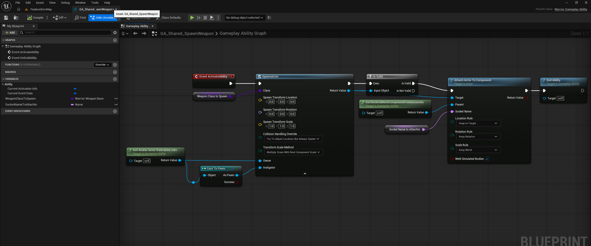
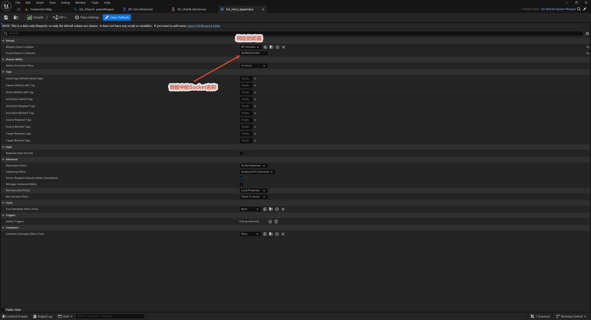
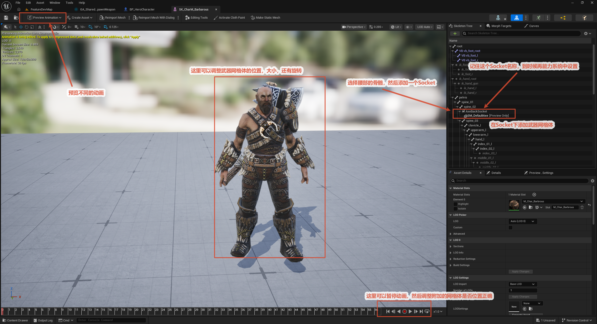
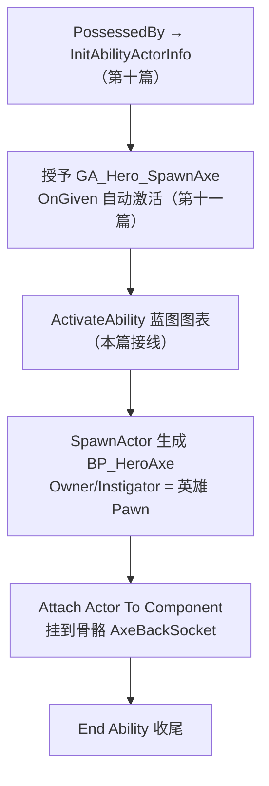

# 武器生成 GA 蓝图逐节点接线

第十二篇把"被生成者"（武器 Actor 双层基类 + BP_HeroWeaponBase）备好了，流程图只剩最后一个空心环节：GA 蓝图里接 `ActivateAbility`。本篇把 `GA_Shared_SpawnWeapon` 这张图逐节点接完，再用数据-only 子蓝图 `GA_Hero_SpawnAxe` 填上具体武器和挂点——进游戏，斧头背在英雄背上，链路通灯。

## 一、GA_Shared_SpawnWeapon：一张图，九个节点

执行主线只有四步：**ActivateAbility → SpawnActor → Is Valid → Attach → End Ability**，两条数据支流从旁边汇入——"身份支流"（谁的角色）与"挂点支流"（挂到哪）。逐个过：

### 1. Event ActivateAbility

能力激活的入口事件（C++ 侧 `K2_ActivateAbility`）。上一篇的激活策略 `OnGiven` 在这里兑现：能力被授予的瞬间自动 `TryActivateAbility`，不需要任何输入触发，事件节点自己就亮了。引擎对这张图有条硬约定：**逻辑走完必须调用 EndAbility**，有始有终。

### 2. Weapon Class to Spawn（变量获取）

`TSubclassOf<AWarriorWeaponBase>` 类型变量，决定生成什么武器。父蓝图只声明不填值——具体填什么，是子蓝图的事。这是整张图"共享逻辑、差异化数据"的第一个口子。

### 3. Get Avatar Actor from Actor Info

纯节点，从能力的 ActorInfo 里取"正在物理执行这个能力的 Actor"——这里就是英雄 Character 本尊。注意 Avatar ≠ Owner：AI 场景下 Owner 可能是 Controller，Avatar 才是场上那个实体。我们后面要挂骨骼、要认 Pawn，都得从 Avatar 出发。

### 4. Cast to Pawn

把 AvatarActor 转型成 `Pawn`。它保持的是**非纯形态**（带 Then / Cast Failed 执行引脚），但所有执行引脚都悬空——只走数据线：`As Pawn` 同时喂给 SpawnActor 的 **Owner** 和 **Instigator** 两个引脚。执行链不经过它，转型失败也只是这两个引脚落空，武器照样生成。

Instigator 值得记一笔，引擎自己的引脚说明写得很清楚：_"Pawn responsible for damage and other gameplay events caused by this actor"_——它是"这把武器造成的事算谁的"的归属凭据，将来碰撞与伤害系统都要读它。

### 5. Spawn Actor from Class

主力节点，四个关键配置：

- **Class** ← `WeaponClassToSpawn` 变量。因为类来自变量，节点的 Class 引脚显示泛型的 Actor Class Reference，Return Value 则被变量类型约束成 `WarriorWeaponBase` 引用；
- **Spawn Transform 拆分引脚全默认**——位置 (0,0,0)、旋转 (0,0,0)、缩放 (1,1,1)。出生位置无所谓：武器下一毫秒就会被挂到 Socket 上，位置由挂接规则重置（见第 9 个节点）；
- **Collision Handling Override = Adjust If Possible But Always Spawn**——生成点有碰撞物就微调躲避，实在躲不开也硬生成。"武器必须存在"比"武器出生在完美的点"重要；
- **Owner / Instigator** ← `As Pawn`。

### 6. Is Valid 宏

校验 SpawnActor 的 Return Value 是否有效。有效走 **Is Valid** 分支去挂接；**Is Not Valid 分支目前悬空**——这里有个坑，见细节与坑③。

### 7. Socket Name to Attachto（变量获取）

`Name` 类型变量，挂到哪个 Socket。又是父蓝图留空、子蓝图填值的差异化口子。

### 8. Get Skeletal Mesh Component from Actor Info

纯节点，返回 ActorInfo 里缓存的**骨骼网格组件**。有个文档陷阱：它的蓝图显示名叫 `GetSkeletalMeshComponentFromActorInfo`，C++ 真名却叫 `GetOwningComponentFromActorInfo`（引擎后来给加了 DisplayName 覆盖）——查源码时对不上号是常事。

挂接的 Parent 是它而不是角色的根组件：**挂 Socket 本质上是挂在骨骼网格组件上**，Socket 是骨骼的附属物，找错了父级连 Socket 的影子都摸不到。

### 9. Attach Actor To Component

挂接待遇。注意这是 **AActor 的成员函数**（ScriptName `AttachToComponent`），和 SceneComponent 上的同名函数（显示名 _Attach Component To Component_）是两个东西——前者 Target 收 Actor，后者 Target 收组件，查文档极易串行。

- **Target** ← 武器 Actor（SpawnActor 的 Return Value）；
- **Parent** ← 英雄骨骼网格组件；
- **Socket Name** ← `SocketNameToAttachto` 变量；
- 三条变换规则：**Location = Snap To Target**（位置完全贴齐 Socket，Spawn Transform 填零的底气就在这）、**Rotation = Keep Relative**（以相对零旋转对齐 Socket 朝向）、**Scale = Keep World**（保持世界缩放，角色自身的缩放不会传导给武器）；
- **Weld Simulated Bodies = true**（默认值，物理焊接，静态武器无感）。

### 10. End Ability

收尾，`Was Cancelled` 不勾（正常结束而非取消）。OnGiven 的一次性能力同样要显式关灯，否则这个能力的 spec 会一直处于激活态。

## 二、GA_Hero_SpawnAxe：零图表的子蓝图

基于 `GA_Shared_SpawnWeapon` 建子蓝图，**图表一个节点没动**，只在 Class Defaults 里填两个变量：

- `Weapon Class to Spawn` = **BP_HeroAxe**
- `Socket Name to Attachto` = **AxeBackSocket**

父蓝图管"怎么生成"，子蓝图管"生成什么、挂哪里"——和角色侧、武器侧如出一辙的分层。同一张共享图表，明天做敌人的镐子，再建一个 `GA_Enemy_SpawnPickaxe` 填两个变量就完事。

注意挂点是 **AxeBackSocket**——斧头先背在背上，不是提在手里。从背到手的持械切换（换 Socket）是后续课题。

## 三、BP_HeroAxe 与骨骼 Socket

武器侧同样只是填数据：`BP_HeroAxe` 基于 `BP_HeroWeaponBase` 建子蓝图，`WeaponMesh` 指定 `SM_DefaultAxe`。

Socket 加在**骨骼资产**上，而不是某个网格实例上——用这套骨骼的所有角色变体共享挂点。在骨骼编辑器里给背部骨骼添加 Socket、命名 `AxeBackSocket`，再把斧头静态网格设为预览资产对着调位姿：Socket 的位置旋转就是武器挂上后的最终对位（配合 Snap To Target 规则）。

至此第十二篇的流程图通灯：

## 四、细节与坑

1. **UE 5.8 小坑：Cast to Pawn 右键找不到 Convert to Pure Cast**。引擎的老毛病，自 5.1 起间歇性复现：右键菜单里的转换项偶尔整个不出现。绕行三招：① Editor Preferences → Blueprint Editor Settings 勾选 **Favor Pure Cast Nodes**，之后新拖的 Cast 默认纯；② 从别的蓝图复制一个纯 Cast 节点过来；③ 重启编辑器，选项常常自己回来。
2. **蓝图显示名 ≠ C++ 真名**。`Get Skeletal Mesh Component From Actor Info` 的源码名是 `GetOwningComponentFromActorInfo`（DisplayName 覆盖）；`Attach Actor To Component` 的 ScriptName 是 `AttachToComponent`，还和 SceneComponent 版撞名。读别人的蓝图、查引擎文档时，显示名和真名要各记一套；
3. **Is Not Valid 分支悬空**（先标记，未改）：生成失败（子蓝图忘配 WeaponClass、生成被拒）时执行链在这里断掉，EndAbility 不会被调用，能力永远处于激活态。更稳妥的接法是 Not Valid 也接 End Ability（勾上 Was Cancelled）；
4. **Spawn Transform 填零不是偷懒**。位置由 Snap To Target 贴齐 Socket 决定，出生变换只活一毫秒。反过来想明白这一点，就不会纠结"为什么不在生成时直接算好手部坐标"——挂接规则就是干这个的，且比手算坐标稳。

## 小结

- 执行主线四步：ActivateAbility → SpawnActor → Is Valid → Attach → End Ability；Cast 与两个变量获取是旁路数据支流；
- 差异化全靠两个实例可编辑变量：`WeaponClassToSpawn`（生成什么）、`SocketNameToAttachto`（挂哪里）——共享图表 + 数据-only 子蓝图，新增武器零图表成本；
- 挂接三要素：Target 武器 Actor、Parent 骨骼网格组件、Socket 名变量；规则组合 Snap To Target / Keep Relative / Keep World = 贴齐 Socket 位置、对齐 Socket 朝向、隔离父级缩放；
- Owner/Instigator 都填 As Pawn：Instigator 是伤害归属凭据，战斗系统将来要读；
- 坑三处：纯化 Cast 右键缺失（UE5.8 bug）、显示名与真名错位、Is Not Valid 悬空（已标记待改）。

下一步：斧头还背在背上——用启动数据资产（StartUpData）把能力和初始属性按数据表批量授予英雄，持械切换（AxeBackSocket ↔ 手部 Socket）紧随其后。
