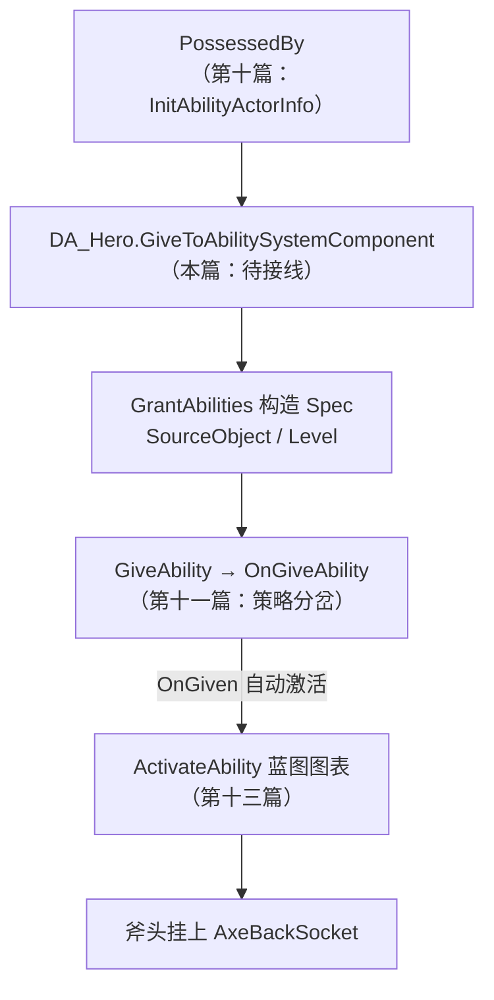

# 启动数据资产与能力批量授予

斧头能生成了，但 `GA_Hero_SpawnAxe` 还躺在内容浏览器里没人授予——上一遍链路的前提"被授予 GA"目前是手动假设。谁、在什么时候、把哪些能力塞给英雄？答案是一块**启动数据资产（StartUpData）**：能力清单写在资产里，授予逻辑写在 C++ 里，PossessedBy 时一次灌入。本篇造这套数据资产的双层基类，配出 `DA_Hero` 实例。

## 一、又是"双层基类 + 实例"


```cpp
UDataAsset ← UDataAsset_StartUpDataBase ← UDataAsset_HeroStartUpDataBase ← DA_Hero(实例)
```

和角色侧、武器侧、GA 侧同一个配方第三次上桌：

- **`DataAsset_StartUpDataBase`**——公共层：两个能力数组 + 授予逻辑。英雄、敌人、Boss 都会有一份自己的启动数据，但"怎么授予"只有一份；
- **`DataAsset_HeroStartUpDataBase`**——英雄层：现在是空类，**预留座位**。将来英雄特有的启动逻辑（比如按存档等级初始化属性）落这里，敌人侧将来平行长出 `DataAsset_EnemyStartUpDataBase`；
- **`DA_Hero`**——实例：真正填表的地方，建在 `PlayerCharacter/` 下。

选 `UDataAsset` 而不是 `UObject` 或 DataTable：它就是"一块纯数据"，编辑器里右键 Miscellaneous → Data Asset 即可创建实例，第五篇的 `DA_InputConfig` 同款路数——**行为进 C++，配置进数据资产**，这份工程反复在用。

## 二、授予逻辑：两个函数，两批能力

```cpp
// DataAsset_StartUpDataBase.h
UPROPERTY(EditDefaultsOnly, Category = "StartUpData")
TArray<TSubclassOf<UWarriorGameplayAbility>> ActiveOnGivenAbilities;

UPROPERTY(EditDefaultsOnly, Category = "StartUpData")
TArray<TSubclassOf<UWarriorGameplayAbility>> ReactiveAbilities;
```

两个数组是第十一篇激活策略在数据侧的镜像：**ActiveOnGivenAbilities** 收 `OnGiven` 策略的能力（授予即激活，出生自带斧头这类），**ReactiveAbilities** 收 `OnTriggered` 策略的能力（等输入或事件唤醒的反应型能力）。分类放在数据里而不是运行时 switch，授予代码对两批一视同仁，策略判断留给 GA 自己的 `OnGiveAbility`。

```cpp
void UDataAsset_StartUpDataBase::GiveToAbilitySystemComponent(
    UWarriorAbilitySystemComponent* InWarriorASCToGive, int32 ApplyLevel)
{
    check(InWarriorASCToGive);
    GrantAbilities(ActiveOnGivenAbilities, InWarriorASCToGive, ApplyLevel);
    GrantAbilities(ReactiveAbilities, InWarriorASCToGive, ApplyLevel);
}
```

对外的总入口：先 `check` 守卫（ASC 空指针属于程序员级错误，直接炸），然后两批依次灌入。`ApplyLevel` 默认 1，一路透传——将来敌人按关卡等级出生、属性随等级缩放，就从这一个参数进去。

```cpp
void UDataAsset_StartUpDataBase::GrantAbilities(
    const TArray<TSubclassOf<UWarriorGameplayAbility>>& InAbilitiesToGive,
    UWarriorAbilitySystemComponent* InWarriorASCToGive, int32 ApplyLevel)
{
    if (InAbilitiesToGive.IsEmpty()) return;

    for (const auto& Ability : InAbilitiesToGive)
    {
        if (!Ability) continue;
        FGameplayAbilitySpec AbilitySpec(Ability);
        AbilitySpec.SourceObject = InWarriorASCToGive->GetAvatarActor();
        AbilitySpec.Level = ApplyLevel;

        InWarriorASCToGive->GiveAbility(AbilitySpec);
    }
}
```

逐行有讲究：

- **空数组早退**——`ReactiveAbilities` 现在就是空的，不早退也只是空转一圈，但早退把"这批没有"挡在函数门口，语义干净；
- **逐项判空 continue**——数组是编辑器手填的，漏配一项不该炸掉整个启动流程，跳过即可（对比入口处的 `check`：内部数据宽容，外部调用严格）；
- **`FGameplayAbilitySpec`**——能力在系统里的"实例凭证"。同一个 GA 类可以被授予多次、给多个角色，Spec 才是运行时操作的句柄。构造时只填类，再补两个字段：
  - `SourceObject = GetAvatarActor()`——"这个能力从哪来的"。将来技能来源可以是装备、Buff、地形，SourceObject 是通用的溯源槽位；
  - `Level = ApplyLevel`——能力等级，GAS 的 cost/cooldown/效果都可以按 Level 缩放；
- **`GiveAbility(Spec)`**——ASC 的正式授予接口。它内部会走到 `OnGiveAbility`——第十一篇的激活策略分岔就在那里：`OnGiven` 的当场 `TryActivateAbility`，斧头落地；`OnTriggered` 的挂机待命。


## 三、DA_Hero：填表时刻

实例侧只干一件事——往数组里拖条目：

- `ActiveOnGivenAbilities` = **[GA_Hero_SpawnAxe]**
- `ReactiveAbilities` = 空（将来输入触发的攻击、翻滚类能力落这里）

至此"出生自带斧头"的全链路，材料全部就位：



## 四、细节与坑

1. **链路还差最后一根线**（本篇的边界）：`GiveToAbilitySystemComponent` 目前没有任何调用方——`WarriorHeroCharacter::PossessedBy` 里只做了 `InitAbilityActorInfo` 和输入绑定，还没有 StartUpData 的 UPROPERTY 和调用。下一步就是在 PossessedBy 里持住 `DA_Hero` 并灌入。另注意 `GiveAbility` 要求在权威端调用（内部有所有权断言），服务器上跑的 PossessedBy 天然满足，客户端重生的场景要留神；
2. **`WarriorGameplayAbility.h` 被 include 了两次**（DataAsset_StartUpDataBase.cpp 第 7、8 行，手误重复，include guard 挡住无害，下次顺手删一行——先标记未改）；
3. **守卫风格不统一**：入口用裸 `check`，而工程其他地方（PossessedBy 里的 InputConfig 检查）用带中文消息的 `checkf`。裸 check 炸出来只有一行断言地址，checkf 能直接告诉配置的人"哪个资产忘了填"。建议后续统一成 checkf——标记待改；
4. **数组 EditDefaultsOnly**——只能在模板/资产默认值里编辑，实例运行期改不了。对"出生配置"这是对的：出生清单是设计期定死的，不是运行时状态。

## 小结

- StartUpData 第四次复用"双层基类 + 实例"配方：`DataAsset_StartUpDataBase`（公共授予逻辑 + 两个能力数组）→ 空的英雄层预留座位 → `DA_Hero` 填表；
- 两个数组对应两种激活策略：ActiveOnGiven（授予即激活）/ Reactive（等触发），分类进数据、判断进 GA；
- 授予三件套：`FGameplayAbilitySpec`（运行时凭证）+ `SourceObject`（溯源槽）+ `Level`（等级缩放口），最后 `GiveAbility` 收口；
- 守卫分工：外部调用 `check` 严格炸，内部数据逐项判空宽容跳过；
- 链路唯一断点：PossessedBy 尚未调用 GiveToAbilitySystemComponent——下一根线。

下一步：`PossessedBy` 里接上最后一根线——角色持住 StartUpData 资产、权威端灌入 ASC，斧头真正背上背；持械切换（AxeBackSocket ↔ 手部）紧随其后。
