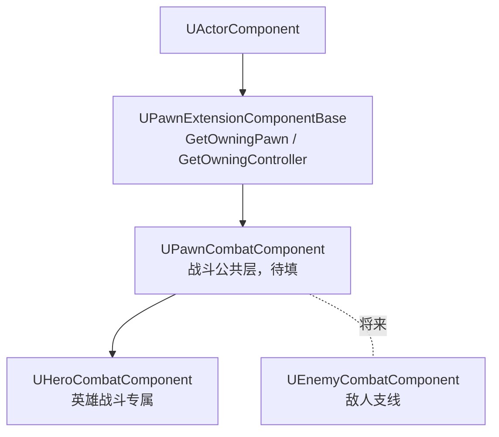

# 战斗组件三层骨架：PawnExtension 分层与 GetOwningPawn 模板

斧头已经背上背，持械切换的战斗逻辑不能全堆进角色类——先给战斗安个家。本篇一次立起三层组件：`UPawnExtensionComponentBase`（挂在 Pawn 身上的组件的公共底座）→ `UPawnCombatComponent`（战斗公共层）→ `UHeroCombatComponent`（英雄专属），英雄构造函数挂载、public getter 暴露。组件体目前全是空壳，这篇记的是分层的设计理由，以及底座里两个模板取值函数的防御写法。

## 一、三层层级：与角色分层同构



这与角色侧 `AWarriorBaseCharacter` → `AWarriorHeroCharacter` 的分层完全同构：Base 层放公共资产，子类层放差异化逻辑。两处设计判断值得展开：

**为什么中间要插一层 PawnExtension，而不是让 Combat 直接继承 ActorComponent？** 挂在 Pawn 身上的扩展组件，将来不止战斗一个——敌人的 AI 组件、别的什么组件，进门第一件事都是"我是谁身上的"。底座只回答**归属**问题（GetOwningPawn / GetOwningController），战斗层回答**业务**问题。归属逻辑写一份，所有扩展组件共用。

**为什么战斗逻辑进组件而不是角色类的成员函数？** 单一职责 + 可移植。GAS 的 GA 回答"做什么"（拔斧、挥击是一个个能力），战斗组件回答"**拿着什么**"——身上挂着哪些武器、当前手持哪把，这是角色状态而非能力行为。状态进了组件，逻辑就不再绑死 Character：任何 Pawn 挂上就能用，角色类也保持苗条。

## 二、GetOwningPawn\<T\>：static_assert + CastChecked

底座的核心资产就这两个函数：

```cpp
template<class T>
T* GetOwningPawn() const
{
    static_assert(TPointerIsConvertibleFromTo<T,APawn>::Value,
        "'T' Template Parameter get GetPawn must be derived from APawn");
    return CastChecked<T>(GetOwner());
}

APawn* GetOwningPawn() const
{
    return GetOwningPawn<APawn>();
}
```

这几个语法点——`static_assert` 怎么读、trait 的 `::Value` 是什么、`CastChecked` 与 `Cast` 的分界——在[查阅：特殊语法速查](查阅-特殊语法速查.md)里逐条展开，本节只记取舍：

- **`static_assert` + `TPointerIsConvertibleFromTo`**：类型约束在编译期挡死。传个 `AActor`、`UStaticMeshComponent` 进来，错误直接落在调用行，报的还是自定义字符串。模板代码的防御要前置到编译期——放到运行期才发现类型错，报出来的往往是被转换链污染过的含糊信息，定位成本高一个量级；
- **`CastChecked` 而非 `Cast`**：挂在 Pawn 身上的组件，Owner 必然是 Pawn，这是装配期就该成立的不变量。`Cast` 返回可空指针，会诱导调用方写判空——而判空分支恰恰掩盖了装配错误。`CastChecked` 期望不符直接断言崩溃：dev 期炸得早、炸得准；Shipping 默认剔除断言、退化为直接转型，零开销；
- **守卫分级的延续**：上一篇是"配置疏漏用 `ensureMsgf`"，这一篇是另一半——"代码不变量用 check 系"。忘填资产是人的疏漏，报个警告继续跑；Owner 类型错了是程序写错了，越早炸越好；
- 非模板重载是便捷入口：不关心具体子类时 `GetOwningPawn()` 少敲一对尖括号（"模板与非模板重载并存"的惯用法，详见[速查](查阅-特殊语法速查.md#模板重载与非模板重载并存)）。

## 三、GetOwningController\<T\>：必经 Pawn 中转

```cpp
template<class T>
T* GetOwningController() const
{
    static_assert(TPointerIsConvertibleFromTo<T,AController>::Value,
        "'T' Template Parameter get GetController must be derived from AController");
    return GetOwningPawn<APawn>() -> GetController<T>();
}
```

注意它复用的是 `GetOwningPawn` 而不是 `GetOwner`——组件到 Controller 没有直连边，Owner 是 Pawn，Controller 握在 Pawn 手里，必经一层中转。`GetController<T>()` 用的是 APawn 的模板重载，取值 + 转型一步完成，写 `GetOwningController<APlayerController>()` 拿到的直接就是玩家控制器指针。将来做受击归属、击杀统计时，从组件一步够到 Controller，不用每处重写这条链。

## 四、英雄侧挂载

```cpp
// WarriorHeroCharacter.h
class UHeroCombatComponent;   // 前置声明，头文件不引入依赖

UPROPERTY(VisibleAnywhere, BlueprintReadOnly, Category = "Combat",
    meta = (AllowPrivateAccess = "true"))
UHeroCombatComponent* HeroCombatComponent;

public:
    FORCEINLINE UHeroCombatComponent* GetHeroCombatComponent() const { return HeroCombatComponent; }
```

```cpp
// WarriorHeroCharacter.cpp 构造函数
HeroCombatComponent = CreateDefaultSubobject<UHeroCombatComponent>(TEXT("HeroCombatComponent"));
```

挂载四件套，每件都有来由：

- **`CreateDefaultSubobject`**：CDO 期创建，蓝图子类的细节面板里能看见这个组件——与相机臂、FollowCamera 同一套机制；
- **`VisibleAnywhere`**：延续上一篇的结论——代码创建的组件只读展示，不在蓝图默认值面板摆下拉框误导配置；
- **`AllowPrivateAccess = "true"`**：成员是 private 的，借 meta 的口子向蓝图只读开放，不必为暴露而放弃封装；
- **public getter 而非 GetComponentsByClass**：组件指针构造期就攥在手里，外部（GA 蓝图、输入绑定）经 getter 直取，零查找开销；按类遍历查找留给"组件不是自己创建"的场景。getter 一行的 `FORCEINLINE` 与头文件里的前置声明也是惯用搭配，语法细节见[速查](查阅-特殊语法速查.md)。

三层类体目前全空——这是刻意为之的脚手架提交：先把层级、挂载、访问通道立稳，下一份实质逻辑落进来时不再动结构。

## 小结

- 三层层级与角色分层同构：PawnExtension 管归属（取 Pawn / 取 Controller），PawnCombat 管战斗公共，HeroCombat 管英雄专属，敌人将来走自己的支线；
- 战斗状态进组件而非角色类：GA 管"做什么"，组件管"拿着什么"；
- 模板防御前置：`static_assert` 编译期挡错型，`CastChecked` 开发期断言不变量、Shipping 零开销——与 ensureMsgf 的守卫分级各守一半；
- 挂载四件套：CreateDefaultSubobject + VisibleAnywhere + AllowPrivateAccess + public getter。

下一步：往 HeroCombatComponent 里填第一份实料——武器登记（生成出的斧头交由组件持有），在此基础上打通"背后 ↔ 手中"的持械切换。
