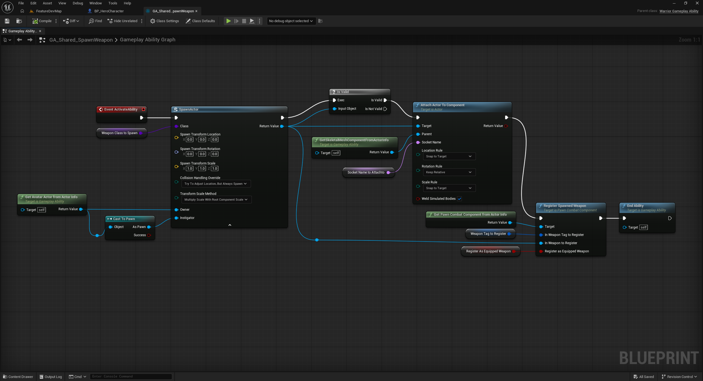
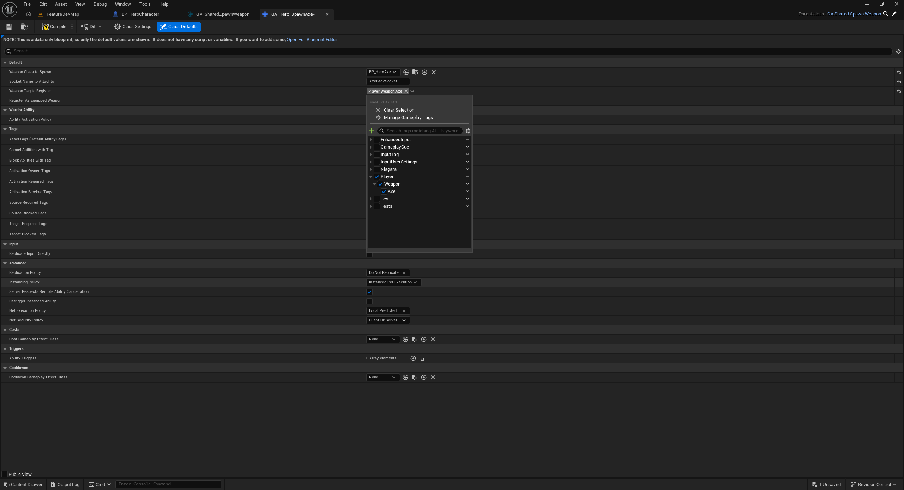
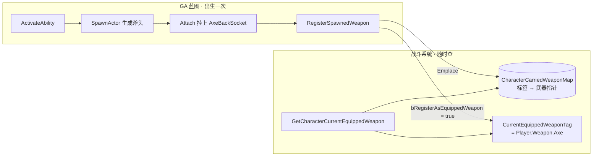

# 武器登记表：标签当钥匙，GA 直取战斗组件

三层的战斗组件骨架立好了，第一份实料落进来：给斧头发一张 GameplayTag 身份证，`UPawnCombatComponent` 里开一张以标签为钥匙的武器登记表，GA 基类再开一条直取战斗组件的通道——生成出来的斧头从此有名有账，将来持械切换要问"我拿着什么"时一步到位。

## 一、身份证先行：Player.Weapon.Axe 原生标签

登记表先得有钥匙。第四篇立好的 Native Gameplay Tags 体系再添一员（宏对两处出现的机制见[速查](查阅-特殊语法速查.md#native-gameplay-tags-宏对)）：

```cpp
// .h
/** Player tags **/
WARRIOR_API UE_DECLARE_GAMEPLAY_TAG_EXTERN(Player_Weapon_Axe);
// .cpp
UE_DEFINE_GAMEPLAY_TAG(Player_Weapon_Axe, "Player.Weapon.Axe");
```

为什么钥匙是 GameplayTag，而不是现成的其他候选：

- **不用枚举**：加一把剑就得改 C++ 全量重编译，且枚举进数据资产、配置表都不如标签通用；
- **不用裸字符串/FName**：拼错静默失效，错误藏到运行时——标签走 Native 常量，变量名拼错编译期就报；
- **不用武器名字**：`GetName()` 跟着资产改名走，改个名登记表就失联。`Player.Weapon.Axe` 的层级命名自带语义——"玩家的武器·斧"，将来 `Player.Weapon.Sword`、`Enemy.Weapon.Axe` 同住一个命名空间。

还有一个方向性问题：**钥匙放在角色侧的登记表里，而不是贴在武器 Actor 身上**。查询的方向永远是"这个 Pawn 拿着什么"——集中一张表，一次哈希直达；标签散在武器身上，问一句就得遍历所有武器。

## 二、登记表本体：一个私有 Map 配三个函数

```cpp
private:
    TMap<FGameplayTag, AWarriorWeaponBase*> CharacterCarriedWeaponMap;
```

写入只有一道门：

```cpp
void UPawnCombatComponent::RegisterSpawnedWeapon(FGameplayTag InWeaponTagToRegister,
    AWarriorWeaponBase* InWeaponToRegister, bool bRegisterAsEquippedWeapon)
{
    checkf(!CharacterCarriedWeaponMap.Contains(InWeaponTagToRegister),
        TEXT("A named %s has already been  as carried weapon"),
        *InWeaponTagToRegister.ToString());
    check(InWeaponToRegister);

    CharacterCarriedWeaponMap.Emplace(InWeaponTagToRegister, InWeaponToRegister);

    if (bRegisterAsEquippedWeapon)
    {
        CurrentEquippedWeaponTag = InWeaponTagToRegister;
    }

    Debug::Print(FString::Printf(TEXT("A weapon named: %s has been registered using the tag %s"),
        *InWeaponToRegister->GetName(), *InWeaponTagToRegister.ToString()));
}
```

逐处取舍：

- **`checkf` 挡重复注册**：同一标签登记两次不是配置疏漏、是代码写错了——哪个键该唯一是设计期定死的不变量，当场炸好过静默顶掉（`Emplace` 对已存在的键会直接覆盖旧值，所以这道守卫不是摆设）。守卫分级延续前两篇的线：配置疏漏用 `ensureMsgf`，代码不变量用 check 系（分级表见[速查](查阅-特殊语法速查.md#断言家族-check-checkf-ensure-ensuremsgf)）；
- **`bRegisterAsEquippedWeapon` 默认 false**：登记 ≠ 装备。表可以挂一堆武器，谁是"当前装备"是独立的一笔——蓝图里把它勾上 true 时 `CurrentEquippedWeaponTag` 才落位。注意**"装备"不等于"在手"**：斧头背在背上也算装备着，这个标签回答的是"身上哪把算主武器"，将来双武器、切换装备都从这里分岔；
- **Map 私有、登记走函数**：断言守卫不给蓝图绕过去的口子；而 `CurrentEquippedWeaponTag` 却公开 `BlueprintReadWrite`——切换装备的蓝图将来直接读写标签即可，这种"改一个已验证合法的键"的操作不需要二次包装。

读出两个函数：

```cpp
AWarriorWeaponBase* UPawnCombatComponent::GetCharacterCarriedWeaponByTag(FGameplayTag InWeaponTagToGet) const
{
    if (CharacterCarriedWeaponMap.Contains(InWeaponTagToGet))
    {
        if (AWarriorWeaponBase* const* FoundWeapon = CharacterCarriedWeaponMap.Find(InWeaponTagToGet))
        {
            return *FoundWeapon;
        }
    }
    return nullptr;
}

AWarriorWeaponBase* UPawnCombatComponent::GetCharacterCurrentEquippedWeapon() const
{
    if (!CurrentEquippedWeaponTag.IsValid())
    {
        return nullptr;
    }
    return GetCharacterCarriedWeaponByTag(CurrentEquippedWeaponTag);
}
```

- `Find` 返回的是**值的指针**——值本身已是武器指针，于是出现 `AWarriorWeaponBase* const*` 的双重指针，判空即"在不在"（`TMap` 的 Emplace/Find 语义见[速查](查阅-特殊语法速查.md#tmap-容器)）；
- `IsValid()` 挡空标签（标签判空见[API 速查](查阅-API速查.md#标签与数据资产)）：从没登记过装备的角色是空手——nullptr 在这里是**合法状态**而非错误，所以只判空返回、不断言。

## 三、GA 基类开通道：GetPawnCombatComponentFromActorInfo

```cpp
// WarriorGameplayAbility.h
class UPawnCombatComponent;   // 前置声明，头文件不引入组件依赖

UFUNCTION(BlueprintPure, Category = "Warrior|Ability")
UPawnCombatComponent* GetPawnCombatComponentFromActorInfo();

// .cpp
return GetAvatarActorFromActorInfo()->FindComponentByClass<UPawnCombatComponent>();
```

三个设计判断：

- **放 GA 基类而非每个蓝图自己连**：将来生成剑、切换装备的每个武器 GA 都要这条通道，写一次蓝图处处用——与"GetOwningPawn 进底座"同一个思路：归属查询公共化；
- **`FindComponentByClass` 兑现了上一篇留的那句话**——"按类遍历查找留给组件不是自己创建的场景"。战斗组件是角色构造期创建的，角色手里有 getter，但 GA 不认识具体角色类；Avatar 身上按类找，是它唯一也足够的通道（`FindComponentByClass` 用法见[API 速查](查阅-API速查.md#actor-与组件基础)）。顺带的好处：这条通道只要求"Avatar 身上有个 PawnCombatComponent"，不绑死英雄子类——敌人的 GA 将来照走；
- **`BlueprintPure`**：纯查询无副作用，蓝图里是无执行引脚的数据节点，随取随用（Callable 与 Pure 的分界见[速查](查阅-特殊语法速查.md#ufunction-的-callable-与-pure)）。

蓝图侧的替代方案是 GetAvatarActor → Cast to HeroCharacter → GetHeroCombatComponent 三步连——能走，但那个 Cast 把共享 GA 绑死在英雄子类上。这条 C++ 通道保住了"共享图表、差异化数据"的分层纯度。

## 四、蓝图接线：Attach 之后登记一步



共享图表的执行链在挂接之后、End Ability 之前多一步 **Register Spawned Weapon**：Target ← `Get Pawn Combat Component From Actor Info`（第三节通道的蓝图形态），In Weapon to Register ← SpawnActor 的 Return Value 直连，b Register As Equipped Weapon 勾上。标签口延续"父蓝图留口子、子蓝图填数据"的老模式——`GA_Hero_SpawnAxe` 的类默认值里把武器标签填成 Player.Weapon.Axe：



写入与读出从此闭环：



## 五、小瑕疵两处：断言文案语病与重复查询（标记待改）

1. **`checkf` 文案有语病**——`"A named %s has already been  as carried weapon"`：双空格中间缺了动词（应为 has already been **registered** as），开头的 "A named" 也丢了 weapon。断言真被触发时，这条消息帮不上排查的忙。待改，先不动；
2. **Contains + Find 双查询**——`Find` 本身找不到就返回 nullptr，判空一步到位；外层再包一层 `Contains` 是白做一次哈希查找，把最该优雅的取值函数写啰嗦了。标记，不擅改。

## 小结

- 武器钥匙用 GameplayTag 而非枚举/字符串/武器名：编译期防拼错、编辑器可扩展、层级自带语义；钥匙放角色侧登记表，查询一次哈希直达；
- 登记表 `TMap<FGameplayTag, AWarriorWeaponBase*>` 私有，写入只有 `RegisterSpawnedWeapon` 一道门——`checkf` 挡重复注册（Emplace 会静默覆盖，守卫不是摆设）；
- 登记 ≠ 装备：`bRegisterAsEquippedWeapon` 单独落位 `CurrentEquippedWeaponTag`（BlueprintReadWrite），"装备着哪把"与"身上有哪些"是两笔账；
- GA 基类 `GetPawnCombatComponentFromActorInfo` 用 `FindComponentByClass` 开通道：不绑死英雄子类，敌人 GA 将来通用；
- 两处待改已标记：断言文案语病、Contains+Find 冗余。
