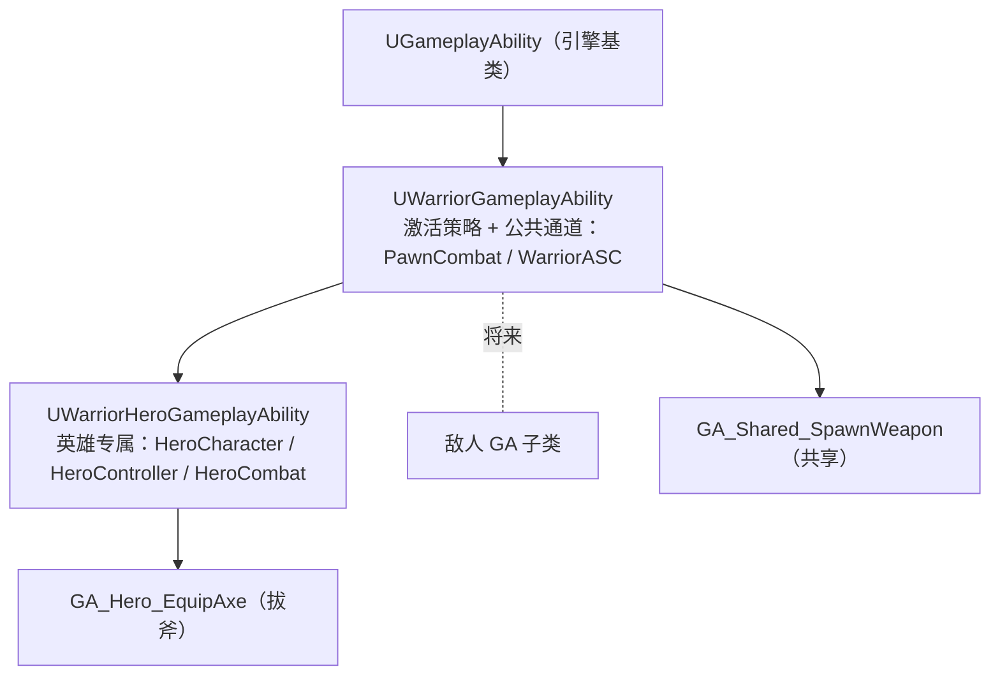

# 英雄 GA 子类：缓存式取值与 ASC 直取通道

登记表有了、基类到战斗组件的通道也通了，但"我的 Avatar 是哪个英雄、它的控制器是谁"这类英雄专属的问题，GA 基类一个都答不上——上一篇把组件通道特意做成 `FindComponentByClass`，就是为了不绑死英雄子类。本篇给 GA 分层再下一层：`UWarriorHeroGameplayAbility` 专门回答英雄侧的查询，取值走 TWeakObjectPtr 缓存；基类顺手再补一条通道，直取工程自定义的 ASC。

## 一、GA 分层第三处同构：公共进底座，专属进子类



这是继角色分层（BaseCharacter → HeroCharacter）、组件分层（PawnCombat → HeroCombat）之后的第三处同构。核心纪律是**公共层的代码不许认识子类**：

- 三个英雄专属 getter 若塞进基类，公共层就反向依赖了英雄子类——上一篇绕开 Cast to HeroCharacter 的原因原样适用，只是这次把依赖整个隔离成一层；
- 蓝图落点跟着分层走：`GA_Hero_EquipAxe` 换用新子类当父类（英雄专属），`GA_Shared_SpawnWeapon` 继续基于基类不动（共享）。"共享图表、差异化数据"再添一维——**共享基类、差异化子类**；
- 敌人 GA 将来基于自己的子类，照样能用基类的激活策略和两条公共通道，英雄的类型包袱一点不背。

## 二、三个英雄专属取值：TWeakObjectPtr 缓存

```cpp
// .h
private:
    TWeakObjectPtr<AWarriorHeroCharacter> CachedWarriorHeroCharacter;
    TWeakObjectPtr<AWarriorHeroPlayerController> CachedWarriorHeroController;

// .cpp
AWarriorHeroCharacter* UWarriorHeroGameplayAbility::GetHeroCharacterFromActorInfo()
{
    if (CachedWarriorHeroCharacter.IsValid())          // ← 条件写反了，见下一节
    {
        CachedWarriorHeroCharacter = Cast<AWarriorHeroCharacter>(CurrentActorInfo->AvatarActor);
    }
    return CachedWarriorHeroCharacter.IsValid() ? CachedWarriorHeroCharacter.Get() : nullptr;
}

AWarriorHeroPlayerController* UWarriorHeroGameplayAbility::GetHeroControllerFromActorInfo()
{
    if (CachedWarriorHeroController.IsValid())         // ← 同病
    {
        CachedWarriorHeroController = Cast<AWarriorHeroPlayerController>(CurrentActorInfo->PlayerController);
    }
    return CachedWarriorHeroController.IsValid() ? CachedWarriorHeroController.Get() : nullptr;
}

UHeroCombatComponent* UWarriorHeroGameplayAbility::GetHeroCombatComponentFromActorInfo()
{
    return GetHeroCharacterFromActorInfo() -> GetHeroCombatComponent();
}
```

设计意图（条件该是什么样下一节说，先把模式本身记清）：

- **为什么缓存**：`BlueprintPure` 的节点在蓝图里可能一帧取好几次，每次都 `Cast` 一遍反射链并不免费。首次 Cast 一份存进成员，之后直取——典型的惰性缓存；
- **为什么是 TWeakObjectPtr 而不是裸指针 / UPROPERTY 强引用**：缓存指针最怕两头——裸指针在角色被销毁后悬垂（崩在十万八千里外），强引用反过来钉住角色不让 GC 回收。GA 只是想"认识它"，不是"拥有它"，弱引用正好是中立姿态，对象没了自动失效（弱引用的缓存惯用法见[速查](查阅-特殊语法速查.md#tweakobjectptr-弱引用)）；
- **直取 `CurrentActorInfo->` 成员而不是走 getter**：`CurrentActorInfo` 是 GA 自带的运行时信息包，`AvatarActor` / `PlayerController` / `AbilitySystemComponent` 三个成员都是它缓存好的（直取口见[API 速查](查阅-API速查.md#gas-接入与能力生命周期)）。取控制器尤其受益——不必沿 Avatar → GetController 链绕，`InitAbilityActorInfo` 时 PlayerController 已经躺在里面；
- **战斗组件走 getter 而不是按类找**：英雄子类认识 `AWarriorHeroCharacter`，就直接用 16 篇的结论——组件指针构造期攥在角色手里，经 `GetHeroCombatComponent()` 零查找到手。与基类的 `FindComponentByClass` 通道对比出分层的味道：**基类不认识子类，按类找；子类认识，直取**。

## 三、真 bug：缓存条件写反，首次调用永远空手（待改）

两个缓存函数的守卫条件都少了一个 `!`。以角色版为例走一遍：

1. `TWeakObjectPtr` 默认构造出来就是**无效**的——`IsValid()` 返回 false；
2. 首次调用进不了 `if`，缓存**永远不会被填充**；
3. 第二次、第三次调用依旧无效依旧不填——函数**永远返回 nullptr**。

连锁反应直接踩在第三个函数上：`GetHeroCombatComponentFromActorInfo()` 里 `GetHeroCharacterFromActorInfo()` 拿回的是空指针，`-> GetHeroCombatComponent()` 当场解引用空指针。`GA_Hero_EquipAxe` 的图表一旦调用这组函数就是崩溃——**蓝图还没接线，雷还没踩响，但代码层面这组通道目前一步都走不通**。

正确形态是"**无效才填充**"：

```cpp
if (!CachedWarriorHeroCharacter.IsValid())
{
    CachedWarriorHeroCharacter = Cast<AWarriorHeroCharacter>(CurrentActorInfo->AvatarActor);
}
```

待改，先不动。

## 四、基类再补一条通道：GetWarriorAbilitySystemComponentFromActorInfo

```cpp
// WarriorGameplayAbility.h —— 与组件通道并排
UFUNCTION(BlueprintPure, Category = "Warrior|Ability")
UWarriorAbilitySystemComponent* GetWarriorAbilitySystemComponentFromActorInfo() const;

// .cpp
return Cast<UWarriorAbilitySystemComponent>(CurrentActorInfo->AbilitySystemComponent);
```

- **放基类而非英雄子类**：ASC 不是英雄专属——`AWarriorBaseCharacter` 构造期创建的就是 `UWarriorAbilitySystemComponent`，敌人将来同用。`FromActorInfo` 后缀的命名家族从此有两个成员，蓝图里一眼认出"这是 GA 问 ActorInfo 要东西"的通道；
- **`Cast` 直接喂弱引用**：`CurrentActorInfo->AbilitySystemComponent` 本身是 `TWeakObjectPtr`，`Cast` 有接受弱引用的重载，不必先 `.Get()` 再转（Cast 的输入形态见[速查](查阅-特殊语法速查.md#cast-与-castchecked)）。这里用 `Cast` 而非 `CastChecked` 值得一句：ASC 的类型虽然是 BaseCharacter 构造写死的，按"代码不变量用 check 系"的分级线够得上 CastChecked，但取 Cast 给将来的非标准 Avatar 留了余地——返回可空，调用方判空即退，不算违和；
- **`const` 补上了**：Pure 配 const 是惯例线——上一篇速查里点名过 `GetPawnCombatComponentFromActorInfo` 漏了 const，这次新函数带上了，新老通道一正一欠（Pure 与 const 的约定见[速查](查阅-特殊语法速查.md#ufunction-的-callable-与-pure)）。

## 小结

- GA 分层第三处同构：公共通道留基类（不认识子类），英雄专属查询进 `UWarriorHeroGameplayAbility`，敌人将来走自己支线；蓝图落点跟着分层走——`GA_Hero_EquipAxe` 基于英雄子类，共享蓝图继续基于基类；
- 缓存式取值 = TWeakObjectPtr 成员 + 无效才填充 + 三元判空返回：Cast 只做一次、弱引用既不悬垂也不钉 GC、nullptr 是合法返回；
- 真 bug 待改：两个缓存函数条件都少了 `!`，首调用起永远返回 nullptr，`GetHeroCombatComponentFromActorInfo` 连锁空指针——整组通道当前一步都走不通；
- 基类新增 `GetWarriorAbilitySystemComponentFromActorInfo`：ActorInfo 里的 ASC 是弱引用，Cast 直取；新函数带上了 const，老通道还欠着。
