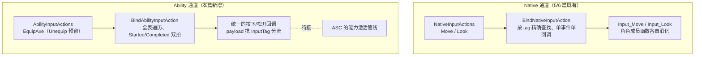
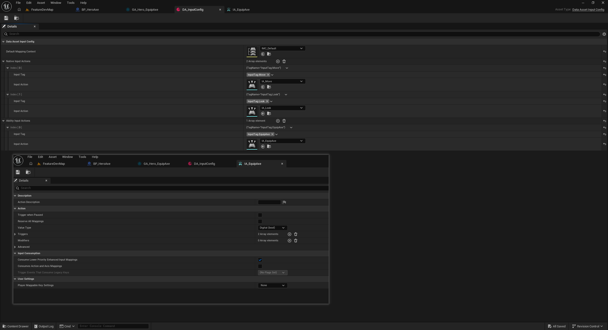

# 能力输入通道：AbilityInputActions 与按松双拍绑定

GA 侧的三层通道备齐了，但 `GA_Hero_EquipAxe` 至今没有触发来源——玩家按下按键，事件得先穿过输入系统才算碰到能力的门。Move/Look 走的 Native 绑定是"角色自己消化"的管线，能力输入的目的地是 ASC，形态两样。本篇在输入配置资产和输入组件里开出第二条通道：`AbilityInputActions` 数组 + `BindAbilityInputAction` 模板。

## 一、Native 与 Ability 分家：绑定形态决定数据结构



两条通道的差异不是"多几个条目"，而是**绑定形态整个不同**：

- **回调各不相同 vs 回调完全统一**：Move 和 Look 的处理函数是两个不同的成员函数，必须按 tag 精确找到各自的 IA 再分别绑；能力输入的按下/松开将来统一转发给 ASC，所有条目共用一对回调；
- **单事件 vs 两拍**：Native 绑定由调用方指定 `ETriggerEvent`；能力输入天然是"按下做什么、松开做什么"两拍，绑定点固定成对。

所以 `AbilityInputActions` 另开一个数组而不是塞进 `NativeInputActions`：塞一起就得在绑定逻辑里按 tag 分流"谁是 Native 谁是能力"，不如在数据资产层面分家——**数组边界就是绑定形态的边界**。两个数组同款 `meta=(TitleProperty="InputTag")`，编辑器里条目名直接显示 tag（TitleProperty 见[速查](查阅-特殊语法速查.md#uproperty-暴露档位与-meta)）：



资产侧同步的动作：新建 `IA_EquipAxe` 输入动作资产、tag 侧声明 `InputTag_EquipAxe` / `InputTag_UnequipAxe` 两个 Native 常量。`UnequipAxe` 目前只有声明——数组里还没条目，是给收刀预留的坑位。

## 二、FWarriorInputActionConfig 长出 IsValid()：条目自检

结构体添了一个成员函数：

```cpp
bool IsValid() const
{
    return InputTag.IsValid() && InputAction;
}
```

- **USTRUCT 可以有成员函数**：反射宏管的是属性暴露，纯 C++ 行为照常写——`FGameplayTag::IsValid()` 自己就是这么长的；
- **判定是两个字段各查各的**：tag 用 `FGameplayTag::IsValid()` 判空（空标签是合法状态，拼错/未设置都是它，见[API 速查](查阅-API速查.md#标签与数据资产)）；IA 是裸指针直接作 bool——UObject 指针的惯用判空；
- **为什么绑定期逐条自检**：数组是编辑器手填的，漏填 tag 或漏挂 IA 都是常态级失误。绑定期 `IsValid()` 短路跳过，脏条目静默淘汰而不是崩游戏——配置错误在编辑器里表现为"按了没反应"，比运行时崩溃友好得多。

## 三、BindAbilityInputAction：全表遍历、两拍绑定、payload 携 tag

```cpp
template <class UserObject, typename CallbackFunc>
inline void UWarriorInputComponent::BindAbilityInputAction(const UDataAsset_InputConfig* InInputConfig,
	UserObject* ContextObject, CallbackFunc InputPressedFunc, CallbackFunc InputReleasedFunc)
{
	checkf(InInputConfig, TEXT("输入配置为空，无法进行绑定操作"));

	for (const FWarriorInputActionConfig AbilityInputActionConfig : InInputConfig->AbilityInputActions)
	{
		if (!AbilityInputActionConfig.IsValid()) continue;

		BindAction(AbilityInputActionConfig.InputAction, ETriggerEvent::Started,   ContextObject, InputPressedFunc,  AbilityInputActionConfig.InputTag);
		BindAction(AbilityInputActionConfig.InputAction, ETriggerEvent::Completed, ContextObject, InputReleasedFunc, AbilityInputActionConfig.InputTag);
	}
}
```

三个设计与 Native 版的分岔点：

- **`Started` / `Completed` 两拍，不是 `Triggered`**：`Started` 是按下瞬间触发一次，`Completed` 是松开瞬间触发一次——按键式能力的标准档；Move/Look 用的 `Triggered` 是按住期间持续触发，套在能力上会变成"按住期间每帧请求激活"（三档语义见[API 速查](查阅-API速查.md#输入管线)）；
- **`BindAction` 第 5 参是 payload，tag 随按键透传进回调**：这个重载把第 5 参起的实参原样塞进回调的参数表——所以回调签名要收一个 `FGameplayTag`，按下 EquipAxe 时回调收到 `InputTag.EquipAxe`，按下将来的收刀键收到 `InputTag.UnequipAxe`。**一个统一回调靠参数分流所有能力输入**，不必每个能力各写一个按下函数；
- **全表遍历而不是按 tag 查找**：Native 版是"拿 tag 当查找键找 IA"（`FindNativeInputActionByTag`），因为每个 tag 的回调不同；这里反过来——回调统一、tag 是数据，**数据当 payload 传过去，而不是当键来找回调**。

一个模板吃两个回调参数而不是一个：按/松在能力系统里语义不同（按下请求激活、松开参与结束判定），两个时机各绑各的回调函数，正是后面 ASC 侧 Pressed/Released 两条转发线的形状。

## 四、通道就绪，两端待接

现状清点：`SetupPlayerInputComponent` 里仍然只绑 Move/Look 两条 Native 输入（`WarriorHeroCharacter.cpp`），`BindAbilityInputAction` 在 C++ 侧还没有调用点；ASC 侧的 Pressed/Released 转发也没落。本篇交出的是中间那截管子——配置资产里有数组、输入组件里有模板，按下 `IA_EquipAxe` 之后事件去哪，等下一截接上。

## 五、小坑：遍历按值拷贝，防御线两模板不一致（待改）

- **range-for 按值拷贝**：`for (const FWarriorInputActionConfig X : ...)` 每轮拷一份结构体。本例结构体只有 tag 指针 + IA 指针，拷贝廉价不伤性能，但"只读遍历一律 `const &`"是零成本的习惯线，待改；
- **两个模板的断言防御不一致**：老模板 `BindNativeInputAction` 里的 `check(InInputConfig)` 被注释掉了（入口 `SetupPlayerInputComponent` 已经 `checkf` 过数据资产，进来必非空），新模板反而自带一条带中文消息的 `checkf`——第二道防线不算错，只是两条通道的防御位置不统一，读代码时会疑惑"为什么一个敢裸奔一个双重保险"。

另外老模板这次补了 `inline`：模板靠隐式实例化本来就把 ODR 豁免了，不写也链得过；写上无害，算是给读代码的人一个"此函数全工程一份"的信号（模板为什么必须定义在头文件里见[速查](查阅-特殊语法速查.md#模板成员函数)）。

## 小结

- 输入分两通道：Native 输入回调各异、按 tag 精确查找；能力输入回调统一、全表遍历批量绑——数组边界就是绑定形态的边界，`AbilityInputActions` 独立成表；
- `FWarriorInputActionConfig::IsValid()` 把条目自检升格成结构体谓词：tag 判空 + 指针作 bool，绑定期脏条目静默淘汰不崩游戏；
- `BindAbilityInputAction` 的三件套：`Started`/`Completed` 两拍（按键式能力标准档，不用 `Triggered`）、payload 把 tag 透传进回调（一个回调分流所有能力）、两个回调参数对应按/松两条转发线；
- 两端待接：C++ 侧无调用点、ASC 侧转发未落，本篇交的是中间那截管子；range-for 按值拷贝待改。
