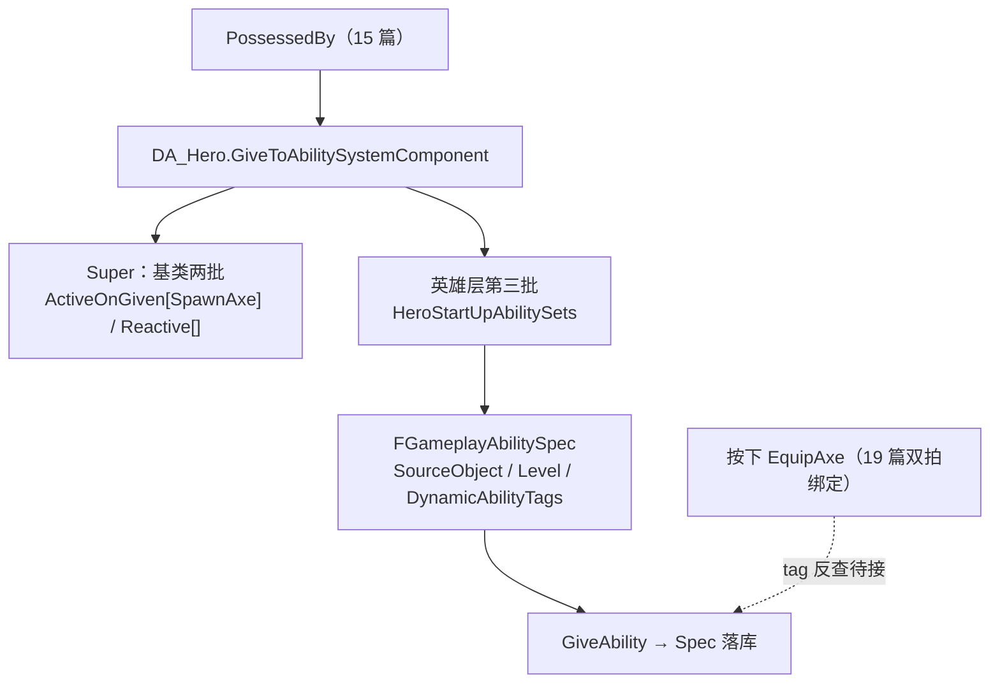
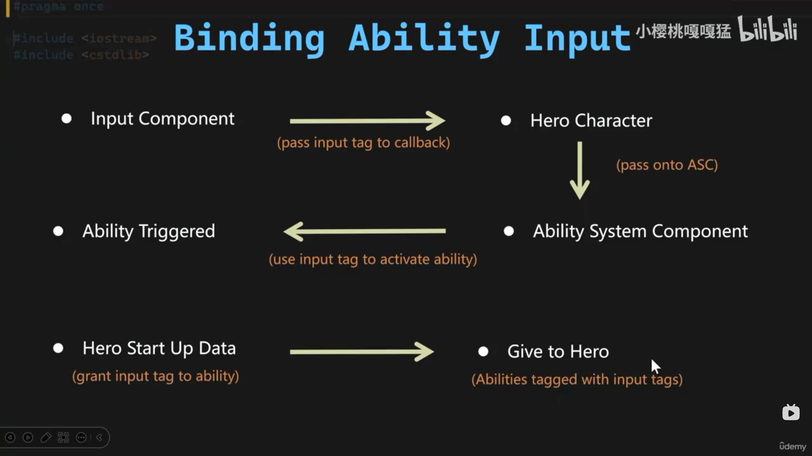

# 能力授予挂输入tag与DynamicAbilityTags

按松双拍的绑定模板备好了，ASC 侧接住之后还差一步"认人"：按下 EquipAxe 的瞬间，ASC 凭什么知道该激活的是 GA_Hero_EquipAxe 而不是别的？答案要在授予时刻就写好——把输入 tag 随能力一起塞进它的运行时凭证。本篇给英雄启动数据资产长出第三批条目："能力 + 输入 tag"成对的结构体数组，并覆写授予函数把它灌进 ASC。

## 一、第三批能力：能力与输入 tag 必须原子配对

基类手里已经有两批能力（14 篇）：ActiveOnGiven（授予即激活，SpawnAxe 在此）和 Reactive（等触发）。GA_Hero_EquipAxe 看似该进 Reactive——它确实是等输入唤醒的——但比 Reactive 条目多一个维度：**绑在哪个键上**。基类数组的元素是光秃秃的 `TSubclassOf`，装不下配对的 tag，所以英雄层自己开一张结构体表：

```cpp
USTRUCT(BlueprintType)
struct FWarriorHeroAbilitySet
{
	GENERATED_BODY()

	UPROPERTY(EditDefaultsOnly, BlueprintReadOnly, meta = (Categories = "InputTag"))
	FGameplayTag InputTag;

	UPROPERTY(EditDefaultsOnly, BlueprintReadOnly)
	TSubclassOf<UWarriorGameplayAbility> AbilityToGrant;

	bool IsValid() const;
};
```

四个设计点：

- **struct 数组而不是"能力数组 + tag 数组"两张平行表**：配对信息拆开后只能靠下标对齐，第几项对第几项全凭人肉——中途插一行删一行就整体错位。struct 把"这个能力绑这个键"做成原子条目，**结构体边界就是配对边界**，与 19 篇"数组边界就是绑定形态的边界"是同一条原则的两次落地；
- `Categories = "InputTag"` 把标签下拉框限死在 InputTag 父级之下（meta 见[速查](查阅-特殊语法速查.md#uproperty-暴露档位与-meta)），手滑选到事件类标签在编辑期就挡住；
- 字段类型收在 `UWarriorGameplayAbility`——18 篇把 GA_Hero_EquipAxe 换到 WarriorHeroGameplayAbility 门下之后，这个槽正好装得下它；
- `IsValid()` 谓词第二次上桌，与 19 篇 `FWarriorInputActionConfig::IsValid()` 同款配方：tag 用 `FGameplayTag::IsValid()` 判空、`TSubclassOf` 直接作 bool（[API 速查](查阅-API速查.md#标签与数据资产)）。理由也同款——数组是编辑器手填的，脏条目授予期静默淘汰，好过运行时炸。

另注意头文件顶部多了 `#include "GameplayTagContainer.h"`：`FGameplayTag` 不在 CoreMinimal 的覆盖范围里，成员用到就得显式带上。

## 二、覆写授予函数：先 Super 后自家

```cpp
void UDataAsset_HeroStartUpDataBase::GiveToAbilitySystemComponent(
	UWarriorAbilitySystemComponent* InASCToGive, int32 ApplyLevel)
{
	Super::GiveToAbilitySystemComponent(InASCToGive, ApplyLevel);

	for (const FWarriorHeroAbilitySet& AbilitySet : HeroStartUpAbilitySets)
	{
		if (!AbilitySet.IsValid()) continue;

		FGameplayAbilitySpec AbilitySpec(AbilitySet.AbilityToGrant);
		AbilitySpec.SourceObject = InASCToGive->GetAvatarActor();
		AbilitySpec.Level = ApplyLevel;
		AbilitySpec.DynamicAbilityTags.AddTag(AbilitySet.InputTag);

		InASCToGive->GiveAbility(AbilitySpec);
	}
}
```

第一行 `Super` 是职责分层：基类先灌它的两批（SpawnAxe 照旧出生激活），英雄层接着灌自家的输入绑定批——**"怎么授予"的公共流程留在基类，"英雄特有批次"落在子类**，将来敌人的启动数据资产不碰这张表。循环体与 14 篇 `GrantAbilities` 同构，只多一行 `DynamicAbilityTags.AddTag`。

顺带一个好现象：range-for 这次用了 `const&`——19 篇给输入组件模板标记的"按值拷贝待改"，在新代码里没有再犯。

## 三、DynamicAbilityTags：tag 挂 Spec，不挂 GA 类

新增的那行是本篇题眼。"用 tag 关联能力"有两个候选挂点，选了 Spec 而不是 GA 类：

- **挂 GA 类（AbilityTags）**：类固有属性，这个类**所有授予实例**共享同一组 tag——同一个 GA 类想按两个键授予两份，做不到；
- **挂 Spec（DynamicAbilityTags）**：**"这一次授予"的附加属性**，随凭证走。同一个 GA 类可以带不同输入 tag 授予多次互不干扰——tag 是数据，不是类型身份。

这也是 ASC 输入管线的标准对接方式：按下 EquipAxe 之后，ASC 在已落库的 Spec 里反查"DynamicAbilityTags 含 InputTag.EquipAxe 的那一份"去激活。GAS 早期用 int32 InputID 做这个关联，tag 匹配是取代它的现行路线（`DynamicAbilityTags`、ASC 侧 `GetAvatarActor()` 见[API 速查](查阅-API速查.md#gas-接入与能力生命周期)）。

对照 19 篇有个对称的观察：**同一个输入 tag 在管线两段扮演两种角色**——输入组件侧它是 payload（随按键透传进回调的数据），ASC 侧它是查找键（拿 tag 反查 Spec）。本篇把 Spec 侧的名牌挂好，管子接上就能认人。



## 四、DA_Hero 填表：EquipAxe 挂上输入名牌



资产侧只添一条：`InputTag.EquipAxe` → `GA_Hero_EquipAxe`。收刀用的 `InputTag_UnequipAxe`（19 篇声明的坑位）等收刀 GA 出现再进这张表。

## 五、两端仍待接，一处存疑的 include

- **管子还差两截**：`BindAbilityInputAction` 在 C++ 侧仍无调用点；ASC 侧"收到按下 → 按 tag 反查 Spec → 请求激活"的转发也还没写。本篇交出的是 Spec 侧的名牌，不是整条通线；
- **include 疑似借道**（存疑待确认）：cpp include 的是 `WarriorHeroGameplayAbility.h`，但全文只用到 `UWarriorGameplayAbility`——子类头文件捎带出了基类所以编得过，直接 include 基类头文件（与基类 cpp 同款）更贴。无害，标记不改。

## 小结

- 第三批能力条目 `FWarriorHeroAbilitySet`：能力与输入 tag 原子配对进 struct，不拆两张平行数组靠下标对齐——配对边界即结构体边界；
- 覆写 `GiveToAbilitySystemComponent` 先 Super 后自家：公共授予流程在基类，英雄特有批次在子类，敌人资产将来不复用这张表；
- `DynamicAbilityTags` 挂 Spec 不挂 GA 类：tag 是"这一次授予"的数据而非类型身份，同一 GA 类可按不同键授予多份；
- tag 的两种角色：输入组件侧是 payload，ASC 侧是查找键——Spec 名牌已挂好，两端转发线仍待接。
