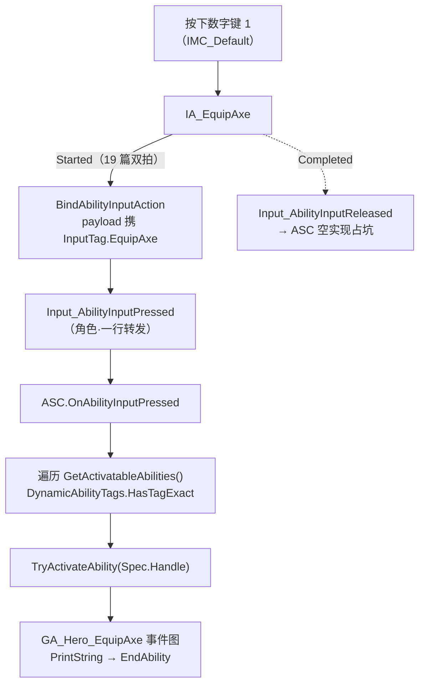

# 能力输入通线：角色转发与ASC反查激活

20 篇末尾点过名：Spec 的名牌挂好了，管子还差两截——`BindAbilityInputAction` 没有 C++ 调用点，ASC 侧"收到按下 → 反查 Spec → 请求激活"的转发也没落。本篇把两截一次接上，再把 IMC 的键位和 GA 的事件图点亮：按下数字键 1，蓝图里打出"装备能力已激活"，能力输入线第一次全线贯通。

## 一、角色侧：一行转发，不消化只递话

调用点落在 `SetupPlayerInputComponent` 尾部，与 Move/Look 两条 Native 绑定并排（`SetupPlayerInputComponent` 作为回调时机见[API 速查](查阅-API速查.md#输入管线)）：

```cpp
WarriorInputComponent->BindNativeInputAction(InputConfigDataAsset, WarriorGameplayTags::InputTag_Move, ETriggerEvent::Triggered, this, &ThisClass::Input_Move);
WarriorInputComponent->BindNativeInputAction(InputConfigDataAsset, WarriorGameplayTags::InputTag_Look, ETriggerEvent::Triggered, this, &ThisClass::Input_Look);

WarriorInputComponent->BindAbilityInputAction(InputConfigDataAsset, this, &ThisClass::Input_AbilityInputPressed, &ThisClass::Input_AbilityInputReleased);
```

19 篇的双拍模板首次上岗。角色侧的两个回调是彻底的一行转发：

```cpp
void AWarriorHeroCharacter::Input_AbilityInputPressed(FGameplayTag InputPlayTag)
{
	WarriorAbilitySystemComponent->OnAbilityInputPressed(InputPlayTag);
}
```

- **角色是中转站不是加工厂**：Move/Look 的处理函数在角色里就地消化成移动和视角；能力输入角色无权解释——"这个 tag 该不该激活、怎么激活"是 ASC 和 GA 的裁判权。差异落在函数体量上：Native 回调十几行业务，能力回调一行转交；
- **命名对照见职责交接**：`Input_AbilityInputPressed`（`Input_` 前缀 = 输入管线回调，与 `Input_Move` 同族）转给 `OnAbilityInputPressed`（`On...` = 被通知方的动作）——两套前缀隔着一次"输入系统 → 能力系统"的交接，与 18 篇 `OnGiveAbility`"授予的落点通知"是同一命名思路；
- **`FGameplayTag` 按值传**：内部就是一个 FName 索引句柄，拷贝成本等于拷个 int，按值收发是标签的标准姿势，不必上 `const &`。

头文件侧只需 `struct FGameplayTag;` 一句前置声明——函数**声明**的参数允许不完整类型，完整定义延迟到 cpp（前置声明机制见[速查](查阅-特殊语法速查.md#前置声明class-uherocombatcomponent)）。

## 二、ASC 侧：按 tag 反查 Spec 并请求激活

```cpp
void UWarriorAbilitySystemComponent::OnAbilityInputPressed(const FGameplayTag& InInputTag)
{
	if (!InInputTag.IsValid()) return;

	for (const FGameplayAbilitySpec& AbilitySpec : GetActivatableAbilities())
	{
		if (!AbilitySpec.DynamicAbilityTags.HasTagExact(InInputTag)) continue;

		TryActivateAbility(AbilitySpec.Handle);
	}
}

void UWarriorAbilitySystemComponent::OnAbilityInputReleased(const FGameplayTag& InInputTag)
{
}
```

20 篇挂的名牌在这里兑现成查找键。四个设计点：

- **`HasTagExact` 而不是 `HasTag`**：后者允许层级匹配——容器里的父标签会匹配子级查询（[API 速查](查阅-API速查.md#标签与数据资产)）。输入 tag 是逐字配对的"名牌"不是层级分类：`InputTag.EquipAxe` 只该匹配一字不差的同名 Spec，父级误伤（比如谁往 Spec 上挂了个光秃秃的 `InputTag`）要在这一行杜绝；
- **命中后不 `break`**：循环把所有匹配的 Spec 逐一尝试激活。20 篇说过"同一个 GA 类可带不同 tag 授予多份"，镜像场景是**同一个 tag 也可以挂多份 Spec**——一个键触发多条能力的批量场景，这行循环天然支持；
- **线性遍历而不是 tag→Spec 缓存表**：`GetActivatableAbilities()` 返回已授予 Spec 容器的 const 引用（[API 速查](查阅-API速查.md#gas-接入与能力生命周期)），"角色身上几十个能力"的数量级线性扫一次无感知；授予/移除随游戏进程增删频繁，维护一张缓存表的失效风险高于省下的那点遍历；
- **`IsValid()` 兜底**：绑定模板在绑定前已经过滤过脏条目（19 篇），这里是转发链末端再守一道——将来 `OnAbilityInputPressed` 的调用方不会只有输入绑定（AI 侧、GA 内部手动调都可能进来），入口自保不指望上游全员可靠。

`Released` 空实现是占坑：19 篇"按下/松开语义不同"的落点——按住型、蓄力型能力的结束判定走松开拍，EquipAxe 只消费按下拍，管子先铺到，水以后再放。另外 range-for 这次是 `const FGameplayAbilitySpec&`，19 篇给输入模板标记的按值拷贝毛病没有复发。

## 三、蓝图侧：1 键挂上，事件图点亮

C++ 三层之外，编辑器侧两步收尾：

- **IMC_Default**：新增一行映射，`IA_EquipAxe` 挂在数字键 **1** 上（Move/Look 之外的第三行）。至此 19 篇 `AbilityInputActions` 条目的三件套配齐：IA 资产、IMC 键位、输入 tag；
- **GA_Hero_EquipAxe 事件图**：`Event ActivateAbility` → PrintString（InString 填"装备能力已激活"）→ `EndAbility`（Was Cancelled = false）收尾。图里还躺着 18 篇的三个直取 getter 节点（GetHeroCharacter / GetHeroCombatComponent / GetHeroControllerFromActorInfo）备查。

PIE 按 1，屏幕打出"装备能力已激活"——能力激活又结束，Spec 回到可再次激活的状态，连按连发。

## 四、整条线串起来



回看 19 篇的判断："同一个输入 tag 在管线两段扮演两种角色"——输入组件侧是 payload（随按键透传的数据），ASC 侧是查找键（反查 Spec）。本篇是后半句的兑现，四层各司其职：**IMC 管"哪个键"、输入组件管"哪次按"、角色管"递话"、ASC 管"认人激活"**——每层只认识自己的邻层，换键改 IMC、换能力改启动数据表，中间三层一行不动。

## 五、两处标记：CommitAbility 缺席与手滑的参数名

- **CommitAbility 缺席（待补）**：`Event ActivateAbility` 自带的说明文字就写着"此图应调用 CommitAbility 与 EndAbility"——Commit 是消耗/冷却的结算口，现在事件图只调了 End。测试态无消耗无冷却看不出问题；将来 EquipAxe 接装备动画和冷却时必须补上，否则免冷却随便连发。标记待补；
- **参数名 `InputPlayTag` 手滑（存疑不改）**：角色侧两个回调的参数名按上下文应为 `InputTag`，"Play" 疑似从 Pressed/Released 的语境里带出来的。ASC 侧同名函数的参数就叫 `InInputTag`，两处一对照更明显。命名瑕疵不影响功能，标记不改。

## 小结

- 角色侧一行转发：`Input_` 前缀回调转 `On...` 转发口，能力输入的裁判权在 ASC 手里，角色只递话；`FGameplayTag` 按值传是标准姿势；
- ASC 反查三件套：`IsValid()` 末端兜底、`HasTagExact` 逐字配对拒绝层级误伤、`TryActivateAbility(Spec.Handle)` 请求激活；命中不 break（一键多 Spec 天然支持）、不建缓存表（数量级不配）；
- `OnAbilityInputReleased` 空实现占坑——按住型/蓄力型能力的结束判定走松开拍；
- IMC 的 1 键与 GA 事件图点亮，按下到打印全线贯通；tag 的"查找键"角色兑现，四层各认邻层；
- 两处标记：事件图 CommitAbility 待补，参数名 `InputPlayTag` 手滑存疑不改。
