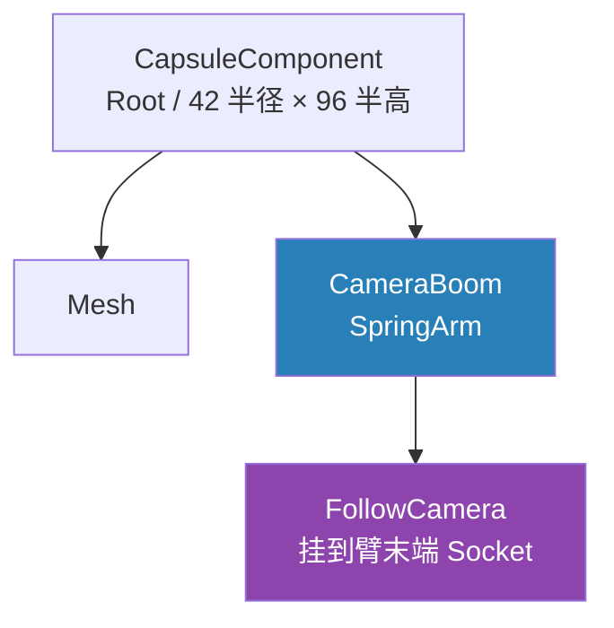

# 相机臂与移动朝向配置

Hero 类从"空壳 + 一条调试打印"变成了真正有构造函数的形态：胶囊尺寸、相机臂（SpringArm）+ 跟随相机（Camera）两个组件、以及一组决定"第三人称手感"的移动参数。这份构造函数是 UE 第三人称角色的经典配置，每一行都在回答一个问题——**相机怎么跟、角色怎么转、松手怎么停**。

## 一、组件装配：根 → 臂 → 相机

```cpp
CameraBoom = CreateDefaultSubobject<USpringArmComponent>(TEXT("CameraBoom"));
CameraBoom->SetupAttachment(GetRootComponent());

FollowCamera = CreateDefaultSubobject<UCameraComponent>(TEXT("FollowCamera"));
FollowCamera->SetupAttachment(CameraBoom, USpringArmComponent::SocketName);
```

层级关系一步到位：



两个 API 是 UE 组件化Actor 的标准起手式：

- **`CreateDefaultSubobject<T>(TEXT("名字"))`**——只能在构造函数里调用，为 CDO（类默认对象）创建组件。名字会成为组件在细节面板里的标识，`CameraBoom` / `FollowCamera` 是 UE 社区的惯例命名，见到就知道是什么；
- **`SetupAttachment(父组件, Socket名)`**——把组件挂到父组件上。相机挂 SpringArm 用的是 `USpringArmComponent::SocketName`，即弹簧臂**末端**的那个 Socket——臂伸多长，相机就飘多远，缩放臂长时相机自动跟随，不用自己算位置。

为什么不直接把相机挂在胶囊上？因为第三人称相机需要**延迟、防穿模、臂长伸缩**这些行为，SpringArm 一个组件全包了——直接挂根组件的相机是"焊死"的，墙一挡就穿进角色体内。

## 二、SpringArm 参数：一套越肩视角

```cpp
CameraBoom->TargetArmLength = 200.f;
CameraBoom->SocketOffset = FVector(0.f, 55.f, 65.f);
CameraBoom->bUsePawnControlRotation = true;

FollowCamera->bUsePawnControlRotation = false;
```

- **`TargetArmLength = 200`**：臂长决定相机到角色的距离。模板第三人称默认 300，这里收到 200——动作 RPG 要的是贴身越肩视角，角色占屏更大、身后盲区更小；
- **`SocketOffset = (0, 55, 65)`**：挂点在臂末端基础上向右（+Y）55、向上（+Z）65——相机从"正后方"挪到"右后上方"，画面主体让出屏幕中央给准星方向。三个数就是越肩手感的最小配置；
- **`bUsePawnControlRotation` 的分工**：臂为 `true`——臂跟着玩家鼠标/手柄的视角控制旋转；相机为 `false`——相机自己不转，只负责沿臂方向投影。旋转的活全部交给臂，相机是个纯粹的"镜头"。两个都开反而会转两倍。

`bUsePawnControlRotation` 意味着视角输入不需要写一行代码：PlayerController 的 ControlRotation 更新，臂跟着转，相机跟着臂——这是这套组件链的"免费午餐"。

## 三、朝向策略：角色跟移动走，不跟视角走

```cpp
bUseControllerRotationPitch = false;
bUseControllerRotationRoll = false;
bUseControllerRotationYaw = false;

GetCharacterMovement()->bOrientRotationToMovement = true;
GetCharacterMovement()->RotationRate = FRotator(0.f, 500.f, 0.f);
```

这四行是第三人称角色**两种经典方案**的分岔口：

| 方案 | 做法 | 手感 | 代表 |
|---|---|---|---|
| 硬绑定 | `bUseControllerRotationYaw = true` | 角色永远面朝视角方向，平移靠 strafe | 战斗瞄准态、FPS |
| 移动朝向 | 三个全 false + `bOrientRotationToMovement` | 角色朝**移动方向**转身，视角独立 | ARPG 常规探索态 |

Warrior 选的是后者：转鼠标只转相机，角色往哪推摇杆就朝哪转身子——探索、跑图的自然形态，也是需要 strafe 时再按住键切换的底子。

- **`bOrientRotationToMovement = true`**：移动组件按移动方向自动旋转角色；
- **`RotationRate = (0, 500, 0)`**：转身速度只留 Yaw（偏航）500 度/秒，Pitch/Roll 为 0——角色永远不会抬头翻滚着走。500 是"跟手但不抽搐"的常用值；
- 三个 `bUseControllerRotation*` 必须显式写 false：角色默认 `Yaw = true`，不关掉的话角色会被视角"锁死"，`bOrientRotationToMovement` 就白配了。

## 四、移动手感：速度与刹车

```cpp
GetCharacterMovement()->MaxWalkSpeed = 400.f;
GetCharacterMovement()->BrakingDecelerationWalking = 2000.f;
```

- **`MaxWalkSpeed = 400`**：常规跑图速度（模板默认 500）。动作游戏通常会按行走/疾跑/受击状态切速度，这里先给基准值；
- **`BrakingDecelerationWalking = 2000`**：松开方向后的减速度。默认值偏小，角色会"滑"一小段；拉到 2000 是要**立刻收步**——动作游戏对停步精度的要求远高于散步模拟。

### 刹车的完整公式：两个来源

`BrakingDecelerationWalking` 只是刹车减速度的一半。移动组件在没有加速输入时（`CalcVelocity` → `ApplyVelocityBraking`）的总减速度大致是：

```
减速度 ≈ GroundFriction × BrakingFrictionFactor × 当前速度 + BrakingDecelerationWalking
```

Warrior 当前配置下（`GroundFriction` 默认 8.0、`BrakingFrictionFactor` 默认 2.0）：

| 当前速度 | 摩擦项 8×2×速度 | 恒定项 2000 | 合计（cm/s²） |
|---|---|---|---|
| 400（满速） | 6400 | 2000 | 8400 → 急停 |
| 100 | 1600 | 2000 | 3600 |
| 25 | 400 | 2000 | 2400 |

两个来源性质不同：

- **摩擦项（`BrakingFrictionFactor` 管的部分）与速度成正比**——高速刹车狠、临近停下越来越弱，指数式"渐停"曲线；
- **`BrakingDecelerationWalking` 是恒定减速度**——不管多快统一补一刀线性减速，低速段主要靠它收尾。

`BrakingFrictionFactor` 存在的意义：`GroundFriction` 是全局抓地力，同时影响**加速曲线、转向、斜坡滑动**，为停得快直接拉高摩擦，起步和转弯手感会一起变僵。这个参数把"刹车时的摩擦"单独乘个系数出来，**只调松手后的减速，不碰其他手感**。调参直觉：要急停拉高恒定减速度（当前思路）或调大 factor；要一点滑步惯性把 factor 调小（< 2）；冰面滑行是 `GroundFriction` 整体调低的事，两个刹车参数救不了。另：UE5 已废弃 `BrakingFriction` 和 `bUseSeparateBrakingFriction`，旧教程里的"单独刹车摩擦值"就是被这套组合取代的，看旧资料别混。

胶囊那行 `GetCapsuleComponent()->InitCapsuleSize(42.f, 96.f)` 写的是引擎模板默认值——显式写出来的意义是把"角色碰撞体多大"这件事收进代码里管，将来敌人用不同体型时，对比就在构造函数里一目了然。

## 五、UPROPERTY：private 组件暴露给蓝图只读

```cpp
private:
#pragma region Components

UPROPERTY(VisibleAnywhere, BlueprintReadOnly, Category = "Camera", meta = (AllowPrivateAccess = "true"))
USpringArmComponent* CameraBoom;

UPROPERTY(VisibleAnywhere, BlueprintReadOnly, Category = "Camera", meta = (AllowPrivateAccess = "true"))
UCameraComponent* FollowCamera;

#pragma endregion
```

四个细节各有讲究：

- **`VisibleAnywhere` 而非 `EditAnywhere`**——组件在构造函数里已经创建并配置好，编辑器里改这些指针没有意义；组件的**数值参数**（臂长之类）直接选中组件本身改。指针给"可见"，修改权留给代码；
- **`AllowPrivateAccess = "true"`**——private 成员默认对反射系统关门，这个 meta 是给蓝图开的"例外通道"。没有它，`BlueprintReadOnly` 对 private 成员不生效，编译直接报错；
- **`BlueprintReadOnly`**——动画蓝图、控件蓝图经常要读相机或组件（做相机抖动、朝向混合），只读暴露够用且防误写。配上 `AllowPrivateAccess`，就是"C++ 拥有，蓝图可看"的标准姿势；
- **`#pragma region Components`**——纯 IDE 折叠用的预处理指令，把"这个类有哪些组件"在头文件里框成一个可折叠区块。类变大后组件、属性、函数各一个 region，导航成本立降。

头文件顶部的两个前置声明（forward declaration）是配套习惯：

```cpp
class USpringArmComponent;
class UCameraComponent;
```

头文件里只需要指针（`USpringArmComponent*`），不需要完整类型定义——前置声明让别的文件 include 这个头时**不必连带编译两个组件的头**，编译加速从习惯开始。真正的 `#include` 挪到 `.cpp` 里（`Camera/CameraComponent.h`、`GameFramework/SpringArmComponent.h`……）。注意前置声明的类名必须带 `U` 前缀且一字不差——写成 `class SpringArmComponent;` 等于声明了一个谁也不认识的无关类，编译器不报错（它合法），但根本没起到前置声明 `USpringArmComponent` 的作用，纯属自我安慰。

## 六、常见坑

1. **`bOrientRotationToMovement` 不生效**——九成是忘了关 `bUseControllerRotationYaw`，角色被视角锁死，移动组件的自动转向永远轮不到；
2. **相机挂在臂上却没跟随旋转**——检查臂的 `bUsePawnControlRotation`。相机自己那份要关（`false`），旋转归属臂，开两份会双重旋转；
3. **`SetupAttachment` 写在构造函数之外**——运行时改挂接要用 `AttachToComponent`，`SetupAttachment` 只在构造阶段对 CDO 有效，晚调用静默无效；
4. **前置声明漏了 `U` 前缀**——`class SpringArmComponent;` 不报错但什么也没声明，成员用的还是完整类型（靠 include 撑着），前置声明的省编译白做了。复制粘贴声明时盯一眼前缀；
5. **private + `BlueprintReadOnly` 没加 meta**——反射系统拒绝暴露 private 成员，编译报错提示就是让你加 `AllowPrivateAccess = "true"`，加上即通；
6. **角色转身"漂"**——`RotationRate` 太低（如 100–200）时角色像船一样缓转，追不上移动方向的变化；动作游戏从 500 起步再按手感微调。

## 小结

- 组件三连：`CreateDefaultSubobject` 创建 → `SetupAttachment` 挂接 → 相机挂臂末端 `SocketName`；SpringArm 白送延迟、防穿模、臂长伸缩；
- 越肩三参数：臂长 200 + SocketOffset 右 55 上 65 + 臂跟 ControlRotation 转、相机不转；
- 朝向走"移动朝向"方案：三个 `bUseControllerRotation*` 全关 + `bOrientRotationToMovement`，转身速率只留 Yaw 500；
- 手感参数：`MaxWalkSpeed` 400 定基准速度；刹车减速度 = `GroundFriction × BrakingFrictionFactor × 速度`（成正比、渐停）+ `BrakingDecelerationWalking`（恒定、收尾），只调刹车不碰加速转向靠 `BrakingFrictionFactor`；
- 组件指针的 UPROPERTY 标配：`VisibleAnywhere` + `BlueprintReadOnly` + private 时 `AllowPrivateAccess = "true"`；头文件前置声明（前缀别抄错），include 下沉到 `.cpp`。

下一步：EnhancedInput 绑定——IMC/IA 资产配上 PlayerController 的输入回调，让小人真正响应键盘摇杆跑起来。
