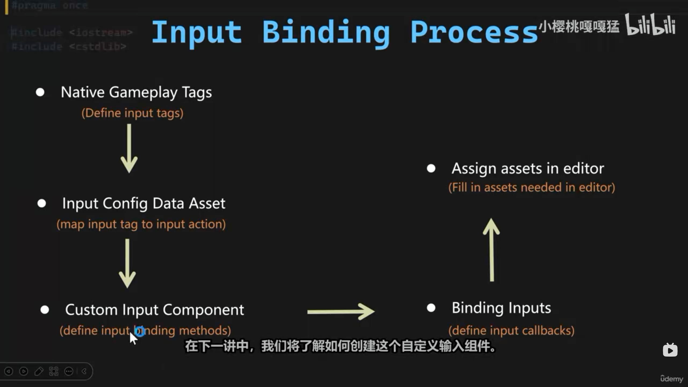

# Native Gameplay Tags：给输入贴标签

在接 EnhancedInput 之前，Warrior 先铺垫了一块基础设施：两个 Native Gameplay Tag——`InputTag.Move` 和 `InputTag.Look`，新建 `WarriorGameplayTags.h/.cpp` 一对文件集中管理，`Build.cs` 顺手补上 `GameplayTags` 模块依赖。这份笔记讲清楚三件事：**标签是什么、Native 声明这套宏怎么用、为什么标签要在写输入代码之前先就位**。

先看 Warrior 要搭的整条输入管线长什么样——从按键到角色一共四站：



按键在 `IMC_Default` 里查表点火对应的 InputAction（WASD → `IA_Move`、鼠标 → `IA_Look`），`EnhancedPlayerInput` 把触发的 IA 交给 PlayerController；Controller 读配置资产（`DA_InputConfig`）按标签逐条绑定，回调最终落到 `BP_HeroCharacter` 的处理函数。**标签就是这条管线里的"路由词"**——配置资产里每个 IA 挂一个标签，Controller 侧的绑定与分发全按标签进行。本篇要打的地基，正是图中央这枚词表。

## 一、Gameplay Tag 是什么

Gameplay Tag（`FGameplayTag`）是一个**层级化的标识符**，形如 `InputTag.Move`：

- 本质是 `FName`，点号分隔形成树状层级——`InputTag.Move`、`InputTag.Look` 同属 `InputTag` 父级；
- 所有标签注册进引擎全局的标签表（`UGameplayTagsManager`），比较是 `FName` 级的廉价操作，还能做层级匹配（`MatchesTag`：父标签能匹配子标签）；
- 它解决的问题是**字符串散落**。"这个输入是移动"、"这个状态是眩晕"、"这个技能可被沉默打断"——这些概念如果用裸字符串在各处比较，拼错一处就静默失效。标签把它们收进统一词表，编辑器下拉框能选、C++ 能引用、蓝图能读。

一个标签就是一句"这个东西**是**什么"的声明。UE 的 GAS（技能系统）、状态机、输入体系大量用标签代替枚举和布尔旗标——枚举要改头文件重新编译，标签加一行就行且跨 C++/蓝图通用。

## 二、Native 声明：一套宏，两个文件

Warrior 的实现是 Native Gameplay Tags 的标准三段式：

```cpp
// Public/WarriorGameplayTags.h
#pragma once
#include "NativeGameplayTags.h"

namespace WarriorGameplayTags
{
	/** Input Tags **/
	WARRIOR_API UE_DECLARE_GAMEPLAY_TAG_EXTERN(InputTag_Move);
	WARRIOR_API UE_DECLARE_GAMEPLAY_TAG_EXTERN(InputTag_Look);
}
```

```cpp
// Private/WarriorGameplayTags.cpp
#include "WarriorGameplayTags.h"

namespace WarriorGameplayTags
{
	UE_DEFINE_GAMEPLAY_TAG(InputTag_Move, "InputTag.Move");
	UE_DEFINE_GAMEPLAY_TAG(InputTag_Look, "InputTag.Look");
}
```

三段各司其职：

- **`UE_DECLARE_GAMEPLAY_TAG_EXTERN`（头文件）**——向所有 include 这个头的代码声明"存在一个叫 `WarriorGameplayTags::InputTag_Move` 的 `FGameplayTag` 常量"，extern 语义，和函数的"声明在 .h"一个道理；
- **`UE_DEFINE_GAMEPLAY_TAG`（.cpp）**——真正定义并**注册**标签。宏展开后是一个静态对象，程序启动时把 `"InputTag.Move"` 这个字符串注册进全局标签表，同时导出一个可直接引用的 `FGameplayTag` 常量；
- **`namespace WarriorGameplayTags` + `WARRIOR_API`**——命名空间防撞（和类名加 `Warrior` 前缀同一逻辑）；`WARRIOR_API` 是模块导出符号，没有它，其他模块 include 头文件时会报链接错误（声明找得到、定义链不上）。

使用侧的体验是**编译期安全**的：

```cpp
// 将来的某处
InputComponent->BindAction(MoveAction, ETriggerEvent::Triggered, this,
    &AWarriorHeroCharacter::Input_Move);  // 配合标签判断来源
FGameplayTag Tag = WarriorGameplayTags::InputTag_Move;  // 点出来，不会拼错
```

变量名 `InputTag_Move` 写错直接编译报错——这是相对字符串最大的优势。

## 三、为什么 Native，而不是编辑器配置

定义 Gameplay Tag 有两条路，对比：

| | 编辑器定义 | Native 定义 |
|---|---|---|
| 定义位置 | Project Settings → GameplayTags，存 ini | `.h/.cpp` 宏 |
| 引用方式 | `FGameplayTag::RequestGameplayTag(FName("InputTag.Move"))` | `WarriorGameplayTags::InputTag_Move` |
| 拼错时 | 运行时返回空标签，**静默失效** | 编译报错 |
| 版本管理 | ini 改动易冲突、难 review | 代码 diff 清晰 |
| 适用 | 策划/蓝图临时加标签 | 工程代码依赖的核心标签 |

核心标签走 Native 是团队工程的主流选择：C++ 代码引用标签时拿到的不是字符串而是常量对象，拼错在编译期就炸；标签的增删和引用它的代码在同一个 commit 里演进。编辑器那条路留给策划临时配置——两边注册进的是**同一张全局表**，不冲突。

## 四、Build.cs：又一个模块依赖

```csharp
PublicDependencyModuleNames.AddRange(new string[]
{
    "Core", "CoreUObject", "Engine", "InputCore", "EnhancedInput", "GameplayTags"
});
```

`NativeGameplayTags.h` 所在的 `GameplayTags` 模块是 UE 自带的运行时模块（GAS 的地基但可独立使用）。老规矩：改完 `Build.cs` 关编辑器跑一次完整构建，模块依赖变更靠编辑器热编译时灵时不灵。

这里同时把 `AddRange` 的参数从单行拆成了多行——依赖列表只会越来越长，竖排一行一个，加删都干净。

## 五、这两个标签准备干什么

`InputTag.Move` / `InputTag.Look` 是给 EnhancedInput 的下一盘棋：输入动作（Input Action）资产上将带上这些标签，PlayerController 或角色侧收到输入回调时**按标签分发**——"带 `InputTag.Move` 标签的 IA 触发了 → 走移动处理"。相比给每个 IA 写一个专用回调函数，按标签路由让输入处理可以泛化成一个循环，之后加"输入标签"就能挂进同一套管线。

先建标签再写输入代码，顺序是刻意的：输入架构的第一块砖是**词表**——先约定"用什么词描述输入"，代码才有共同语言可引用。

## 六、常见坑

1. **声明了忘定义 / 定义了忘声明**——`EXTERN` 声明没有对应 `UE_DEFINE` 链接报错；只有定义没有声明则其他文件用不了。一对宏成对写，一个标签两处出现；
2. **漏 `WARRIOR_API`**——本模块内编译正常，其他模块一引用就 `unresolved external symbol`。这是"在单一模块里能跑"和"工程级可用"的区别；
3. **标签字符串拼错不报编译错**——`UE_DEFINE_GAMEPLAY_TAG(InputTag_Move, "InputTag.Mvoe")` 编译照过，变量名对但注册的字符串是错的。变量名与字符串保持一致（去掉点、换下划线）能让人一眼扫出不一致；
4. **两个地方定义同一个标签字符串**——启动时报 duplicate tag 错误。Native 与编辑器 ini 里各定义一次同名字符串也会撞，全局只有一张表；
5. **把标签当字符串比较**——`Tag.ToString() == TEXT("InputTag.Move")` 绕回了字符串世界还丢了层级匹配；用 `Tag == OtherTag`（精确）或 `Tag.MatchesTag(OtherTag)`（层级）。

## 小结

- Gameplay Tag = 层级化 `FName` 标识符，全局注册、廉价比较、支持父匹配，C++/蓝图通用，是替代枚举与布尔旗标的"是什么"词表；
- Native 三件套：头文件 `UE_DECLARE_GAMEPLAY_TAG_EXTERN` 声明、`.cpp` `UE_DEFINE_GAMEPLAY_TAG` 定义注册、`WARRIOR_API` 导出，包在 `WarriorGameplayTags` 命名空间里；
- Native vs 编辑器：核心标签走 Native 吃编译期检查与干净的版本管理，策划临时标签走编辑器，两者同表不冲突；
- `Build.cs` 补 `GameplayTags` 模块依赖，变更后完整构建；
- `InputTag.Move` / `InputTag.Look` 为下一步铺路：IA 资产带标签，输入回调按标签分发——先立词表，再写管线。

下一步：创建 IA/IMC 资产、把 `InputTag` 挂上输入动作，PlayerController 里绑定 EnhancedInput 回调——小人正式跑起来。
