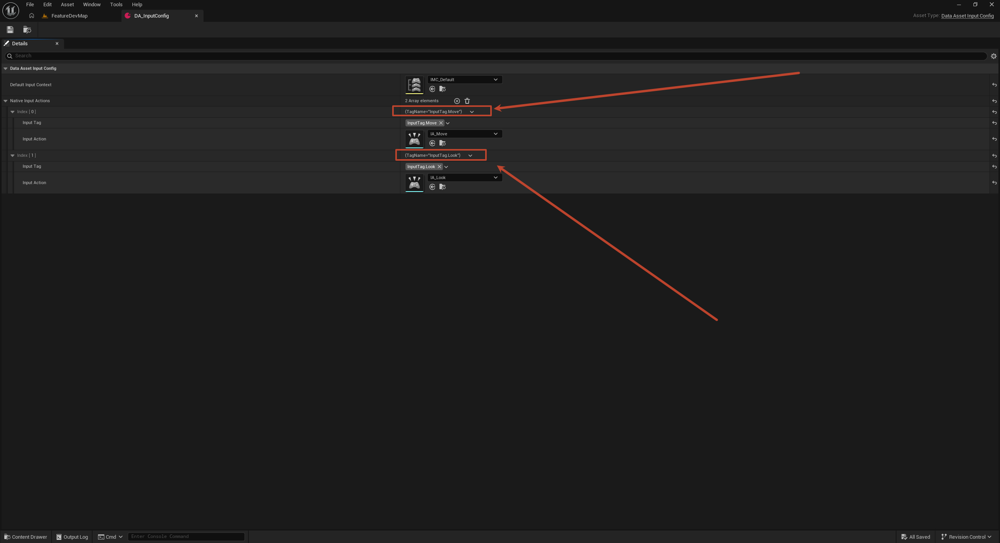

# 输入绑定：InputConfig 数据资产与标签路由

上一节的 `InputTag` 词表在本节兑现成真正的输入管线：一个 `UDataAsset_InputConfig` 把"标签 ↔ InputAction ↔ IMC"的对应关系收进**一份可编辑的数据资产**，`BP_HeroController` 在 BeginPlay 时读它挂上下文、绑动作，按键最终按标签路由到 `BP_HeroCharacter` 的处理函数。管线总图见上篇开头，本篇按站走读一遍，再拆每一环。

## 一、总流程走读：从按键到角色

整条管线一次走完：

1. **按键 → IA**：`IMC_Default` 里维护"按键 ↔ InputAction"的映射——WASD 触发 `IA_Move`、鼠标触发 `IA_Look`、空格触发 `IA_Jump`。IMC 只管"哪个键点火哪个 IA"，不管按下之后干什么；
2. **IA → Controller**：增强输入的 `EnhancedPlayerInput` 把触发的 IA 交给宿主 PlayerController——`BP_HeroController` 继承自 `AWarriorHeroPlayerController`，输入的入口天然在控制器侧；
3. **Controller 读配置**：BeginPlay 时从 `DA_InputConfig` 取出 `DefaultInputContext`，通过 `EnhancedInputLocalPlayerSubsystem` 加进本地玩家；再遍历 `NativeInputActions` 数组，按"标签 → IA"逐条 `BindAction`——查找用的是 C++ 侧的 `FindNativeInputActionByTag`；
4. **回调 → Character**：绑定的回调函数落在 `BP_HeroCharacter` 上（`Input_Move` / `Input_Look` / `Input_Jump`），角色自己消化移动、视角、跳跃。

`DA_InputConfig` 在这条管线里是**配置中枢**：Controller 的代码/蓝图不认识任何具体 IA，它只认识"给我一个标签，我还你一个 InputAction"。换一套操作方案（手柄、键位重映射、新技能键）改资产就行，绑定逻辑一行不动——这就是本节的核心收益。

## 二、为什么用 DataAsset 收拢输入配置

不收拢时的三种典型写法都有病：

- **C++ 硬编码**：`ConstructorHelpers` 在构造函数里按路径加载 IA 资产——路径写死在代码里，资产一挪动就崩，策划也碰不了；
- **蓝图变量散配**：Controller 蓝图里开一排 `UInputAction*` 变量逐个填——每加一个输入加一个变量，绑定节点也加一个，数量翻倍地膨胀；
- **每处用到就查一次**：角色、控制器、UI 各自持有 IA 引用——同一份对应关系存了 N 份，改一处漏三处。

`UDataAsset` 是 UE 提供的"纯数据资产"基类：不像 Actor 那样存在于世界里，就是一个可序列化的数据袋子。把输入配置做成 DataAsset，等于给角色发一份**输入档案**——IMC 用哪个、每个标签对应哪个 IA，一页看完、一处修改、处处生效。将来敌人 AI 不吃玩家输入，但技能系统的"标签 ↔ 能力"完全可以复用这个模式。

## 三、C++ 实现：一个结构体 + 一个类

```cpp
// Public/DataAsset/Input/DataAsset_InputConfig.h
USTRUCT(BlueprintType)
struct FWarriorInputActionConfig
{
	GENERATED_BODY()

public:
	UPROPERTY(EditDefaultsOnly, BlueprintReadOnly, meta=(Categories = "InputTag"))
	FGameplayTag InputTag;

	UPROPERTY(EditDefaultsOnly, BlueprintReadOnly)
	UInputAction* InputAction;
};

UCLASS()
class WARRIOR_API UDataAsset_InputConfig : public UDataAsset
{
	GENERATED_BODY()

public:
	UPROPERTY(EditDefaultsOnly, BlueprintReadOnly)
	UInputMappingContext* DefaultInputContext;

	UPROPERTY(EditDefaultsOnly, BlueprintReadOnly, meta=(TitleProperty="InputTag"))
	TArray<FWarriorInputActionConfig> NativeInputActions;

	UInputAction* FindNativeInputActionByTag(const FGameplayTag& InInputTag);
};
```

先分清结构体里这两个成员——它们是 **"名字"和"实物"** 的关系：

|            | `FGameplayTag InputTag`                                      | `UInputAction* InputAction`                                             |
| ---------- | ------------------------------------------------------------ | ----------------------------------------------------------------------- |
| 本质       | 全局标签表里的标识符（`InputTag.Move`），纯 `FName`，无行为  | 一个资产（`IA_Move.uasset`），真正的输入事件对象                        |
| 携带什么   | 只有一个名字                                                 | 值类型（Axis2D / bool）、Triggers（按下/持续）、Modifiers（死区、取反） |
| 谁认识它   | C++ 代码（`WarriorGameplayTags::InputTag_Move`，编译期引用） | IMC（哪个键触发它）、绑定回调（触发后调谁）                             |
| 回答的问题 | "这个输入**是谁**"                                           | "触发的是**哪个事件**"                                                  |

两者缺一不可："按键 → IA"这段由 IMC 资产管（WASD 触发 `IA_Move`），但 IMC 只负责点火，不知道触发之后该干什么；"IA → 处理函数"这段就要靠查表——代码拿着标签问 `FindNativeInputActionByTag(InputTag_Move)`，拿到 `IA_Move` 再去绑定。如果让代码直接引用 IA 资产，就得硬编码资产路径，每加一个输入改一处代码；有了标签，代码只认识词表，"名字对应哪个 IA"变成 DA 里一行可编辑的数据。打个比方：IA 是插座，IMC 决定哪个开关通电点亮它，InputTag 是插座旁的名字贴纸——布线的人（Controller）不看插座长什么样，只认贴纸找插座。

逐个说设计点：

- **`FWarriorInputActionConfig`**——"一个标签配一个 IA"这对关系本身就是概念单元，做成结构体后数组语义清晰：数组一行 = 一个输入的完整定义。`BlueprintType` 让蓝图也能读写这个结构；
- **`meta=(Categories = "InputTag")`**——标签选择器只显示 `InputTag` 父级下的标签。这是一个**词表约束**：角色属性标签、状态标签再多也不会混进输入配置的下拉框，配错在编辑期就被挡住；
- **`EditDefaultsOnly`**——只在资产默认值面板可编辑。DataAsset 没有运行时实例的概念，`EditAnywhere` 在这里没有意义，写 `EditDefaultsOnly` 是把意图说死；
- **`meta=(TitleProperty="InputTag")`**——数组每行的折叠标题显示标签名而不是"0/1/2"下标，一眼扫出哪行是哪个输入；
- **`FindNativeInputActionByTag`**——线性遍历查表，实现放在 `.cpp` 里：

```cpp
// Private/DataAsset/Input/DataAsset_InputConfig.cpp
UInputAction* UDataAsset_InputConfig::FindNativeInputActionByTag(const FGameplayTag& InInputTag)
{
	for (const FWarriorInputActionConfig& InputActionConfig : NativeInputActions)
	{
		if (InputActionConfig.InputTag == InInputTag && InputActionConfig.InputAction)
		{
			return InputActionConfig.InputAction;
		}
	}
	return nullptr;
}
```

标签用 `==` 精确比较（`FGameplayTag` 重载过，`FName` 级廉价操作），同时校验 IA 指针非空才返回——半配置的行（有标签没资产）当不存在处理，调用方拿到 `nullptr` 自己决定报警还是跳过。

## 四、DA_InputConfig 资产实例

C++ 类编译后，在 `Content/PlayerCharacter/` 下创建 `DA_InputConfig`（右键 → Miscellaneous → Data Asset → 选 `DataAsset_InputConfig`），填入三行配置：



配套的动作是把输入资产从模板目录迁进了自有目录：`IA_Move` / `IA_Look` / `IA_Jump` / `IMC_Default` 等从 `Content/ThirdPerson/Input/` 挪到 `Content/PlayerCharacter/Input/`——模板资产和自有资产分家，`ThirdPerson/` 里只留 Mannequin 网格动画那些"借来的身体"，输入这套"自己接的线"归自己的目录。

一个要注意的现状：Native 宏目前只注册了 `InputTag.Move` 和 `InputTag.Look` 两个标签，**`InputTag.Jump` 还没有 `UE_DEFINE_GAMEPLAY_TAG` 声明**——标签选择器只列全局表里已注册的标签，要让 Jump 这行真正生效，需要在 `WarriorGameplayTags.h/.cpp` 里照 Move 的样子补第三行宏，否则按 Jump 标签查表永远拿空。

## 五、绑定为什么放在 Controller

流程图里挂 IMC、绑动作都发生在 `BP_HeroController`，回调却落在 `BP_HeroCharacter`——这个分工是刻意的：

- **输入是"玩家"的概念，不是"角色"的概念**。Controller 代表玩家意志，贯穿整局游戏不换；Character 是玩家当前驾驶的躯壳，死亡重生成夺舍都要换。绑定点放 Controller，换角色不用重绑输入；
- **回调落角色**是因为执行者是角色：移动要调 `CharacterMovementComponent`、跳跃要改运动状态——这些 API 和数据都在 Character 身上，回调跟着执行者走；
- **挂 IMC 走 `EnhancedInputLocalPlayerSubsystem`**（`GetLocalPlayerSubsystem` → `AddMappingContext`）而不是别的路径，是增强输入的标准姿势：上下文属于本地玩家，优先级参数留给将来"UI 打开时降级游戏输入"这类需求。

于是 Controller 的接线只有两步：BeginPlay 里加 `DefaultInputContext`，然后对每个要处理的标签调 `FindNativeInputActionByTag` 拿 IA、`BindAction` 到角色侧函数。加一个新输入 = 标签表加一行宏 + DA 加一行配置 + 角色加一个函数，Controller 侧零改动。

这对分工能运转，前提是 **GameMode 把两端派上场**——`BP_BaseGameMode` 的类默认值里本节补上了两行：`Default Pawn Class = BP_HeroCharacter`、`Player Controller Class = BP_HeroController`（第 1 篇埋的"挂 Default Pawn"在此兑现）。玩家加入 → GameMode 生成 `BP_HeroController` → Spawn 出 `BP_HeroCharacter` 并 Possess——管线的"玩家意志"和"执行躯壳"就此接通。注意这两个类引用走的都是蓝图类（`_C`），和 ini 里 `GlobalDefaultGameMode` 带 `_C` 后缀是同一个语法。

## 六、常见坑

1. **标签没注册就引用**——`FindNativeInputActionByTag` 拿空标签查表返回 `nullptr`，静默无反应不报错。配置 DA 时看到某行标签选不出来或行为缺失，先查 `WarriorGameplayTags` 里宏声明齐不齐（当前的 `InputTag.Jump` 就是现成例子）；
2. **`Categories` 过滤写错**——`meta=(Categories = "InputTag")` 里字符串和标签父级不一致，下拉框直接空白，容易误以为标签系统坏了；
3. **IMC 加了没生效**——确认走的是 LocalPlayer 子系统的 `AddMappingContext`，且在 Controller/Player 合法获取 LocalPlayer 的时机（BeginPlay 之后）调用；编辑器里 PIE 多客户端时注意各 LocalPlayer 各挂各的；
4. **把绑定写进 Character 且只在 Possess 时绑一次**——角色重生、切换后绑定跟着旧角色对象蒸发。绑定点放 Controller（或绑定时以 Controller 为语境、目标函数放角色）才能穿越换角；
5. **DA 里 IA 引用失效**——迁移输入资产目录后 `DA_InputConfig` 里的 IA 引用没有重定向（正常会有 fixup 弹窗，点了重定向保存即可），漏掉的话运行时那行配置等于空。

## 小结

- 总流程：按键 → IMC 查表点火 IA → PlayerController 收到 → 按 `DA_InputConfig` 的"标签 ↔ IA"表绑定 → 回调落 Character 执行；
- `UDataAsset_InputConfig` 把输入配置收成一份资产：加输入不改代码，改资产即可；`FWarriorInputActionConfig` 结构体让"一行一个输入"成为自然单位；
- 编辑器细节四件套：`Categories` 限词表、`EditDefaultsOnly` 限定资产编辑、`TitleProperty` 让数组行显示标签名、查找函数空指针当不存在；
- 绑定点在 Controller（玩家意志、贯穿换角），回调在 Character（执行者身上）；IMC 走 `EnhancedInputLocalPlayerSubsystem` 标准路径；`BP_BaseGameMode` 补上 Default Pawn / PlayerController 双指向，两端由 GameMode 接通；
- `InputTag.Jump` 尚未在 Native 注册，补宏前 Jump 行是"装饰性"的。

下一步：补上 `InputTag.Jump` 宏，Controller 完成两步接线——小人就能在 `FeatureDevMap` 里跑起来、转视角、起跳。
