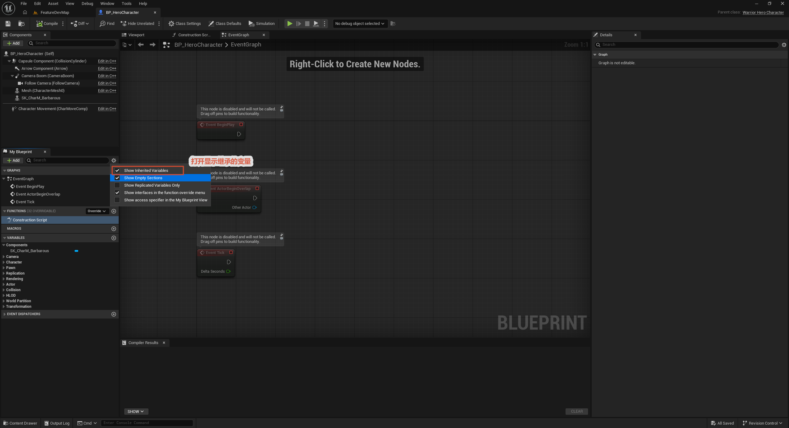
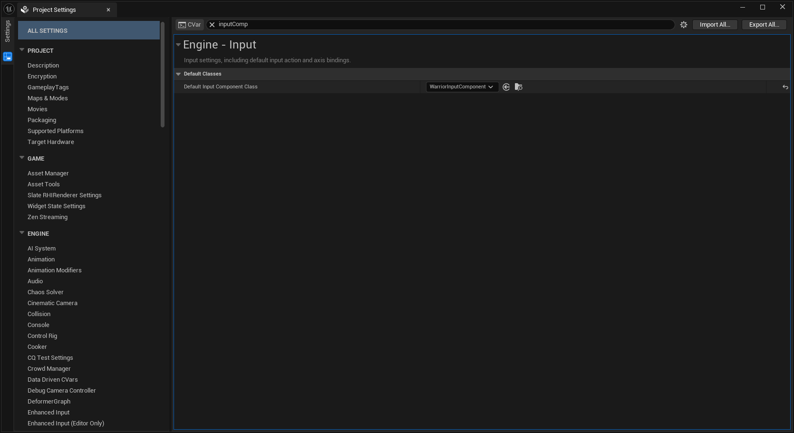

# 自定义输入组件：WarriorInputComponent

上一节备好了"标签 ↔ IA"的配置表，绑定还没落笔。本节不绕蓝图，直接把整套流程写进 C++——自定义 `UWarriorInputComponent`，一个模板函数 `BindNativeInputAction` 把"查表 → 判空 → 绑定"三步并一步；接线落点选引擎为角色输入预留的官方入口 `SetupPlayerInputComponent`，蓝图侧只剩一行资产指派。`Input_Move`、`Input_Look` 就此跑通，管线正式通电。

## 一、为什么自定义输入组件

用原生 `UEnhancedInputComponent` 绑一个输入，完整链条是五步：拿到 Pawn 的 InputComponent → **Cast 成** `UEnhancedInputComponent`（不转型调不到 `BindAction`）→ 按 tag 查 `DA_InputConfig` → 判空 → 绑定。一个输入五步，十个输入五十步——而且这五十步里没有任何一步是业务逻辑，全是管线杂务。

`InputComponent` 本来就是绑定的"驻地"：引擎给每个 Pawn 配一个，所有输入绑定都发生在它身上。把工程级的绑定惯例做成**它的子类成员函数**，是最自然的收纳位置——所有调用方（Controller、Character、将来的技能系统）共享同一套糖，而继承 `UEnhancedInputComponent` 意味着原生能力一点不少，只加不减。

## 二、代码走读

```cpp
// Public/Components/Input/WarriorInputComponent.h
UCLASS()
class WARRIOR_API UWarriorInputComponent : public UEnhancedInputComponent
{
	GENERATED_BODY()

public:
	template<class UserObject, typename CallbackFunc>
	void BindNativeInputAction(const UDataAsset_InputConfig* InInputConfig, const FGameplayTag& InInputTag, ETriggerEvent TriggerEvent, UserObject* ContextObject, CallbackFunc Func);
};

template <class UserObject, typename CallbackFunc>
void UWarriorInputComponent::BindNativeInputAction(const UDataAsset_InputConfig* InInputConfig,
	const FGameplayTag& InInputTag, ETriggerEvent TriggerEvent, UserObject* ContextObject, CallbackFunc Func)
{
	checkf(InInputConfig, TEXT("输入配置为空，无法进行绑定操作"));

	if (UInputAction* FoundAction = InInputConfig->FindNativeInputActionByTag(InInputTag))
	{
		BindAction(FoundAction, TriggerEvent, ContextObject, Func);
	}
}
```

几个设计点：

- **模板参数 `UserObject` + `CallbackFunc`**——`BindAction` 的回调目标是"某对象上的某函数"这对组合，模板让成员函数、lambda、普通函数都能传，调用侧一行一个输入；
- **`checkf` 带人话**——配置指针为空直接崩并打印"输入配置为空，无法进行绑定操作"，比静默 nullptr 之后排查"为什么没反应"便宜得多。fail-fast 的报错信息写给未来的自己看，值得写清楚；
- **模板必须放头文件**——模板是编译期配方，`UWarriorInputComponent.cpp` 里只剩一个 include 不是偶然：模板函数只有被调用时才实例化，定义放 .cpp 的话，其他翻译单元 include 到的只有声明，链接时 `unresolved external symbol`。这条和普通成员函数"声明 .h 定义 .cpp"的惯例正好相反；
- **查表前置判空**——`FindNativeInputActionByTag` 返回空（标签没配、IA 没填）就整条跳过，不绑也不崩，半配置的行当不存在。

配套的两处小修：`FindNativeInputActionByTag` 加了 **`const`**（纯查询不改动对象，参数是 `const UDataAsset_InputConfig*`，两头一致——查询类函数默认 `const` 是习惯，不是可选装饰）；DA 的属性 `DefaultInputContext` 更名 **`DefaultMappingContext`**，更贴近引擎对 Mapping Context 的官方叫法。

## 三、接线落点：SetupPlayerInputComponent

绑定不走蓝图、也不放 BeginPlay，而是直接写进引擎为"角色接收输入"预留的官方入口：

```cpp
// Private/Character/WarriorHeroCharacter.cpp
void AWarriorHeroCharacter::SetupPlayerInputComponent(class UInputComponent* PlayerInputComponent)
{
	// Super::SetupPlayerInputComponent(PlayerInputComponent);
	checkf(InputConfigDataAsset, TEXT("忘記分配有效的數據資產作為輸入配置"));
	checkf(InputConfigDataAsset->DefaultMappingContext, TEXT("DA_InputConfig 裡忘記配置 DefaultMappingContext"));

	ULocalPlayer* LocalPlayer = GetController<APlayerController>()->GetLocalPlayer();
	UEnhancedInputLocalPlayerSubsystem* Subsystem = ULocalPlayer::GetSubsystem<UEnhancedInputLocalPlayerSubsystem>(LocalPlayer);

	check(Subsystem);
	Subsystem->AddMappingContext(InputConfigDataAsset->DefaultMappingContext, 0);

	UWarriorInputComponent* WarriorInputComponent = CastChecked<UWarriorInputComponent>(PlayerInputComponent);
	WarriorInputComponent->BindNativeInputAction(InputConfigDataAsset, WarriorGameplayTags::InputTag_Move, ETriggerEvent::Triggered, this, &ThisClass::Input_Move);
	WarriorInputComponent->BindNativeInputAction(InputConfigDataAsset, WarriorGameplayTags::InputTag_Look, ETriggerEvent::Triggered, this, &ThisClass::Input_Look);
}
```

- **`SetupPlayerInputComponent` 的时机**——Pawn 被 Possess、InputComponent 就绪时由引擎调用。上一节说"绑定点放 Controller 才能穿越换角"，在这里由回调机制等效达成：重生、换角都会重新走一遍这个函数，绑定跟着角色自动重建，不存在"绑在旧角色上蒸发"的问题；
- **`CastChecked` 而非 `Cast`**——换装 `DefaultInputComponentClass` 之后，Pawn 身上的组件**预期必然**是 `WarriorInputComponent`；类型不符等于 ini 忘了改，`CastChecked` 当场崩掉。配置错误在第一次 Possess 就炸出来，好过静默拿到空指针；
- **一行一个输入**——`BindNativeInputAction(InputConfigDataAsset, WarriorGameplayTags::InputTag_Move, ETriggerEvent::Triggered, this, &ThisClass::Input_Move)`：标签走 Native 常量（编译期检查），`ThisClass` 是 UE 惯用的"本类"别名，写它比抄长类名不怕拼错。Move、Look 各占一行，正是这套糖要的效果；
- **`Super` 被注释掉**——`ACharacter` 的默认实现只处理旧式输入绑定，EnhancedInput 路线下跳过它，避免无意义的父类逻辑混进来。

蓝图侧从此只剩**资产指派**这一件事。`InputConfigDataAsset` 是 private 的 `UPROPERTY`，靠 `meta = (AllowPrivateAccess = "true")` 暴露给蓝图（没有这条 meta，私有成员在蓝图面板里不可见）——在类默认值的 CharacterData 分栏下，把 `DA_InputConfig` 指给它：



改完 C++ 头文件回编辑器，面板弹出"属性被外部修改、即将重载"的对话框是正常流程——蓝图存的只是属性值，类定义（包括这个变量）始终以 C++ 为准。

## 四、Input_Move 与 Input_Look：最先通电的两个输入

```cpp
void AWarriorHeroCharacter::Input_Move(const FInputActionValue& InputActionValue)
{
	const FVector2D MovementVector = InputActionValue.Get<FVector2D>();
	const FRotator MovementRotation(0.f, Controller->GetControlRotation().Yaw, 0.f);
	if (MovementVector.Y != 0.f)
	{
		const FVector ForwardDirection = MovementRotation.RotateVector(FVector::ForwardVector);
		AddMovementInput(ForwardDirection, MovementVector.Y);
	}

	if (MovementVector.X != 0.f)
	{
		const FVector RightDirection = MovementRotation.RotateVector(FVector::RightVector);
		AddMovementInput(RightDirection, MovementVector.X);
	}
}
```

- **`InputActionValue.Get<FVector2D>()`**——IA 的值类型是模板取回的，`IA_Move` 配的是 Axis2D，这里就取二维向量。类型对不上（IA 改了值类型、代码没跟上）拿到的是零值，动不了但不会崩；
- **只取 Controller 的 Yaw**——`MovementRotation` 把俯仰和滚转清零，移动方向只跟随水平视角：抬头按 W 不是往天上走；
- **`AddMovementInput` 是方向不是位移**——累积一个方向请求，实际位移由 `CharacterMovementComponent` 按速度、加速度等参数结算，和第 3 篇配的 `bOrientRotationToMovement` 正好咬合：这里给方向，朝向自动转过去。

`Input_Look` 同款套路，回调把二维轴值分别转交给 Controller：

```cpp
// Private/Character/WarriorHeroCharacter.cpp
void AWarriorHeroCharacter::Input_Look(const FInputActionValue& InputActionValue)
{
	const FVector2D LookAxisVector = InputActionValue.Get<FVector2D>();

	if (LookAxisVector.X != 0.f)
	{
		AddControllerYawInput(LookAxisVector.X);
	}

	if (LookAxisVector.Y != 0.f)
	{
		AddControllerPitchInput(LookAxisVector.Y);
	}
}
```

- **`AddControllerYawInput` / `AddControllerPitchInput`**——视角的"拥有者"是 PlayerController，Character 上的这两个函数只是转发：水平喂 Yaw、垂直喂 Pitch，鼠标一动、Control Rotation 跟着转，而 `Input_Move` 取的正是这个旋转的 Yaw——两个回调在 Controller 的视角上会师；
- **不乘灵敏度、不做死区**——这些是 IA / PlayerInput 层的职责（Modifier、联动 IMC 的配置），回调里拿到什么用什么，层次不越权。

Move、Look 已通。往后每个新输入，照葫芦画瓢的成本，就是这套架构的收益。

## 五、全局换装：DefaultInputComponentClass

```ini
// Config/DefaultInput.ini
DefaultPlayerInputClass=/Script/EnhancedInput.EnhancedPlayerInput
DefaultInputComponentClass=/Script/Warrior.WarriorInputComponent
```

原来第二行指向 `/Script/EnhancedInput.EnhancedInputComponent`，现在改成自己的类——在编辑器里就是 Project Settings → Input 页面把 `Default Input Component Class` 换成 `WarriorInputComponent`：



机制：引擎为每个 Pawn 创建 InputComponent 时读这两行配置——`EnhancedPlayerInput` 管输入的采集端，`InputComponentClass` 管绑定端。换掉之后，**全工程所有 Pawn 默认拿到的就是 `WarriorInputComponent`**，`SetupPlayerInputComponent` 里 `CastChecked` 的"预期必然"才有底气——不换的话 Pawn 身上还是原生组件，`CastChecked` 第一次 Possess 就会崩，等于用崩溃替你检查配置。

`/Script/Warrior.WarriorInputComponent` 的语法是"`/Script/` + 模块名 + 类名"——C++ 类的资产路径写法，和蓝图类的 `_C` 后缀是两个世界的两套规则。

## 六、uproject 补依赖

```json
// Warrior.uproject
"AdditionalDependencies": [
    "Engine",
    "EnhancedInput"
]
```

`Build.cs` 里早就依赖了 `EnhancedInput`，这次在 `.uproject` 层又声明一遍——两者作用不同：`Build.cs` 是模块间的正式依赖关系，`.uproject` 的 `AdditionalDependencies` 影响的是**从项目文件触发的构建与 IDE 工程生成**（右键 uproject → Generate project files 那条链路）。模板工程默认只列 `Engine`，自定义组件头文件 include 了 `EnhancedInputComponent.h` 之后，工程生成与独立编译需要这条声明才能正确解析。

## 七、常见坑

1. **模板函数定义写进 .cpp**——本模块内碰巧能编过（被同 .cpp 的代码调用时实例化），其他文件一用就链接报错。模板定义放头文件，没商量；
2. **只写了子类没改 ini**——`CastChecked` 第一次 Possess 就崩：Pawn 身上的组件还是原生 `EnhancedInputComponent`。这正是 `CastChecked` 的价值：配置错当场炸，不静默；
3. **私有 `UPROPERTY` 蓝图里找不到**——忘了 `AllowPrivateAccess = "true"`，变量在类默认值面板直接消失，蓝图无从指派资产；
4. **改完 ini 不重启编辑器**——`DefaultInputComponentClass` 在引擎初始化时读取，热重载不重读，改完要完全重启；
5. **DA 的 `DefaultMappingContext` 忘了配**——`AddMappingContext(nullptr)` 静默无效：绑定一路畅通、`checkf` 全过、按键却毫无反应也不崩。症状是"回调一次都不触发"，和上一条同属"静默失败"家族。排查思路：回调入口打调试输出，把"管线哪一层死了"变成屏幕上一行字，再往上游逐层收缩。根治是给 `DefaultMappingContext` 也补一条 `checkf`，第一次 Possess 就崩出一句指名道姓的报错；
6. **`checkf` 当成日志用**——它是断言：开发期崩给你看，`DO_CHECK=0` 的发布构建里会被编译掉。校验用 `checkf`，可恢复的错误仍走日志 + 兜底逻辑。

## 小结

- 自定义 `UWarriorInputComponent : UEnhancedInputComponent`，把"查表 → 判空 → 绑定"收进模板函数 `BindNativeInputAction`，模板定义必须放头文件，`checkf` 带人话报错；
- 接线落点 `SetupPlayerInputComponent`：引擎在 Possess 时回调，重生换角自动重绑；绑定全程在 C++ 完成，蓝图侧只剩给 `InputConfigDataAsset` 指派 `DA_InputConfig`（私有变量靠 `AllowPrivateAccess` 暴露）；
- `CastChecked` 把"ini 忘换组件类"变成第一次 Possess 就崩的显式错误；DA 属性更名 `DefaultMappingContext`、查找函数补 `const`；
- `DefaultInputComponentClass` 指到 `/Script/Warrior.WarriorInputComponent`，全工程 Pawn 默认换装；`.uproject` 的 `AdditionalDependencies` 补 `EnhancedInput`，服务工程生成那条链路；
- `Input_Move` / `Input_Look` 跑通：Axis2D 取值、只取 Yaw 的方向计算、`AddMovementInput` 交给移动组件结算；视角输入转交 Controller 的 Yaw/Pitch，与移动共用同一套控制旋转。

下一步：管线已通电，往后每个新输入都是一行绑定加一个回调的事。
