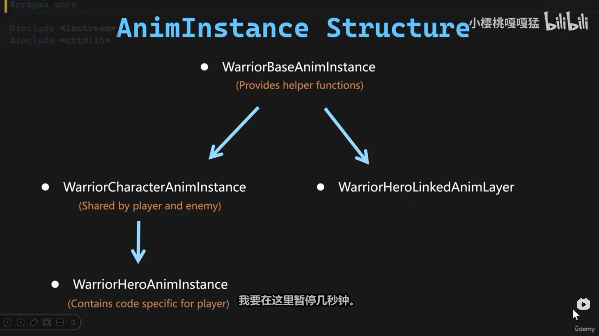

# 动画绑定与 AnimInstance 分层

输入管线通了，角色听使唤地跑，但模型还杵在 T-Pose 里滑行——动画没接上。本节把整条动画链绑起来：mesh 指认 Anim Class、动画蓝图换 C++ 父类、`NativeInitializeAnimation` 缓存主人、`NativeUpdateAnimation` 逐帧喂 `GroundSpeed` 与 `bHasAcceleration`。分工原则一句话：**数据搬运归 C++，姿态组织归蓝图**——蓝图也能用 Event Blueprint Update Animation 取数，但逐帧逻辑放 native 更快、可断点、可被整条继承链复用。

## 一、绑定流程全景

先看清"绑定"到底绑了什么。一条链，两次指认：

```
BP_Hero (SkeletalMeshComponent)
   │  ① Anim Class
   ▼
ABP_Hero (动画蓝图：AnimGraph 状态机、混合)
   │  ② Parent Class
   ▼
UWarriorHeroAnimInstance (C++：缓存主人、逐帧算数据)
   │  GroundSpeed / bHasAcceleration (BlueprintReadOnly)
   ▼
AnimGraph 状态机 (Idle ↔ Walk ↔ Run 切换)
```

- **① mesh 指认蓝图**——BP_Hero 的 SkeletalMeshComponent 上，Animation 分栏的 Anim Class 指到 `ABP_Hero`。运行时引擎为 mesh 实例化一个该类的 AnimInstance 对象，之后每帧驱动它；
- **② 蓝图指认 C++**——`ABP_Hero` 的 Parent Class 从默认的 `UAnimInstance` 换成 `UWarriorHeroAnimInstance`（File → Reparent Blueprint）。C++ 类从此成为蓝图的父类：native 的初始化与逐帧更新随继承注入，蓝图变量面板里也多出 `GroundSpeed`、`bHasAcceleration` 可读。



换完父类后打开 ABP_Hero 的 Class Defaults，就是图里这套结构的落地：父类一栏已是 `WarriorHeroAnimInstance`，Details 面板的 Anim 分栏列出 Native 函数的挂载点（搜 "thread" 能定位到 Thread Anim Update 分组——多线程更新的预留入口，本节没用到；性能吃紧时再把逐帧取数迁去 worker 线程）。

## 二、四层类的分工

```cpp
// AnimInstance/WarriorBaseAnimInstance.h —— 工程级地基
UCLASS()
class WARRIOR_API UWarriorBaseAnimInstance : public UAnimInstance
{
	GENERATED_BODY()
};

// AnimInstance/WarriorCharacterAnimInstance.h —— 角色级：凡 Character 都要的数据
UCLASS()
class WARRIOR_API UWarriorCharacterAnimInstance : public UWarriorBaseAnimInstance
{
	GENERATED_BODY()

public:
	virtual void NativeInitializeAnimation() override;
	virtual void NativeUpdateAnimation(float DeltaSeconds) override;

protected:
	UPROPERTY()
	AWarriorBaseCharacter* OwningCharacter;

	UPROPERTY()
	UCharacterMovementComponent* OwningCharacterMovement;

	UPROPERTY(VisibleDefaultsOnly, BlueprintReadOnly, Category="AnimData|LocomtionData")
	float GroundSpeed;

	UPROPERTY(VisibleDefaultsOnly, BlueprintReadOnly, Category="AnimData|LocomtionData")
	bool bHasAcceleration;
};

// AnimInstance/Hero/WarriorHeroAnimInstance.h —— 英雄专用（连招、战斗数据将来的落点）
UCLASS()
class WARRIOR_API UWarriorHeroAnimInstance : public UWarriorCharacterAnimInstance { ... };

// AnimInstance/Hero/WarriorHeroLinkAnimLayer.h —— 分层动画专用
UCLASS()
class WARRIOR_API UWarriorHeroLinkAnimLayer : public UWarriorBaseAnimInstance { ... };
```

设计点：

- **与 Character 分层同构**——第 1 篇里角色是 `BaseCharacter` / `HeroCharacter` 两层，动画实例照抄这条线再加一级地基：Base 给全工程，Character 加"角色才有的数据"，Hero 收英雄专属。谁家的角色用谁家的动画类，两层继承树对得上号；
- **Base 目前是空的**——不是设计失误，是"先立地基再盖楼"：工程级公共能力（调试开关、共享曲线）日后有统一落点，不用等需要时再全链路改基类；
- **LinkAnimLayer 故意绕开 Character 层**——Link Anim Layer 是分层动画（上下半身各演各的：腿跑、手持武器），同一个角色会挂多个分层实例。它们不需要 `GroundSpeed` 这类移动数据，若继承 Character 层，每个分层实例都白跑一遍 `NativeUpdateAnimation`。直接从 Base 出头，是做减法。

## 三、两个 Native 入口

```cpp
// AnimInstance/WarriorCharacterAnimInstance.cpp
void UWarriorCharacterAnimInstance::NativeInitializeAnimation()
{
	Super::NativeInitializeAnimation();
	OwningCharacter = Cast<AWarriorBaseCharacter>(TryGetPawnOwner());
	
	if (OwningCharacter)
	{
		OwningCharacterMovement = OwningCharacter->GetCharacterMovement();
	}
}

void UWarriorCharacterAnimInstance::NativeUpdateAnimation(float DeltaSeconds)
{
	Super::NativeUpdateAnimation(DeltaSeconds);
	
	if (!OwningCharacter || !OwningCharacterMovement)
	{
		return;
	}
	
	GroundSpeed = OwningCharacter->GetVelocity().Size2D();
	bHasAcceleration = OwningCharacterMovement->GetCurrentAcceleration().SizeSquared2D() > 0.f;
}
```

- **`TryGetPawnOwner()`——AnimInstance 回溯主人的官方通道**。AnimInstance 挂在 mesh 上、mesh 挂在角色上，这个函数一手包办两级回溯，返回 `APawn*`；
- **`Cast` 而非 `CastChecked`**——和上一节 InputComponent 的"预期必然"正相反：这里没有配置保证 ABP 一定用在 `WarriorBaseCharacter` 身上（美术拿去别的角色测试是合法用法），转型失败不致命，判空跳过即可。断言选型的判据是"失败是否意味着配置错误"，不是"哪里都该断"；
- **缓存的意义**——转型和取组件都是一次性事务，初始化做完，每帧更新零查询开销。代价是两个缓存指针要靠 `UPROPERTY()` 登记——GC 知道这份引用的存在，角色销毁时指针自动置空，缓存不悬垂。少了这条 `UPROPERTY()`，裸指针就是定时炸弹：角色死了指针还指着旧地址，崩溃点离案发现场十万八千里；
- **双判空短路**——初始化失败的实例（`TryGetPawnOwner` 拿空）每帧进来先出去，不崩不闹，动画照常跑只是数据不更新。

## 四、喂给动画图的两个数

- **`GroundSpeed = GetVelocity().Size2D()`**——速度向量的水平模长。Z 分量被丢掉是刻意的：起跳下落不该把移动混合空间的轴搅乱， locomotion 动画只关心"在地面跑多快"；
- **`bHasAcceleration = GetCurrentAcceleration().SizeSquared2D() > 0.f`**——本帧是否有输入加速度。它和 `GroundSpeed` 是互补的一对：松手后角色要滑行一小段速度才归零，单看速度分不清"正在跑"和"正在停"；加上加速度，起跑（有加速度）与刹车滑行（速度 > 0 但无加速度）就能分开演；
- **`SizeSquared2D` 而非 `Size2D`**——只比"是否为零"不需要开方，平方比较省一次 sqrt。判零、判阈值一律用平方，是引擎代码的通行习惯。

这两个变量靠 `VisibleDefaultsOnly + BlueprintReadOnly` 暴露：类默认值面板**看得见**（运行时观察取值，调试用）、蓝图**读得到**（AnimGraph 条件引用），但**改不了**——数据的唯一写手是 C++，值永远只有一个来源。

顺手记一笔：`Category` 写成了 `AnimData|LocomtionData`（Locomotion 少个 o），蓝图分栏会照错的拼显示。改 Category 不影响引用，越早改越便宜。

## 五、蓝图侧的两处指派

C++ 侧就绪后，蓝图侧只剩机械操作：

1. **BP_Hero 的 mesh**：Animation → Anim Class 指到 `ABP_Hero`；
2. **ABP_Hero 换父类**：Class Settings 里 Parent Class 换成 `WarriorHeroAnimInstance`，或 File → Reparent Blueprint。

之后 ABP_Hero 的变量面板里就能直接引用 `GroundSpeed`、`bHasAcceleration` 搭状态机（Idle ↔ Walk ↔ Run 的切换条件）——状态机怎么搭是蓝图侧的话题，本节到"数据能被读到"为止。

## 六、常见坑

1. **缓存指针忘了 `UPROPERTY()`**——GC 不登记这份引用，角色销毁后指针悬垂，偶发崩溃且崩溃点漂移。AnimInstance 里缓存任何 UObject 指针，第一件事挂 `UPROPERTY()`；
2. **`NativeUpdateAnimation` 里不判空**——初始化失败的实例每帧都在解引用空指针。入口双判空是固定动作，哪怕初始化"肯定"成功；
3. **只换了父类没指 Anim Class**（或反之）——链条断在任何一环症状都一样：动画不更新、变量读不到。排查沿链条两站各查一遍：mesh 的 Anim Class、ABP 的 Parent Class；
4. **蓝图里用 Event Blueprint Update Animation 再取一遍数**——和 native 更新双轨并行，数据来源打架、还白付蓝图虚拟机开销。数据搬运统一走 C++，蓝图只消费；
5. **暴露修饰符选错**——`VisibleDefaultsOnly` 写成 `EditAnywhere` 之类，动画数据就能在蓝图侧被改，值来源混乱；反之全锁死（不写 `BlueprintReadOnly`）则 AnimGraph 读不到。这对修饰符的意图就是"可见、可读、不可改"；
6. **分层动画的 ABP 继承到 Character 层**——每个 link layer 实例都白跑一遍逐帧更新。分层用独立基类直出 Base。

## 小结

- 绑定链条两站：mesh 的 **Anim Class** 指到 ABP_Hero，ABP_Hero 的 **Parent Class** 换成 `WarriorHeroAnimInstance`——运行时引擎按 Anim Class 实例化 AnimInstance，C++ 的 native 逻辑随继承注入；
- 四层分工：`Base`（工程地基，暂空）→ `Character`（角色级数据缓存与更新）→ `Hero`（英雄专属落点）；`LinkAnimLayer` 故意直出 Base——分层动画不需要移动数据，绕开 Character 层省掉每层一份的无效更新；
- `NativeInitializeAnimation` 一次性缓存主人（`TryGetPawnOwner` + `Cast`，失败合法故不用断言版），`NativeUpdateAnimation` 逐帧喂 `GroundSpeed`（水平模长）与 `bHasAcceleration`（平方比较省开方），两者合用才能区分起跑与刹车滑行；
- 缓存指针必须 `UPROPERTY()` 登记，GC 销毁自动置空；数据变量用 `VisibleDefaultsOnly + BlueprintReadOnly`——看得见、读得到、改不了。

下一步：数据通道已通，AnimGraph 里用这两个变量搭 locomotion 状态机。
