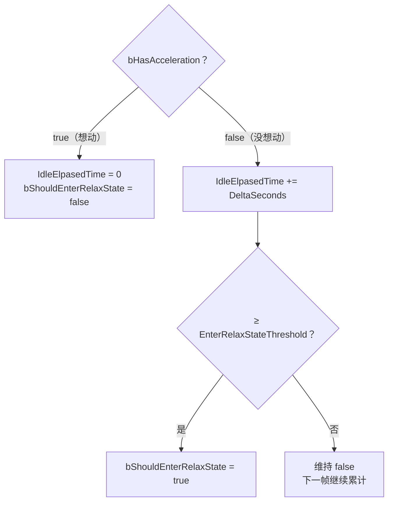
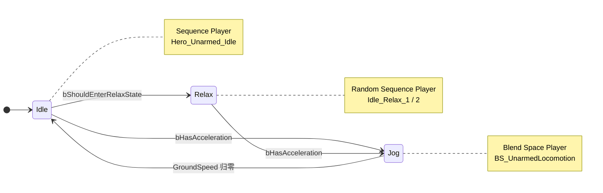

# Relax 待机状态与 Random Sequence Player

上一篇的状态机只有动/停两档，角色站定 5 秒后还在同一个待机循环里原地灌风——活人站久了会换个姿势。本篇给 UnarmedLocomotion 加第三个状态 **Relax**：C++ 侧在 `NativeUpdateAnimation` 里掐一个"多久没按方向键"的秒表，到点置位 `bShouldEnterRelaxState`；蓝图侧 Relax 状态里挂 **Random Sequence Player**，把两段 relax 待机交给它随机轮播。分工延续前两篇的格局：**计时与判定归 C++，姿态与随机归蓝图**。

## 一、C++：空闲秒表

```cpp
// AnimInstance/Hero/WarriorHeroAnimInstance.h 新增三个成员

// 是否进入放松状态（AnimGraph 过渡条件读它）
UPROPERTY(VisibleDefaultsOnly, BlueprintReadOnly, Category="AnimData|LocomtionData")
bool bShouldEnterRelaxState;

// 多少秒未移动后进入放松状态
UPROPERTY(EditDefaultsOnly, BlueprintReadOnly, Category="AnimData|LocomtionData")
float EnterRelaxStateThreshold = 5.f;

// 空闲累计时间
float IdleElpasedTime;
```

```cpp
void UWarriorHeroAnimInstance::NativeUpdateAnimation(float DeltaSeconds)
{
	Super::NativeUpdateAnimation(DeltaSeconds);

	if (bHasAcceleration)
	{
		IdleElpasedTime = 0.f;
		bShouldEnterRelaxState = false;
	}
	else
	{
		IdleElpasedTime += DeltaSeconds;
		bShouldEnterRelaxState = (IdleElpasedTime >= EnterRelaxStateThreshold);
	}
}
```

每帧的判定逻辑画成流程图就一目了然：



三个成员，三档刻意不同的暴露策略：

- **`bShouldEnterRelaxState`：`VisibleDefaultsOnly + BlueprintReadOnly`**——和 `GroundSpeed` 一档：运行时数据，C++ 是唯一写手，AnimGraph 只读。Class Defaults 面板能看它翻没翻 true，调试秒表不用打日志；
- **`EnterRelaxStateThreshold`：`EditDefaultsOnly`**——三个里唯一故意放宽的。阈值是设计参数不是运行时数据：5 秒合不合适要跑起来才知道，`EditDefaultsOnly` 让它能在 `ABP_Hero` 的 Class Defaults 里直接改，不用重编译 C++。注意它仍锁在"默认值"一级——实例不可改，值的来源依然单一；
- **`IdleElpasedTime`：不加 `UPROPERTY`**——纯内部累计器，蓝图看不见也不需要看见。暴露面每多一个变量就多一分被误用成"第二数据源"的可能，不用的口子不开。

判定为什么用 `bHasAcceleration` 清表而不是 `GroundSpeed`：松手瞬间加速度立即归零，秒表从那一刻就开始走；速度却要等滑行结束才归零。于是秒表可能在角色还在滑行时就走到点——没关系，`bShouldEnterRelaxState` 只在状态机的 Idle 状态里被测试，而进入 Idle 本身要等 `GroundSpeed` 归零。**判定与消费分离**：C++ 只负责"多久没想动"，姿态层面什么时候真的切，由状态机的档位流向说了算。

秒表逻辑写在 Hero 层而非 Character 层：敌人也有待机，但"站 5 秒换姿势"是英雄的行为设定，敌人 AI 将来的 idle 打断逻辑多半不同——数据落点跟角色分层同一个思路。

顺手记一笔：`NativeInitializeAnimation` 里缓存 `OwningHeroCharacter` 时，判空要判**转型源** `OwningCharacter`，不能顺手写成判目标 `OwningHeroCharacter`——后者首帧必是 null，条件永远不成立，Cast 一次都不执行，变量一路为空，等将来连招系统真解引用它时才案发，离现场十万八千里。这个变量本篇还没用上，是连招/战斗数据的预留位。

## 二、Relax 状态：Random Sequence Player

蓝图侧两步：

1. `ABP_Hero` 的 AnimGraph → UnarmedLocomotion 状态机 → 新增状态 **Relax**；
2. 双击进入，右键添加 **Random Sequence Player**，Details 面板的 Sequences 数组挂两个序列：`Hero_Unarmed_Idle_Relax_1`、`Hero_Unarmed_Idle_Relax_2`（与普通待机同在 `Assets/HeroCharacter/Animations/Axe/` 下）。

Random Sequence Player 与上两篇用的播放器是一家人，分工不同：

- **Sequence Player** 挂一个序列，循环播到死——Idle 状态一个动画，它够用；
- **Random Sequence Player** 挂一个序列池，播完当前项后**按权重（Weight）随机挑下一项**——两段 relax 小动作谁先谁后、谁多谁少（改 Weight），交给节点自己轮。

两个"为什么不用别的做法"：

- **为什么不给每段 relax 单开状态机状态**——两段还好，五段就是五个状态十来条连线，权重、避免连播这些随机策略全要手搓进过渡规则。RSP 一个节点全包，状态机只回答"进不进 Relax"一个问题，随机交给专职节点；
- **为什么不干脆把 Idle 状态的播放器换成 RSP、把普通待机和两段 relax 一起挂进去**——那样"站多久才换姿势"就失去了档位界限：随机池开局就可能播 relax，节奏不可控。独立状态 + C++ 阈值才把"前 5 秒规规矩矩站着、之后开始有小动作"变成设计出来的节奏。**随机要有边界，全随机等于没设计**。

## 三、过渡规则接线

搭完 Relax 后的整台状态机长这样，每个状态标注了各自挂的播放器：



新增两条，原有 Idle ↔ Jog 两条不动：

- **Idle → Relax：`bShouldEnterRelaxState == true`**——秒表到点切档；
- **Relax → Jog：`bHasAcceleration == true`**——放松中开跑，直接切 Jog，不绕道 Idle。绕道（Relax → Idle → Jog）虽然靠过渡链式触发也能跑起来，但要叠两次 crossfade：姿态先从放松混向站立、没站稳又混向慢跑，起跑瞬间绵软；直连一次混合到位，"想动去 Jog"也是全机统一的语义——任何静止档位，想动就走同一条件去同一个出口。反向的 Jog → Relax 则不必连：进 Relax 的前提是站满 5 秒，而站定必然先经过 Idle，待够 5 秒时人早就在 Idle 里了——这条线永远是死线。

于是完整循环成立：跑 → 松手滑行 → 站定（普通待机）→ 5 秒 → Relax 随机小动作 → 再动 → 直接回跑。

Relax → Idle 要不要留一条 `!bShouldEnterRelaxState` 兜底？当前逻辑下这个条件只在有加速度时为假，而那条路已被 Relax → Jog 覆盖——现在是条死线。但若将来秒表引入别的重置源（受击、交互打断把 `IdleElpasedTime` 清零），这条线立刻有用。现在不留：过渡线在图上是明摆着的，需求来时加一条线的事，过早兜底只会让图变吵。

混合时长：idle 与 relax 的姿态差异比 idle 与 jog 大（重心、手臂都不在一个位置），Idle → Relax 这条线的 crossfade 从默认 0.2s 放宽到 0.3s 上下，切换更绵。

## 四、细节与坑

1. **`NativeInitializeAnimation` 判空判错对象**——判了转型目标而不是源，Cast 永远不执行。症状是延迟爆炸：变量一直为空，解引用它的系统上线那天才案发。缓存的固定句式：**判来源，转目标**；
2. **`IdleElpasedTime` 忘了在有加速度时清零**——秒表从进游戏一路累计，5 秒后任何一次停步都瞬间进 Relax，"一停就换姿势"。累计器的重置路径和累计路径要成对写；
3. **阈值修饰符选错档**——写成 `VisibleDefaultsOnly` 则调一次参重编译一次 C++；写成 `EditAnywhere` 则每个实例都能改，值来源分裂。设计参数的正确档位是 `EditDefaultsOnly`：子类默认值可调、实例不可动；
4. **清表判据换用 `GroundSpeed`**——滑行段被计入秒表，阈值实际提前；被外力挤一下速度不为零也会重置秒表，站半天不放松。意图判加速度、结果判速度，这对配对在过渡规则里用过，这里又用了一次；
5. **RSP 的序列挂错骨架**——Relax 用的序列必须与 `SK_Hero` 同骨架，挂错时 ABP 编译期就报引用问题，不是运行时才炸。

## 小结

- C++ 侧一个秒表：有加速度清零并压下 `bShouldEnterRelaxState`，无加速度累计、过阈值置位；清表判 `bHasAcceleration`（意图）而非速度（结果），判定与消费分离——秒表走到点不等于立刻切姿态，状态机档位流向说了算；
- 三个成员三档暴露：状态量 `VisibleDefaultsOnly + BlueprintReadOnly`（只读）、阈值 `EditDefaultsOnly`（子类默认值可调）、累计器不暴露（不开不用的口子）；
- 蓝图侧一个节点：Relax 状态挂 Random Sequence Player，序列池 + Weight 权重随机轮播；随机策略交给专职节点，状态机只管档位切换；
- 结构取舍：不给每段 relax 单开状态（连线爆炸），也不把 relax 混进 Idle 的随机池（失去节奏边界）——随机要有边界，全随机等于没设计。

下一步：持械（Axe）后的第二套 locomotion 与 Link Anim Layer 分层。
